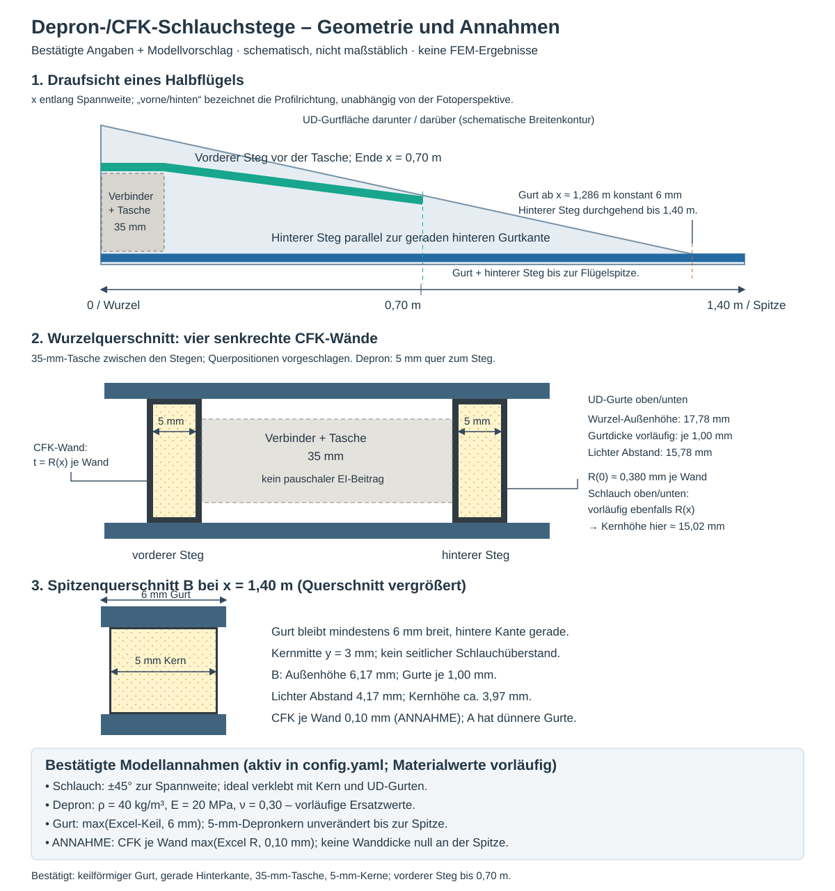

# Bestätigte Geometrie: durchgehender hinterer Steg

Der Nutzer hat die Variante mit **mindestens 6 mm Gurtbreite und unverändert 5 mm breitem Depronkern** gewählt. Ober- und Untergurt folgen der ursprünglichen linearen Excel-Keilkontur bis zur 6-mm-Grenze bei x≈1,28618 m; danach bleibt ihre Breite bis x=1,40 m konstant 6 mm. Die hintere Gurtkante bleibt gerade. Die Excel-Datei bleibt unverändert; die Mindestbreite wird im SI-Modell angewendet und der Knick als zusätzliche Station eingefügt. Dabei werden die ursprünglichen diskreten Lagenintervalle erhalten.

Der hintere Steg verläuft durchgehend bis zur Flügelspitze. Seine Kernmitte bleibt y=3 mm, parallel zur hinteren Gurtkante. Kernbreite 5 mm; CFK-Schlauch geschlossen mit jeweils zwei senkrechten Wänden und oberem/unterem Abschnitt. Der vordere Steg endet weiter bei x=0,70 m, die Verbindertasche ist 35 mm breit. Ihre Länge von 0,14 m bleibt eine Annahme. Der Verbinder erhält keinen unbelegten zusätzlichen Steifigkeitsbeitrag.

**Zusätzliche Wanddickenannahme:** Weil Excel R an der Spitze auf null fällt, gilt nun je Schlauchwand max(Excel R(x), 0,10 mm). Das ist eine vorläufige Mindestdicke für die durchgehende Geometrie, keine gemessene Schlauchdicke. Der jeweilige Knick der Dickenfunktion wird ebenfalls als Station eingefügt. Die Schlauchaußenflächen passen mit Kernmitte y=3 mm unter den 6-mm-Gurt; kein seitlicher Überstand wird verwendet.

Gurtdicke: Variante A verwendet die diskreten Excel-Lagenzahlen; B die durchgehenden Wurzellagen. Die Schlauchaußenhöhe entspricht jeweils dem tatsächlichen lichten Abstand der Gurte. Der Kern ist um die oberen/unteren Schlauchdicken niedriger. Idealer Verbund; keine Kleberadien, Schälspannungs- oder Delaminationsnachweise.

Materialannahmen bleiben: Depron E=20 MPa, ν=0,30, ρ=40 kg/m³; vorläufige CFK-Lamina gemäß config.yaml; Schlauch in zwei ausgeglichenen ±45°-Teilschichten. Der kleine lokale Winkel des vorderen Stegs wird in der Faserorientierung vernachlässigt.

Flugstatik, Auflagenversuch und Eigenformen verwenden wieder die vollständigen 1,40 m Halbspannweite. Es gibt keinen Schnitt bei 1,29 m und keine Schnitt-Ersatzlast. Eine Flügelschale ist weiterhin nicht modelliert. Die neue Gurt-/Steggeometrie ist eine geänderte Variante gegenüber den archivierten Rechnungen; die bisherigen Messwerte dürfen nur bei tatsächlich übereinstimmendem Bauzustand als Validierung dienen.

Aktive Werte: [config.yaml](../config.yaml). Maschinenlesbare Dokumentation: [stegannahmen.yaml](stegannahmen.yaml). Modell-, Netz-, Verformungs- und Spannungsbilder entstehen aus den neuen Solverläufen; ältere Bilder befinden sich im archivierten Ergebnisordner.

Aktueller Versuchsaufbau: Nur die Unterseitenknoten auf je einer Kontaktlinie bei x=±0,896 m werden vertikal festgehalten. Oberseite, innere Knoten und benachbarte Querschnitte bleiben vertikal frei. Die Biegeneigung ist frei; die Lagerung bleibt bilateral. Versuchskraft und Schwingungsmasse wirken über dem hinteren Steg, x=-25 bis +25 mm. Die Geometrieskizze stellt keine endliche Auflagefläche oder Kontaktpressung dar. Messpunktvergleich und Flug-FEM-Krümmung sind im [aktuellen Bericht](../results/report.md) beschrieben.
