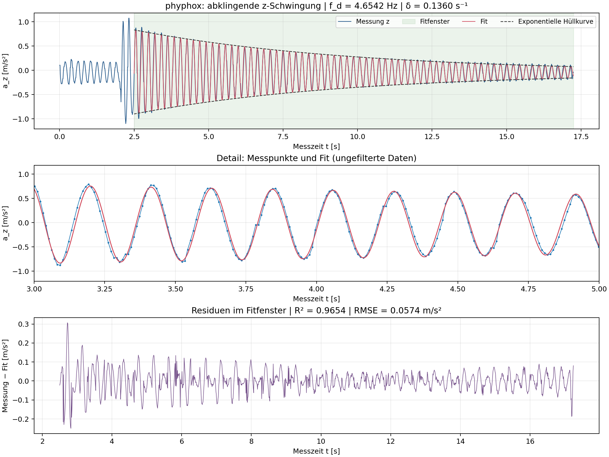

## Schwingungsmessung mit phyphox: z-Achse

### Kurzanleitung: Messung und CSV-Export

1. **Aufbau vorbereiten:** Holm wie im gewuenschten Versuch lagern und belasten. Smartphone fest und ohne Spiel am Messort befestigen; seine z-Achse (senkrecht zum Display) muss in Schwingungsrichtung zeigen. Messort, Lagerung, Belastung sowie Telefonmasse und Befestigung notieren, da diese die Eigenfrequenz beeinflussen.
2. **phyphox einstellen:** Das Experiment **"Beschleunigung ohne g" / "Acceleration (without g)"** oeffnen. Fuer diese Auswertung wird die z-Beschleunigung benoetigt. Vor jeder Wiederholung alte Messdaten loeschen bzw. eine neue Aufnahme beginnen.
3. **Ausschwingen aufnehmen:** Mit der Starttaste starten, etwa 2 s Ruhe aufzeichnen, den Holm leicht auslenken und loslassen oder kurz anregen. Anschliessend frei ausschwingen lassen, ohne Holm oder Telefon zu beruehren. Nach etwa 15-20 s Ausschwingzeit die Aufnahme stoppen. Zwei bis drei getrennte Messungen erleichtern die Kontrolle der Wiederholbarkeit.
4. **Als CSV exportieren:** Im Experimentmenue **"Daten exportieren" / "Export Data"** waehlen und **CSV mit Komma als Spaltentrenner und Dezimalpunkt** auswaehlen (englisch "CSV (Comma, decimal point)"). Ueber den Speichern-/Teilen-Dialog die Exportdatei auf dem Geraet sichern oder auf den Rechner Uebertragen; Menuebezeichnungen koennen je nach Betriebssystem abweichen.
5. **Datei verwenden:** phyphox buendelt die CSV-Dateien in einem ZIP-Archiv. ZIP entpacken und **`Raw Data.csv`** verwenden. Fuer die vorliegende Auswertung sind **`Time (s)`** und **`Linear Acceleration z (m/s^2)`** massgeblich; die Originaldatei mit allen Achsen unveraendert aufbewahren. Beim Tabellenimport Komma als Trennzeichen und Dezimalpunkt einstellen. Fuer den Abklingfit nur den freien Ausschwingabschnitt nach der Anregung auswaehlen.

Hinweise zum [Beschleunigungssensor ohne g](https://phyphox.org/docs/file-format/input/) und zum [CSV-/ZIP-Exportformat](https://phyphox.org/docs/file-format/): offizielle phyphox-Dokumentation. Die Schritte beschreiben eine neue Messung; der genaue Aufbau der vorhandenen Aufnahme ist im Export nicht dokumentiert.

### Auswertung der vorhandenen Messung

Quelle: [Acceleration (without g) 2026-10-18 10-31-02.zip](../Acceleration%20(without%20g)%202026-10-18%2010-31-02.zip); CSV `Raw Data.csv`, Spalte `Linear Acceleration z (m/s^2)`. Laut ZIP-Metadaten wurde am 18.10.2026 von 10:30:22 bis 10:30:39 Uhr (UTC+02:00) gemessen; der Dateiname bezeichnet den Exportzeitpunkt. 1720 Messpunkte von 0.00336 bis 17.24418 s, Abtastrate etwa 99.70 Hz. Ausgewertet wird die von phyphox exportierte lineare Beschleunigung ohne g; keine zusätzliche Filterung oder Resampling.

Die stärkere Anregung liegt bei etwa 2,1 s. Für den freien Ausschwingvorgang wird das Fenster **2.50 bis 17.24418 s** verwendet (1471 Punkte); die Anregung und der unmittelbar folgende Übergang bleiben außerhalb des Fits. Nichtlinearer Kleinste-Quadrate-Fit eines exponentiell gedämpften Sinus mit linearem Basislinienanteil; mehrere Frequenzstartwerte zwischen 3,2 und 6,8 Hz vermeiden eine ungünstige lokale Lösung.

Mit **τ = t − 2.50 s**, τ in Sekunden und a_z in m/s² lautet die Fitfunktion:

```text
a_z(t) = -0.0341507 -0.0005206·τ
         + 0.8664465·exp(−0.1360335·τ)·cos(2π·4.6542135·τ -1.6070989)
```

| Größe | Ergebnis |
|---|---:|
| Gemessene gedämpfte Eigenfrequenz f_d | 4.65421 Hz |
| Periodendauer 1/f_d | 0.21486 s |
| Abklingkonstante δ | 0.13603 s⁻¹ |
| Amplituden-Zeitkonstante 1/δ | 7.351 s |
| Dämpfungsgrad ζ | 0.00465 (0.465 %) |
| Ungedämpfte Eigenfrequenz f_0 (Einmodenmodell) | 4.65426 Hz |
| Bestimmtheitsmaß R² | 0.96537 |
| Residuen-RMSE | 0.05739 m/s² |

Dabei gelten f_0 = √(f_d² + (δ/2π)²) und ζ = δ/(2πf_0). Die Hüllkurven des Beschleunigungsfits sind c + bτ ± A·exp(−δτ). Die Amplitude A ist eine Beschleunigung, keine Auslenkung des Holms.



**Fitstabilität:** Zusätzliche Zeitfenster liefern folgende Werte:

| Messzeitfenster [s] | f_d [Hz] | δ [s⁻¹] |
|---|---:|---:|
| 3.0–17.24 | 4.65552 | 0.13109 |
| 2.5–8.00 | 4.64571 | 0.15783 |
| 8.0–17.24 | 4.66253 | 0.11385 |
| 3.0–12.00 | 4.65207 | 0.13897 |

Die Frequenz steigt im späteren Fenster leicht an; auch die Abklingrate hängt vom Fenster ab. Der konstante Einmodenfit ist daher eine Näherung. Als praktische Angabe ergibt sich **eine dominante Eigenfrequenz von rund 4.65 Hz**; die zusätzlichen Fenster sind eine Sensitivitätsprüfung und kein statistisches Konfidenzintervall. Die vielen Nachkommastellen dokumentieren die numerische Anpassung, nicht die Messgenauigkeit. Systematische Residuen können unter anderem durch weitere Schwingungsanteile, amplitudenabhängiges Verhalten oder die Sensorverarbeitung entstehen; die einzelne Messung trennt diese Ursachen nicht.

**Einordnung zum Rechenmodell:** Dies ist die dominante z-Schwingung des gemessenen Aufbaus. Messort, Telefonbefestigung und Zusatzmasse, Lagerung sowie Belastungszustand sind im Export nicht dokumentiert. Die Zuordnung zu einer bestimmten berechneten Eigenform und ein direkter Modellabgleich bleiben deshalb offen; die Modellfrequenzen wurden nicht an diese Messung angepasst.

Reproduzierbar mit `.venv/Scripts/python.exe tests/analyze_phyphox.py`. [Fitparameter und Fenstervergleich](phyphox_fit.json), [Plot als PDF](phyphox_decay.pdf). SHA-256 des ZIP: `b0e4acf910a838c9f02b0a06e8ad975b7bfc6731f6e47efd72173b4c478c852d`.
