# Holmberechnung – Import, Nachrechnung und Ausführungsnachweis

**Hinweis zu den Berechnungen:** Die Berechnungen dokumentieren das beschriebene Modell und seine Annahmen. Sie ersetzen keinen geprüften Festigkeits- oder Lufttüchtigkeitsnachweis.

## Aufgabenstellung und Modellumfang

Verglichen werden zwei UD-Lagenverteilungen der Holmgurte: Fall A entspricht der Auslegung nach Excel mit einer zur Flügelspitze hin gestuft abnehmenden Anzahl der UD-Lagen gemäß dem diskreten Excel-Lagenplan. In Fall B wird dagegen die jeweilige Anzahl der UD-Lagen an der Wurzel über die gesamte Halbspannweite bis zur Flügelspitze durchgehend beibehalten; für Ober- und Untergurt gilt jeweils dessen eigene Wurzellagenzahl. Berechnet wird der Holm, nicht die vollständige Flügelsteifigkeit.
x=0 an der Wurzel, x=L an der Halbflügelspitze. Gesamtspannweite 2.8 m; Halbspannweite 1.4 m.

## Tatsächlich ausgeführte Schritte

| Schritt | Status |
|---|---|
| Excel-Inventur, Formeltokens, Cache-/Konsistenzprüfung | ausgeführt, schreibgeschützt |
| Rekonstruktion einfacher Excel-Näherungen | ausgeführt; keine Neuberechnung der Arbeitsmappe |
| Varianten A/B: Statik, Masse, Eigenwertlösung | ausgeführt |
| Räumliche FreeCAD/CalculiX-FEM | ausgeführt |

Originaldatei: `C:\Users\USER\Documents\ChatGPT\Holmberechnung1\Holmberechnung_deutsch_korrigiert3_Biest.xls`  
SHA-256: `310f7fe670c74eb42d6dfe5a9c250a67c4957ffa026299d3ba60b1b76c17d7b0`

Vollständige Daten: [Inventur](excel_inventory.json), [SI-Modell](normalized_input.json), [Konfiguration](used_config.yaml), [Diagnose](diagnostics.json), [Ergebnisse](summary.json).

## Fehlende Daten und Annahmen

- Nutzergeometrie: Gurtbreiten max(Excel-Keil, 6 mm); Excel-Datei unverändert. Eingefügte Knickstationen übernehmen die Lagen des ursprünglichen Intervalls.
- ANNAHME: CFK-Schlauchwand max(Excel R, 0.1 mm), damit der durchgehende Steg an der Spitze nicht auf null Wanddicke ausläuft.
- Einordnung der Excel-Flugnäherung: Für eine Gleichlast (gleichmäßig über die Halbspannweite verteilter Auftrieb) gilt bei gleichbleibender Biegesteifigkeit eigentlich M₀L²/(4EI) für die Durchbiegung der Flügelspitze. Die verwendete Excel-Formel M₀L²/(2EI) ergibt eine doppelt so große Durchbiegung. Dies ist als Näherung für Fall A zu begründen: Die Auslegung reduziert von der Wurzel bis zur Flügelspitze die Anzahl der UD-Lagen und macht den Holm dadurch zunehmend biegeweicher. So bleibt die Krümmung trotz abnehmendem Biegemoment über einen weiten Bereich annähernd konstant, wie der Krümmungsgraph für Fall A zeigt.
- Fertigungsstand: Fall B wurde gebaut, mit der jeweiligen UD-Wurzellagenzahl von Ober- und Untergurt durchgehend bis zur Flügelspitze. Fall A beschreibt die Excel-Auslegung mit gestufter UD-Lagenzahl.
- Lastansatz: Der unveränderte Excel-Auftrieb wird gemäß Nutzerangabe als Grenzlast angesetzt, da maximale Geschwindigkeit und höchster möglicher Auftrieb verwendet wurden. Ein zusätzlicher Sicherheitsfaktor zur Ermittlung einer Bruchlast wurde nicht angewendet, da dieser Lastfall nach Einschätzung des Nutzers bereits praktisch nicht als statischer Lastzustand auftreten kann.
- Bestätigtes Schlauchmodell: zwei Depronkerne, ±45°-CFK-Wände; Materialwerte bleiben Annahmen. Hinteres Stegende gemäß YAML; Flügelschale nicht enthalten.
- VORLÄUFIG: Materialkennwerte enthalten ausdrücklich bestätigte Beispielannahmen.
- Fluglast tiefenproportional aus separater Excel-Flächengeometrie; örtlich konstanter Auftriebsbeiwert als Annahme, keine berechnete 3D-Auftriebsverteilung.

## Aktive Fluglast: tiefenproportional

q(x)=F_halb · c(x) / ∫₀ᴸc(s)ds. c(x) ist die Flächentiefe aus der Excel-Flächengeometrie, nicht die Gurtbreite. Angenommen wird ein örtlich konstanter Auftriebsbeiwert. Der Gesamtauftrieb entspricht dem Excel-Wert. Für die räumliche Lastverteilung wird die örtliche Flächentiefe verwendet.

In der 3D-FEM wird diese Streckenlast durch einen äquivalenten vertikalen Gurtflächendruck proportional zu c(x)/b_Gurt(x) auf konsistente Knotenkräfte abgebildet. Die Gurtbreite dient nur der Lastübertragung auf das vorhandene Holmnetz. Das ist keine aerodynamische Druckverteilung auf einer mitmodellierten Flügelschale. Kraftsumme und erstes Lastmoment werden gegen die tiefenproportionale Sollverteilung geprüft.

Lastschwerpunkt und Soll-Wurzelmoment unten beziehen sich auf die unverformte Referenzgeometrie. Im nichtlinearen Vergleich bleiben die daraus erzeugten vertikalen Knotenkräfte konstant; die Flächentiefe oder der Auftrieb werden während der Verformung nicht aerodynamisch neu berechnet. Veränderte Hebelarme sind deshalb von der initialen Lastmomentprüfung zu unterscheiden.

Halbflügelfläche 0.2605 m²; Kraft je Halbflügel 1085.42 N; Lastschwerpunkt x=0.618042 m; Wurzelmoment 670.833 N·m. q(0)=958.333 N/m; q(L)=395.833 N/m.

| x [m] | Flächentiefe [mm] | q(x) [N/m] | Excel-Quelle |
|---|---:|---:|---|
| 0 | 230 | 958.333 | Berechnung der Werte!C22 |
| 0.4 | 220 | 916.667 | Berechnung der Werte!C23 |
| 0.8 | 190 | 791.667 | Berechnung der Werte!C24 |
| 1 | 170 | 708.333 | Berechnung der Werte!C25 |
| 1.2 | 130 | 541.667 | Berechnung der Werte!C26 |
| 1.4 | 95 | 395.833 | Berechnung der Werte!C27 |

Dies ist eine geometrisch gewichtete Lastannahme, keine Lösung der realen 3D-Auftriebsverteilung. Der zentrale Labor-Biegeversuch und die unbelastete Modalanalyse werden durch diese Änderung nicht verändert.

Fehlende Eingaben werden nicht automatisch ersetzt. Explizite Annahmen aus der verwendeten YAML sind als vorläufig markiert; Beispiele in `examples/material.example.yaml` werden niemals automatisch eingelesen.
Die E1-Angabe stammt aus der ausgewählten Excel-Materialzeile. Ob sie den tatsächlich ausgehärteten Verbund beschreibt, muss bestätigt werden. Festigkeits-/Beulnachweise und Flugsicherheitsfreigabe sind nicht Gegenstand dieser Rechnung.

## Excel-Inventur und Mapping

| Blatt | belegte Zeilen | Spalten |
|---|---:|---:|
| Berechnung der Werte | 173 | 34 |
| Materialdaten | 84 | 16 |
| Flächensteckung | 69 | 18 |
| Roving-Gelege Umrechnung | 30 | 5 |

Alle belegten Werte, Kommentare, Formelergebnisse und verfügbare Formeltokens stehen in der Inventur. BIFF-Formeltexte sind diagnostisch: xlrd kann Klammern uneindeutig darstellen; Tokens bleiben als verlustfreie Referenz erhalten. Fehlende, Excel-fehlerhafte und durch unabhängige Beziehungen auffällige Caches werden gemeldet. Keine vollständige Excel-Formelauswertung; keine LibreOffice-Neuberechnung ausgeführt.

| Parameter | SI-Wert | Originalwert/-einheit | interne Einheit | Blatt/Zelle | Herkunft / Überschreibung |
|---|---:|---|---|---|---|
| span | 2.8 | 2800 mm | m | Berechnung der Werte!D45 | Excel-Cache |
| total_lift | 2170.83 | 2170.83 N | N | Berechnung der Werte!D37 | Excel-Cache |
| weight | 30 | 30 N | N | Berechnung der Werte!D39 | Excel-Eingabe |
| load_factor | 72.3611 | 72.3611 1 | 1 | Berechnung der Werte!D41 | Excel-Cache |
| E1 | 1.35e+11 | 135000 MPa | Pa | Berechnung der Werte!U68 | Excel-Cache |
| support_fraction | 0.64 | 64 % | 1 | Berechnung der Werte!C145 | Excel-Eingabe |
| test_mass | 3.8 | 3.8 kg | kg | Berechnung der Werte!C144 | Excel-Eingabe |
| modal_mass | 5.58 | 5.58 kg | kg | Berechnung der Werte!C170 | Excel-Eingabe |
| excel_I_old | 4.4903e-07 | 449030 mm4 | m⁴ | Berechnung der Werte!W68 | Excel-Cache |
| excel_I_new | 8.69642e-09 | 8696.42 mm4 | m⁴ | Berechnung der Werte!W78 | Excel-Cache |
| excel_flight_old | 0.0122832 | 12.2832 mm | m | Berechnung der Werte!C126 | Excel-Cache |
| excel_flight_new | 0.634229 | 634.229 mm | m | Berechnung der Werte!G126 | Excel-Cache |
| measured_root | 0.00702 | 7.02 mm | m | Berechnung der Werte!D146 | Excel-Cache |
| measured_tip | 0.005985 | 5.985 mm | m | Berechnung der Werte!D147 | Excel-Cache |
| measured_frequency | 4.5 | 4.5 Hz | Hz | Berechnung der Werte!C173 | Excel-Eingabe |
| measured_stiffness | 5310.26 | 5.31026 N/mm | N/m | Berechnung der Werte!D149 | Excel-Cache |
| excel_test_root | 0.00380672 | 3.80672 mm | m | Berechnung der Werte!C146 | Excel-Cache |
| excel_frequency | 6.66736 | 6.66736 Hz | Hz | Berechnung der Werte!C171 | Excel-Cache |
| stations[111].x | 0 | 0 mm | m | Berechnung der Werte!C111 | Excel-Auslegung/Cache |
| stations[111].width_top | 0.0625 | 62.5 mm | m | Berechnung der Werte!D111 | Excel-Auslegung/Cache |
| stations[111].width_bottom | 0.0625 | 62.5 mm | m | Berechnung der Werte!D111 | Excel-Auslegung/Cache |
| stations[111].height | 0.01778 | 17.78 mm | m | Berechnung der Werte!H111 | Excel-Auslegung/Cache |
| stations[111].clear_height | 0.0158736 | 15.8736 mm | m | Berechnung der Werte!J111 | Excel-Auslegung/Cache |
| stations[111].theoretical_thickness | 0.000953212 | 0.953212 mm | m | Berechnung der Werte!K111 | Excel-Auslegung/Cache |
| stations[111].plies_top | 10 | 10 1 | 1 | Berechnung der Werte!M111 | Excel-Auslegung/Cache |
| stations[111].plies_bottom | 10 | 10 1 | 1 | Berechnung der Werte!M111 | Excel-Auslegung/Cache |
| stations[111].web_required | 0.000379882 | 0.379882 mm | m | Berechnung der Werte!R111 | Excel-Auslegung/Cache |
| stations[112].x | 0.2 | 200 mm | m | Berechnung der Werte!C112 | Excel-Auslegung/Cache |
| stations[112].width_top | 0.0537143 | 53.7143 mm | m | Berechnung der Werte!D112 | Excel-Auslegung/Cache |
| stations[112].width_bottom | 0.0537143 | 53.7143 mm | m | Berechnung der Werte!D112 | Excel-Auslegung/Cache |
| stations[112].height | 0.01735 | 17.35 mm | m | Berechnung der Werte!H112 | Excel-Auslegung/Cache |
| stations[112].clear_height | 0.0157007 | 15.7007 mm | m | Berechnung der Werte!J112 | Excel-Auslegung/Cache |
| stations[112].theoretical_thickness | 0.000824627 | 0.824627 mm | m | Berechnung der Werte!K112 | Excel-Auslegung/Cache |
| stations[112].plies_top | 9 | 9 1 | 1 | Berechnung der Werte!M112 | Excel-Auslegung/Cache |
| stations[112].plies_bottom | 9 | 9 1 | 1 | Berechnung der Werte!M112 | Excel-Auslegung/Cache |
| stations[112].web_required | 0.000329198 | 0.329198 mm | m | Berechnung der Werte!R112 | Excel-Auslegung/Cache |
| stations[113].x | 0.4 | 400 mm | m | Berechnung der Werte!C113 | Excel-Auslegung/Cache |
| stations[113].width_top | 0.0449286 | 44.9286 mm | m | Berechnung der Werte!D113 | Excel-Auslegung/Cache |
| stations[113].width_bottom | 0.0449286 | 44.9286 mm | m | Berechnung der Werte!D113 | Excel-Auslegung/Cache |
| stations[113].height | 0.01692 | 16.92 mm | m | Berechnung der Werte!H113 | Excel-Auslegung/Cache |
| stations[113].clear_height | 0.0155349 | 15.5349 mm | m | Berechnung der Werte!J113 | Excel-Auslegung/Cache |
| stations[113].theoretical_thickness | 0.000692569 | 0.692569 mm | m | Berechnung der Werte!K113 | Excel-Auslegung/Cache |
| stations[113].plies_top | 7 | 7 1 | 1 | Berechnung der Werte!M113 | Excel-Auslegung/Cache |
| stations[113].plies_bottom | 7 | 7 1 | 1 | Berechnung der Werte!M113 | Excel-Auslegung/Cache |
| stations[113].web_required | 0.000277261 | 0.277261 mm | m | Berechnung der Werte!R113 | Excel-Auslegung/Cache |
| stations[114].x | 0.6 | 600 mm | m | Berechnung der Werte!C114 | Excel-Auslegung/Cache |
| stations[114].width_top | 0.0361429 | 36.1429 mm | m | Berechnung der Werte!D114 | Excel-Auslegung/Cache |
| stations[114].width_bottom | 0.0361429 | 36.1429 mm | m | Berechnung der Werte!D114 | Excel-Auslegung/Cache |
| stations[114].height | 0.01563 | 15.63 mm | m | Berechnung der Werte!H114 | Excel-Auslegung/Cache |
| stations[114].clear_height | 0.0144444 | 14.4444 mm | m | Berechnung der Werte!J114 | Excel-Auslegung/Cache |
| stations[114].theoretical_thickness | 0.000592797 | 0.592797 mm | m | Berechnung der Werte!K114 | Excel-Auslegung/Cache |
| stations[114].plies_top | 6 | 6 1 | 1 | Berechnung der Werte!M114 | Excel-Auslegung/Cache |
| stations[114].plies_bottom | 6 | 6 1 | 1 | Berechnung der Werte!M114 | Excel-Auslegung/Cache |
| stations[114].web_required | 0.000238554 | 0.238554 mm | m | Berechnung der Werte!R114 | Excel-Auslegung/Cache |
| stations[115].x | 0.8 | 800 mm | m | Berechnung der Werte!C115 | Excel-Auslegung/Cache |
| stations[115].width_top | 0.0273571 | 27.3571 mm | m | Berechnung der Werte!D115 | Excel-Auslegung/Cache |
| stations[115].width_bottom | 0.0273571 | 27.3571 mm | m | Berechnung der Werte!D115 | Excel-Auslegung/Cache |
| stations[115].height | 0.01434 | 14.34 mm | m | Berechnung der Werte!H115 | Excel-Auslegung/Cache |
| stations[115].clear_height | 0.013389 | 13.389 mm | m | Berechnung der Werte!J115 | Excel-Auslegung/Cache |
| stations[115].theoretical_thickness | 0.0004755 | 0.4755 mm | m | Berechnung der Werte!K115 | Excel-Auslegung/Cache |
| stations[115].plies_top | 5 | 5 1 | 1 | Berechnung der Werte!M115 | Excel-Auslegung/Cache |
| stations[115].plies_bottom | 5 | 5 1 | 1 | Berechnung der Werte!M115 | Excel-Auslegung/Cache |
| stations[115].web_required | 0.000193019 | 0.193019 mm | m | Berechnung der Werte!R115 | Excel-Auslegung/Cache |
| stations[116].x | 0.9 | 900 mm | m | Berechnung der Werte!C116 | Excel-Auslegung/Cache |
| stations[116].width_top | 0.0229643 | 22.9643 mm | m | Berechnung der Werte!D116 | Excel-Auslegung/Cache |
| stations[116].width_bottom | 0.0229643 | 22.9643 mm | m | Berechnung der Werte!D116 | Excel-Auslegung/Cache |
| stations[116].height | 0.01348 | 13.48 mm | m | Berechnung der Werte!H116 | Excel-Auslegung/Cache |
| stations[116].clear_height | 0.0126469 | 12.6469 mm | m | Berechnung der Werte!J116 | Excel-Auslegung/Cache |
| stations[116].theoretical_thickness | 0.000416545 | 0.416545 mm | m | Berechnung der Werte!K116 | Excel-Auslegung/Cache |
| stations[116].plies_top | 5 | 5 1 | 1 | Berechnung der Werte!M116 | Excel-Auslegung/Cache |
| stations[116].plies_bottom | 5 | 5 1 | 1 | Berechnung der Werte!M116 | Excel-Auslegung/Cache |
| stations[116].web_required | 0.000170287 | 0.170287 mm | m | Berechnung der Werte!R116 | Excel-Auslegung/Cache |
| stations[117].x | 1 | 1000 mm | m | Berechnung der Werte!C117 | Excel-Auslegung/Cache |
| stations[117].width_top | 0.0185714 | 18.5714 mm | m | Berechnung der Werte!D117 | Excel-Auslegung/Cache |
| stations[117].width_bottom | 0.0185714 | 18.5714 mm | m | Berechnung der Werte!D117 | Excel-Auslegung/Cache |
| stations[117].height | 0.01262 | 12.62 mm | m | Berechnung der Werte!H117 | Excel-Auslegung/Cache |
| stations[117].clear_height | 0.0119203 | 11.9203 mm | m | Berechnung der Werte!J117 | Excel-Auslegung/Cache |
| stations[117].theoretical_thickness | 0.000349836 | 0.349836 mm | m | Berechnung der Werte!K117 | Excel-Auslegung/Cache |
| stations[117].plies_top | 4 | 4 1 | 1 | Berechnung der Werte!M117 | Excel-Auslegung/Cache |
| stations[117].plies_bottom | 4 | 4 1 | 1 | Berechnung der Werte!M117 | Excel-Auslegung/Cache |
| stations[117].web_required | 0.000144533 | 0.144533 mm | m | Berechnung der Werte!R117 | Excel-Auslegung/Cache |
| stations[118].x | 1.1 | 1100 mm | m | Berechnung der Werte!C118 | Excel-Auslegung/Cache |
| stations[118].width_top | 0.0141786 | 14.1786 mm | m | Berechnung der Werte!D118 | Excel-Auslegung/Cache |
| stations[118].width_bottom | 0.0141786 | 14.1786 mm | m | Berechnung der Werte!D118 | Excel-Auslegung/Cache |
| stations[118].height | 0.0109 | 10.9 mm | m | Berechnung der Werte!H118 | Excel-Auslegung/Cache |
| stations[118].clear_height | 0.0103036 | 10.3036 mm | m | Berechnung der Werte!J118 | Excel-Auslegung/Cache |
| stations[118].theoretical_thickness | 0.000298203 | 0.298203 mm | m | Berechnung der Werte!K118 | Excel-Auslegung/Cache |
| stations[118].plies_top | 3 | 3 1 | 1 | Berechnung der Werte!M118 | Excel-Auslegung/Cache |
| stations[118].plies_bottom | 3 | 3 1 | 1 | Berechnung der Werte!M118 | Excel-Auslegung/Cache |
| stations[118].web_required | 0.000125409 | 0.125409 mm | m | Berechnung der Werte!R118 | Excel-Auslegung/Cache |
| stations[119].x | 1.2 | 1200 mm | m | Berechnung der Werte!C119 | Excel-Auslegung/Cache |
| stations[119].width_top | 0.00978571 | 9.78571 mm | m | Berechnung der Werte!D119 | Excel-Auslegung/Cache |
| stations[119].width_bottom | 0.00978571 | 9.78571 mm | m | Berechnung der Werte!D119 | Excel-Auslegung/Cache |
| stations[119].height | 0.00918 | 9.18 mm | m | Berechnung der Werte!H119 | Excel-Auslegung/Cache |
| stations[119].clear_height | 0.00872644 | 8.72644 mm | m | Berechnung der Werte!J119 | Excel-Auslegung/Cache |
| stations[119].theoretical_thickness | 0.000226781 | 0.226781 mm | m | Berechnung der Werte!K119 | Excel-Auslegung/Cache |
| stations[119].plies_top | 3 | 3 1 | 1 | Berechnung der Werte!M119 | Excel-Auslegung/Cache |
| stations[119].plies_bottom | 3 | 3 1 | 1 | Berechnung der Werte!M119 | Excel-Auslegung/Cache |
| stations[119].web_required | 9.87163e-05 | 0.0987163 mm | m | Berechnung der Werte!R119 | Excel-Auslegung/Cache |
| stations[120].x | 1.3 | 1300 mm | m | Berechnung der Werte!C120 | Excel-Auslegung/Cache |
| stations[120].width_top | 0.00539286 | 5.39286 mm | m | Berechnung der Werte!D120 | Excel-Auslegung/Cache |
| stations[120].width_bottom | 0.00539286 | 5.39286 mm | m | Berechnung der Werte!D120 | Excel-Auslegung/Cache |
| stations[120].height | 0.007675 | 7.675 mm | m | Berechnung der Werte!H120 | Excel-Auslegung/Cache |
| stations[120].clear_height | 0.00743333 | 7.43333 mm | m | Berechnung der Werte!J120 | Excel-Auslegung/Cache |
| stations[120].theoretical_thickness | 0.000120836 | 0.120836 mm | m | Berechnung der Werte!K120 | Excel-Auslegung/Cache |
| stations[120].plies_top | 2 | 2 1 | 1 | Berechnung der Werte!M120 | Excel-Auslegung/Cache |
| stations[120].plies_bottom | 2 | 2 1 | 1 | Berechnung der Werte!M120 | Excel-Auslegung/Cache |
| stations[120].web_required | 5.79446e-05 | 0.0579446 mm | m | Berechnung der Werte!R120 | Excel-Auslegung/Cache |
| stations[121].x | 1.4 | 1400 mm | m | Berechnung der Werte!C121 | Excel-Auslegung/Cache |
| stations[121].width_top | 0.001 | 1 mm | m | Berechnung der Werte!D121 | Excel-Auslegung/Cache |
| stations[121].width_bottom | 0.001 | 1 mm | m | Berechnung der Werte!D121 | Excel-Auslegung/Cache |
| stations[121].height | 0.00617 | 6.17 mm | m | Berechnung der Werte!H121 | Excel-Auslegung/Cache |
| stations[121].clear_height | 0.00617 | 6.17 mm | m | Berechnung der Werte!J121 | Excel-Auslegung/Cache |
| stations[121].theoretical_thickness | 0 | 0 mm | m | Berechnung der Werte!K121 | Excel-Auslegung/Cache |
| stations[121].plies_top | 0 | 0 1 | 1 | Berechnung der Werte!M121 | Excel-Auslegung/Cache |
| stations[121].plies_bottom | 0 | 0 1 | 1 | Berechnung der Werte!M121 | Excel-Auslegung/Cache |
| stations[121].web_required | 0 | 0 mm | m | Berechnung der Werte!R121 | Excel-Auslegung/Cache |

## Rekonstruierte Excel-Näherungen

Die Vorlage bestimmt Auftrieb aus ca, Geschwindigkeit und Fläche; G ist in N angegeben, keine Masse in kg. n=A/G wird geprüft. Die in Excel verwendete konstante Streckenlast integriert zu A/2. Gemäß Nutzerangabe entspricht dieser Auftrieb der Grenzlast, da maximale Geschwindigkeit und höchster möglicher Auftrieb angesetzt wurden. Eine zusätzliche Erhöhung zur Bruchlast wurde nicht vorgenommen, da dieser Lastfall nach Einschätzung des Nutzers bereits praktisch nicht als statischer Lastzustand auftreten kann.
Die Höhen H (Profil), h (unter Beplankung), h1 (lichte Steghöhe) und t (theoretische Gurtdicke) sind zu unterscheiden. Das Standardmapping verwendet h als Holm-Außenhöhe. Fertigungslagen verschieben Gurtschwerpunkte gegenüber der theoretischen Excel-Geometrie.

Für konstantes EI an der Wurzel gelten:
- Gleichlast-Kragträger: δ=qL⁴/(8EI), M₀=qL²/2. Die ausgeschriebene Excel-Näherung M₀L²/(2EI) überschätzt ausschließlich diesen Referenzfall mit konstantem EI um Faktor 2. Für den abgestuften Holm A kann sie dagegen eine Näherung für annähernd konstante Krümmung κ(x)≈M₀/EI₀ darstellen; siehe die Einordnung unter „Fehlende Daten und Annahmen“.
- Gelenkiger Laborversuch, zentrale Kraft: δ₀=F(2pL)³/(48EI). Die Formel beschreibt die Absenkung δ₀ der Flügelmitte gegenüber zwei Auflagern unter einer mittig aufgebrachten Kraft F (in Newton). L ist die Halbspannweite (1,4 m); p ist die Auflagerposition als Anteil der Halbspannweite (hier 0,64 beziehungsweise 64 %). Jedes Auflager liegt damit 0,896 m von der Mitte entfernt; 2pL ist der Abstand zwischen den beiden Auflagern (1,792 m). EI ist die Biegesteifigkeit des Holms. Die Formel setzt kleine Verformungen und eine über die Länge gleichbleibende Biegesteifigkeit voraus; hier wird dafür der Wert an der Wurzel verwendet. Sie dient als einfache Vergleichsrechnung, während die genauere Balkenrechnung die entlang des Holms veränderliche Steifigkeit berücksichtigt. Die Flügelabschnitte außerhalb der Auflager sind freie Überhänge: Ohne Eigengewicht biegen sie sich in diesem Modell nicht zusätzlich, bewegen sich aber durch die Neigung des Holms an den Auflagern mit.
- Zentraler Feder-Masse-Ersatz: k=6EI/(pL)³ und f=√(k/m)/(2π). Strukturmasse fehlt in dieser einfachen Excel-Näherung.

| Größe | neu rekonstruierter Wert | Bedeutung |
|---|---:|---|
| uniform_q_N_m | 775.298 | konstante Halbflügel-Streckenlast N/m |
| root_moment_Nm | 759.792 | Wurzelmoment Nm |
| flight_uniform_root_EI_m | 0.317115 | korrekte Gleichlastformel, m; konstantes korrigiertes Excel-Wurzel-EI |
| excel_written_flight_root_EI_m | 0.634229 | ausgeschriebene Excel-Näherung, m |
| test_root_constant_EI_m | 0.00380672 | Wurzelabsenkung, m; konstantes korrigiertes Excel-Wurzel-EI |
| test_tip_constant_EI_m | 0.00321192 | Spitzenhebung relativ Auflagen, m |
| spring_frequency_excel_mass_Hz | 6.66736 | Feder-Masse-Näherung mit C170, Hz |

**Die vorstehenden Flugwerte rekonstruieren ausschließlich die Excel-Vergleichsrechnung mit Gleichlast. Sie sind nicht die aktive tiefenproportionale Last oder deren Wurzelmoment.**


Diese Werte verwenden das theoretische Excel-Wurzel-EI und ersetzen keine Rechnung der Fertigungsvarianten. C144 ist die statische Laständerungsmasse; C170 wird separat als gesamte mitbewegte Zentralmasse interpretiert. Ihre physische Bedeutung muss am Aufbau bestätigt werden.

| gespeicherte Excel-/Messgröße | Wert in SI |
|---|---:|
| excel_I_old | 4.4903e-07 |
| excel_I_new | 8.69642e-09 |
| excel_flight_old | 0.0122832 |
| excel_flight_new | 0.634229 |
| measured_root | 0.00702 |
| measured_tip | 0.005985 |
| measured_frequency | 4.5 |
| measured_stiffness | 5310.26 |
| excel_test_root | 0.00380672 |
| excel_frequency | 6.66736 |

## Berechnungsverfahren und Randbedingungen

Fall A verwendet abschnittsweise konstante ganze Lagenzahlen [xᵢ,xᵢ₊₁); der Spitzenwert 0 beschreibt das Ende, kein endliches gurtloses Intervall. Breiten und Höhen werden linear interpoliert. Fall B übernimmt nur die oberen/unteren Wurzellagen; restliche Geometrie bleibt gleich.
1D-Balkenmodell: Für jeden Querschnitt wird berechnet, wo die neutrale Achse liegt, an der durch reine Biegung weder Zug noch Druck entsteht. Daraus wird die Biegesteifigkeit EI des gesamten Querschnitts bestimmt. Dabei zählen die Steifigkeit der einzelnen Materialien, ihre Querschnittsflächen und ihr Abstand zur neutralen Achse. Bei CFK werden die unterschiedlichen Materialeigenschaften längs und quer zur Faserrichtung berücksichtigt und auf physikalische Konsistenz geprüft. Das Balkenmodell beschreibt die vertikale Biegung; eine damit verbundene Verdrehung wird darin nicht erfasst. Die räumliche FEM hat diese Einschränkung nicht. Ein Verbinder wird erst als mittragend berücksichtigt, wenn geklärt ist, wie er Kräfte und Biegemomente überträgt.
Flug: M(x)=∫ₓᴸq(s)(s−x)ds, κ=M/EI, θ=∫κdx und w=∫θdx. Krümmung wird innerhalb jedes diskreten Lagenintervalls einseitig mit Gaußquadratur integriert; kein Glätten der Steifigkeitssprünge. Zusätzlich eine an allen Geometrie- und Lagensprüngen segmentierte numerische Balkenlösung mit Gaußintegration. Positive Fluglast bedeutet positive Durchbiegung.
Laborversuch: vollständiger Flügel, freie Überhänge und zentrale Last; die Wurzel bleibt beweglich. Der 1D-Balken verwendet zwei vertikale Punktauflager bei jeweils 64 % der Halbspannweite links und rechts von der Flügelmitte (bei 1,4 m Halbspannweite also bei −0,896 m und +0,896 m). Die räumliche Lagerung wird separat durch test.fem_support_model festgelegt und im FEM-Abschnitt beschrieben. An jedem Auflager werden die Knoten auf einer quer über die Holm-Unterseite verlaufenden Linie in vertikaler Richtung festgehalten (Modellbezeichnung: bottom_contact_line). Damit wird verhindert, dass der Holm in der Simulation in Nickrichtung verkippt, also um die in Spannweitenrichtung verlaufende Holm-Längsachse kippt. Im praktischen Laborversuch wird diese Stabilisierung durch die Auflage über die Flügeltiefe und die geeignete Platzierung des Zusatzgewichts erreicht. Die konfigurierte 20-mm-Breite legt lediglich die Unterteilung des Rechennetzes um das Auflager fest; sie ist keine 20 mm breite, festgehaltene Auflagefläche.
Dynamik: Euler-Bernoulli-Hermite-Elemente, konsistente verteilte Masse und separate Zentralmasse am beweglichen Wurzelknoten; optional Rotationsträgheit. Vollmodell erfasst symmetrische und antisymmetrische Biegemoden. Zentralmasse ist fest mitbewegend; lose aufgelegte Massen können Kontakt verlieren. Statische Laborversuchsmasse und dynamische Gesamtmasse werden nicht addiert.
Abschätzung der Schwingungsfrequenz nach Rayleigh: Als vereinfachte Schwingungsform wird die Biegelinie verwendet, die eine mittige Kraft im Laborversuch erzeugt. Aus der Steifigkeit des Holms und der mitbewegten Masse wird dann die Frequenz abgeschätzt. Dabei wird berücksichtigt, dass sich die einzelnen Bereiche des Holms unterschiedlich stark bewegen und deshalb unterschiedlich zur Schwingung beitragen. Die ebenfalls angegebene Feder-Masse-Abschätzung verwendet dieselben Annahmen und liefert daher denselben Wert; sie ist keine unabhängige Kontrolle. Die genauere Eigenfrequenzberechnung bestimmt die Schwingungsformen und Frequenzen direkt aus dem Rechenmodell.
Zusätzliche Verformung durch Schub: Neben der Biegung kann sich der Holm auch dadurch verformen, dass sich seine Querschnitte gegeneinander verschieben. Dieser zusätzliche Anteil kann für den Fluglastfall optional abgeschätzt und getrennt ausgegeben werden. In der 1D-Balkenrechnung für den Laborversuch und die Eigenfrequenzen wird dieser Anteil nicht berücksichtigt. Eine Überprüfung eines um Schubverformung erweiterten Balkenmodells ist damit nicht erfolgt.

## Variantenvergleich

| Größe | A | B | (B−A)/A |
|---|---:|---:|---:|
| half_spar_mass_kg | 0.140465 | 0.173854 | 23.8 % |
| flight_tip_m | 0.499856 | 0.391276 | -21.7 % |
| flight_integral_tip_m | 0.499856 | 0.391275 | -21.7 % |
| test_root_m | -0.0056406 | -0.00494968 | -12.2 % |
| test_right_tip_m | 0.00593223 | 0.00478371 | -19.4 % |
| rayleigh_Hz | 5.38947 | 5.74661 | 6.63 % |

| Eigenform | A [Hz] / Symmetrie | B [Hz] / Symmetrie |
|---|---|---|
| 1 | 5.3894 / symmetrisch | 5.7465 / symmetrisch |
| 2 | 102.45 / antisymmetrisch | 97.917 / antisymmetrisch |
| 3 | 134.63 / symmetrisch | 120.35 / symmetrisch |
| 4 | 170.22 / antisymmetrisch | 169.93 / antisymmetrisch |
| 5 | 234.44 / symmetrisch | 237.64 / symmetrisch |
| 6 | 458.4 / antisymmetrisch | 468.03 / antisymmetrisch |

**Kontrolle der Kräfte und Ergebnisse der linearen Balkenrechnung**

Im Laborversuch gleichen die Auflagerkräfte die aufgebrachte Last praktisch vollständig aus. Die verbleibende rechnerische Abweichung beträgt bei beiden Fällen weniger als 0,00001 N. Die Kontrolle des Kräftegleichgewichts ist damit erfüllt.

Im Fluglastfall nimmt die Einspannung an der Wurzel je Halbflügel eine Gegenkraft von **1085,4 N** und ein Gegenmoment von **670,83 Nm** auf. Diese Werte sind für Fall A und Fall B gleich, weil dieselbe Auftriebslast angesetzt wird. Die Gegenkraft und das Gegenmoment wirken der äußeren Belastung entgegen.

Die lineare Balkenrechnung ergibt folgende Durchbiegung an der Flügelspitze, jeweils 1,4 m von der Wurzel entfernt:

| Ergebnis | Fall A: gestufte UD-Lagen | Fall B: durchgehende Wurzellagen |
|---|---:|---:|
| Durchbiegung der Flügelspitze im Fluglastfall | 499,9 mm | 391,3 mm |

Fall B biegt sich weniger, weil die UD-Lagenzahl an der Wurzel bis zur Flügelspitze beibehalten wird.

**Einordnung:** Diese Durchbiegungen sind im Verhältnis zur Halbspannweite groß. Die lineare Balkenrechnung berücksichtigt nicht, wie die stark veränderte Form das Tragverhalten beeinflusst. Die Werte müssen deshalb zusammen mit den Ergebnissen der geometrisch nichtlinearen FEM beurteilt werden.

**Materialmengen je Halbflügel**

Die folgende Tabelle zeigt die im Modell enthaltenen Materialvolumina in cm³. Die einzelnen CFK-Wandbereiche um die Depronkerne sind jeweils zusammengefasst. Diese Volumina bilden zusammen mit den Materialdichten die Grundlage der Massenberechnung.

| Holmteil | Fall A [cm³] | Fall B [cm³] |
|---|---:|---:|
| Oberer UD-Gurt | 33,64 | 44,73 |
| Unterer UD-Gurt | 33,64 | 44,73 |
| Hinterer Depronkern | 86,37 | 80,97 |
| CFK-Wände um den hinteren Kern | 11,49 | 11,14 |
| Vorderer Depronkern | 50,77 | 49,57 |
| CFK-Wände um den vorderen Kern | 8,30 | 8,18 |

## Räumliche FEM und Netzkonvergenz

Aktives Biest-Schlauchmodell: keilförmige UD-Gurte mit gerader hinterer Kante, hinterer 5-mm-Depronkern bis x=1,40 m; Gurtbreite max(Excel-Keil, 6 mm) mit Knick bei x≈1,28618 m, vorderer bis x=0,70 m. Hintere Kernmitte y=3 mm; Verbindertasche 35 mm breit. Taschenlänge 0,14 m als Excel-basierte Annahme; vorderer Steg danach linear zur Keilkontur geführt. Idealer Verbund. Der Verbinder und seine Tasche werden als Lage-/Freiraumvorgabe dokumentiert, ohne unbelegten Steifigkeitsbeitrag. Jeder CFK-Schlauch besitzt zwei senkrechte Wände und obere/untere Abschnitte, jeweils max(R(x), 0,10 mm) als vorläufige Mindestwanddicke, in zwei halbe ±45°-Teilschichten zerlegt. Orientierungen beziehen sich auf die globale Spannweitenrichtung; die kleine lokale Schräglage des vorderen Stegs wird in der Faserorientierung vernachlässigt. Depron isotrop mit E=20 MPa, ν=0,30, ρ=40 kg/m³; CFK-Werte vorläufig. Der eigene strukturierte 3D-Netzgenerator erzeugt quadratische C3D20R-Hexaeder statt Gmsh-Tetraeder. Alle Materialgrenzen innerhalb eines Intervalls teilen Knoten. Nichtpassende Knoten an Lagensprüngen werden über quadratische Flächen-Verschiebungsinterpolation verbunden, ohne starre Lastspider; zusätzliche lokale Diskretisierungssteifigkeit ist durch Netzverfeinerung zu prüfen.
CAD in mm; der strukturierte Netzgenerator arbeitet direkt in m. Solver: m, N, kg, s, Pa; Dichte kg/m³. E-Modul N/mm² aus Excel wird mit 10⁶ in Pa umgerechnet. UD-Gurtfaser entlang x; Schlauchfasern ±45° zur Spannweitenrichtung in der jeweiligen Wandebene. Ausgegebene σxx sind globale Längsspannungen, in der linearen Rechnung im UD-Gurt zugleich Fasernormalspannungen; bei großen nichtlinearen Rotationen ist diese Gleichsetzung nicht allgemein zulässig.
Lasten werden über die Elementflächen in konsistente Knotenkräfte umgerechnet; kein starrer Lastspider. Auflagen beschränken vertikale Verschiebung auf unteren Flächenbändern; drei weitere skalare Bedingungen verhindern Starrkörperbewegungen in der Ebene. Zusätzliche Zentralmasse verteilt sich über das Lastband. Ein Band kann lokal steifer wirken als die idealisierte Balken-Punktauflage.
Mindestens drei Netzfaktoren; relative Änderung zwischen den letzten zwei Stufen bezogen auf feinste Stufe. Räumliche Modalsuche liefert auch Quer-/Torsionsmoden; deren erste Frequenz darf erst nach Prüfung der Form einer vertikalen Balkenmode zugeordnet werden. Nichtlineare Statik wird separat gerechnet; Modalanalyse ist unbelastet linear, keine vorgespannte Analyse.

Status: **ausgeführt**.

### FEM A

| Netzfaktor | Flugtip [m] | Testwurzel [m] | f₁ [Hz] |
|---|---:|---:|---:|
| 1 | 0.526753 | -0.00625027 | 5.14649 |
| 2 | 0.525334 | -0.00622768 | 5.15962 |
| 3 | 0.522705 | -0.00621811 | 5.16298 |

**Netzkonvergenz:** erreicht.
Änderung der letzten beiden Stufen, bezogen auf die feinste: flight_tip_m: 0.503 %, test_root_m: 0.154 %, frequency_Hz: 0.0651 %.
Eigenfrequenzen 1–6 nach Index: 0.0651 %, 0.264 %, 0.428 %, 0.277 %, 0.272 %, 0.165 %. Ein Modenwechsel wird damit nicht ausgeschlossen.

**Netz 1: nicht erfolgreich abgeschlossen:** Nichtlinearer Vergleich: Zeitlimit 600s überschritten; kein abgeschlossenes Volllastergebnis. Siehe C:\Users\USER\Documents\ChatGPT\Holmberechnung1\results\fem_sandwich_q20\A\level_1\flight\nonlinear.log

FEM-Strukturmasse: Halbflügel 0.140465 kg; Vollflügel 0.280931 kg. Enthält Gurte, CFK-Schläuche und Depron, keine Flügelschale und keine zentrale Zusatzmasse.

| 3D-Eigenform | Frequenz [Hz] | Symmetrie | Anteil vertikaler Verschiebung |
|---|---:|---|---:|
| 1 | 5.16298 | quasi-symmetrisch | 99.9 % |
| 2 | 8.60521 | quasi-symmetrisch | 5.44 % |
| 3 | 51.6919 | quasi-symmetrisch | 81.8 % |
| 4 | 93.7249 | gemischt | 79.2 % |
| 5 | 97.0701 | gemischt | 38.4 % |
| 6 | 123.17 | gemischt | 0.452 % |
Die Zuordnung erfolgt aus den räumlichen Eigenformen; Tabellenindizes sind kein Beweis einer Übereinstimmung mit den reinen 1D-Biegemoden.

| Größe | Balken | räumliche FEM (feinstes Netz) | (FEM−Balken)/Balken |
|---|---:|---:|---:|
| flight_tip_m | 0.499856 | 0.522705 | 4.571 % |
| test_root_m | -0.0056406 | -0.00621811 | 10.24 % |
Frequenzvergleich erfordert Eigenformzuordnung. Die ausgewählte 3D-Form hat überwiegend vertikale Verschiebungen; Biege-Torsions-Mischformen sind möglich und müssen anhand der Bilder geprüft werden. Die räumlichen Auflagerbedingungen unterscheiden sich vom Punktauflager des Balkens.

### FEM B

| Netzfaktor | Flugtip [m] | Testwurzel [m] | f₁ [Hz] |
|---|---:|---:|---:|
| 1 | 0.410354 | -0.00538921 | 5.51971 |
| 2 | 0.409678 | -0.0053759 | 5.52934 |
| 3 | 0.407342 | -0.00536273 | 5.53454 |

**Netzkonvergenz:** erreicht.
Änderung der letzten beiden Stufen, bezogen auf die feinste: flight_tip_m: 0.574 %, test_root_m: 0.246 %, frequency_Hz: 0.0939 %.
Eigenfrequenzen 1–6 nach Index: 0.0939 %, 0.345 %, 0.106 %, 0.406 %, 0.312 %, 0.608 %. Ein Modenwechsel wird damit nicht ausgeschlossen.

FEM-Strukturmasse: Halbflügel 0.173854 kg; Vollflügel 0.347709 kg. Enthält Gurte, CFK-Schläuche und Depron, keine Flügelschale und keine zentrale Zusatzmasse.

| 3D-Eigenform | Frequenz [Hz] | Symmetrie | Anteil vertikaler Verschiebung |
|---|---:|---|---:|
| 1 | 5.53454 | quasi-symmetrisch | 99.9 % |
| 2 | 9.52189 | quasi-symmetrisch | 5.04 % |
| 3 | 55.825 | quasi-symmetrisch | 83.2 % |
| 4 | 92.1606 | quasi-antisymmetrisch | 99.4 % |
| 5 | 102.082 | gemischt | 9.49 % |
| 6 | 115.185 | quasi-symmetrisch | 84 % |
Die Zuordnung erfolgt aus den räumlichen Eigenformen; Tabellenindizes sind kein Beweis einer Übereinstimmung mit den reinen 1D-Biegemoden.

Nichtlinearer Flugvergleich auf Netzstufe 1: zusätzlicher qualitativer Vergleich, **kein netzkonvergierter nichtlinearer Nachweis**.

| Statik | linear [m] | geometrisch nichtlinear [m] | Abweichung relativ linear |
|---|---:|---:|---:|
| flight | 0.410354 | 0.472038 | 15.03 % |

| Größe | Balken | räumliche FEM (feinstes Netz) | (FEM−Balken)/Balken |
|---|---:|---:|---:|
| flight_tip_m | 0.391276 | 0.407342 | 4.106 % |
| test_root_m | -0.00494968 | -0.00536273 | 8.345 % |
Frequenzvergleich erfordert Eigenformzuordnung. Die ausgewählte 3D-Form hat überwiegend vertikale Verschiebungen; Biege-Torsions-Mischformen sind möglich und müssen anhand der Bilder geprüft werden. Die räumlichen Auflagerbedingungen unterscheiden sich vom Punktauflager des Balkens.

## Bilder

### Geometrie und Lagenplan


**Lesen:** Oben: Außenhöhe und Gurtbreite in mm über der Halbspannweite x. Unten: UD-Lagen je Gurt; die Stufenlinie A zeigt die diskreten Excel-Intervalle, B die durchgehenden Wurzellagen.

**Einordnung:** Der Gurt folgt dem Keil und bleibt nach Erreichen der YAML-Mindestbreite 6 mm breit. Die Höhe nimmt weiter ab. Der Nullwert der A-Lagen am Endpunkt kennzeichnet das Ende, keinen endlichen gurtlosen Abschnitt. B behält mehr Material außen und ist deshalb steifer und schwerer; die Mindestbreite ändert nicht den Lagenplan.

### Lastfälle und Lagerung

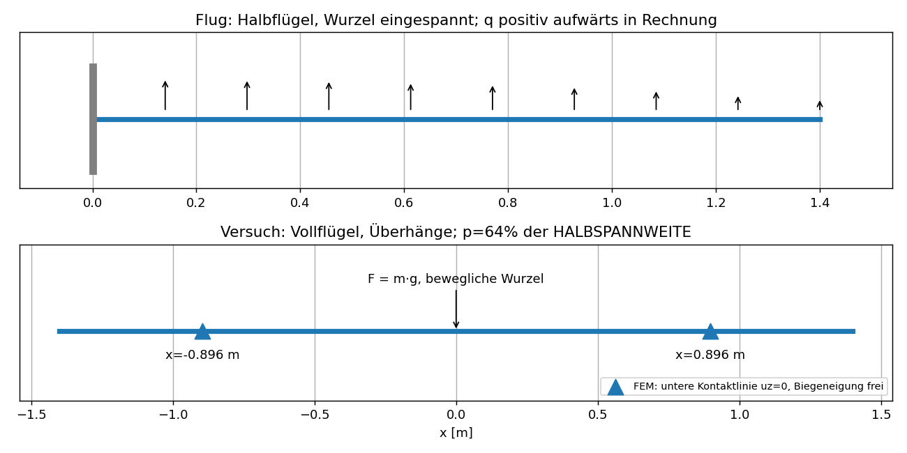


**Lesen:** Oben: eingespannter Halbflügel von 0 bis 1.4 m mit aufwärts gerichteter Fluglast. Unten: vollständiger Flügel mit beweglicher Mitte, zwei Auflagen bei ±0.896 m und zentraler Abwärtskraft.

**Einordnung:** Die Flugeinspannung und die Laborversuchslager sind unterschiedliche Randbedingungen; ihre Verformungswerte sind nicht direkt vergleichbar. Das Bild zeigt das mechanische Prinzip. Die räumlichen Auflagerbedingungen sind im FEM-Abschnitt beschrieben. Bei bottom_contact_line werden nur Unterseitenknoten auf einer Linie je Auflager vertikal gehalten. Innere und obere Knoten bleiben vertikal frei; Biegeneigung und horizontales Gleiten werden zugelassen, abgesehen von der Starrkörperstabilisierung. Die Lagerung bleibt bilateral.

### Balkenvergleich A/B: Steifigkeit, Masse und Verformung

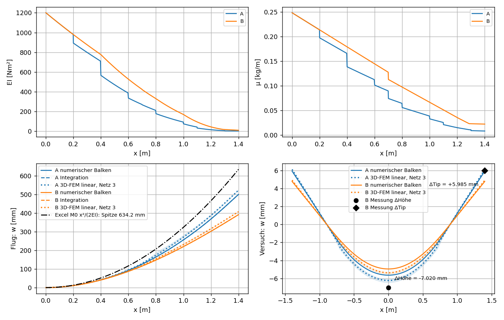


**Lesen:** Vier Teilbilder: oben links Biegesteifigkeit EI [N·m²], oben rechts längenbezogene Masse μ [kg/m], unten links Flugverformung w [mm] einschließlich der Excel-Näherung (schwarz strichpunktiert), unten rechts Laborversuch w [mm]. x ist jeweils die Spannweitenkoordinate in m. Gepunktet: lineare 3D-FEM der feinsten abgeschlossenen Netzstufe, ohne Darstellungsfaktor. Die Linie ist das arithmetische Mittel der vertikalen Knotenverschiebungen je x-Querschnitt; das transparente Band zeigt deren Minimum bis Maximum (einschließlich Torsion und lokaler Verformung). Schwarze Punkte: Excel-Messungen des B-Modells, ΔHöhe an x=0 abwärts und ΔTip aufwärts; Vorzeichen gemäß YAML. Die Tip-Seite ist nur für die Darstellung als +L angenommen, da Excel keine Seite angibt.

**Einordnung:** Lagenabstufungen erzeugen Sprünge in EI und μ bei A; das vordere Stegende bei 0,70 m erzeugt zusätzlich einen Übergang bei beiden Varianten. Mindestbreite und Mindestwanddicke ändern weitere Kurvensteigungen. B liegt außerhalb der Wurzel überwiegend höher: zusätzliche Masse erkauft zusätzliche Steifigkeit. Flugtip im Balken: A: 499.9 mm; B: 391.3 mm. Die schwarze strichpunktierte Kurve ergänzt die Excel-Näherung M₀L²/(2EI) mit 634,2 mm Spitzenverformung. Für diese Vergleichskurve wird die Wurzelkrümmung über die Länge konstant angesetzt; die Verformung wächst dadurch quadratisch von der Wurzel zur Spitze. Verwendet werden das Excel-Wurzelmoment bei Gleichlast und das korrigierte Excel-Wurzel-EI, nicht die aktuelle tiefenproportionale Lastverteilung. Die gestrichelte Krümmungsintegration und die numerische Balkenlösung liegen fast übereinander; das ist eine interne Verfahrensprüfung, kein unabhängiger Bauteilnachweis. Im Laborversuch sinkt die Mitte ab (A: -5.641 mm; B: -4.95 mm); die freien Überhänge heben sich durch die Auflagerneigung. Die großen Flugverformungen verlangen eine nichtlineare Prüfung; ihr tatsächlicher Abschlussstatus steht im FEM-Abschnitt. Die FEM-Überlagerung verwendet dieselben Flug- beziehungsweise Laborversuchslasten. Unterschiede zum Balken können aus Schub, Torsion, örtlicher Querschnittsverformung und der räumlichen Lagerung stammen. Der Knotenmittelwert ist keine flächengewichtete Querschnittsverschiebung; das Band zeigt die Streuung innerhalb des Querschnitts. Nichtlineare Ergebnisse sind in dieser Überlagerung nicht enthalten. Das konfigurierte 2-%-Netzkonvergenzziel ist für die ausgewerteten Verschiebungen und sechs Eigenfrequenzen erreicht; dies belegt keine lokale Spannungskonvergenz. Messwerte sind unabhängig von den berechneten Kurven und wurden nicht zum Anpassen der Materialwerte verwendet. Die genaue Messposition über der Flächentiefe ist nicht dokumentiert; FEM-Knotenmittel und Tabellenwert im Taschenband sind daher nicht automatisch exakt dieselbe Messgröße.

### Fluglast, Querkraft, Biegemoment und Krümmung

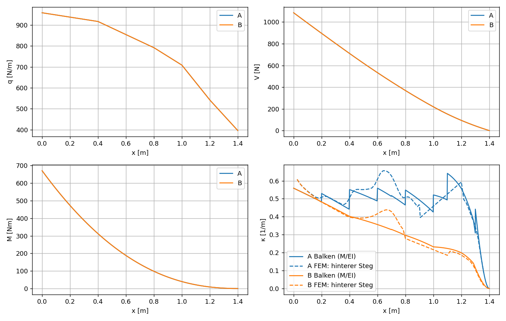


**Lesen:** Oben links tiefenproportionale Streckenlast q(x) [N/m], oben rechts Querkraft V [N], unten links Moment M [N·m], unten rechts Krümmung κ=M/EI [1/m]. A/B haben dieselbe äußere Last; ihre Kurven können übereinanderliegen. Im Krümmungsdiagramm zusätzlich gestrichelt: lineare Flug-FEM A/B entlang der Mitte des hinteren Depronkerns bei y=3 mm, z=0. Durchgezogen: Balkenkrümmung M/EI. Kein Laborversuchslastfall.

**Einordnung:** Die Last folgt der separat aus Excel importierten Flächentiefe, nicht der Gurtbreite: q(0)=958.3 N/m und q(L)=395.8 N/m. Das Integral beträgt unverändert 1085.4 N je Halbflügel. V und M fallen daher nicht mehr wie bei Gleichlast linear beziehungsweise rein quadratisch über die gesamte Spannweite ab; die abschnittsweise lineare Tiefenkontur erzeugt entsprechende Übergänge. Das Wurzelmoment beträgt 670,83 N·m. Unterschiede zwischen A/B entstehen in κ über EI, nicht in q, V oder M. Ein örtlich konstanter c_l ist eine Annahme; Randwirbel, Verwindung und lokale Profile sind nicht aerodynamisch gelöst. Die endliche Spitzenlast folgt dieser Annahme und ist keine behauptete reale Randwirbelverteilung. κ ist kein Festigkeitskriterium. Die FEM-Kurve ist die zweite Ableitung w′′ der tatsächlichen vertikalen Knotenverschiebungen auf dieser Linie. Sie wird durch lokale kubische Ausgleichspolynome über jeweils fünf benachbarte Stationen gewonnen; dadurch werden Netzrauschen und scharfe Übergänge geglättet. Die örtlich variable Auswertebreite steht zusammen mit Verschiebung und Krümmung in flight_rear_curvature_A.csv beziehungsweise flight_rear_curvature_B.csv. Dies ist eine lineare kinematische Linienkrümmung einschließlich örtlicher Schub-/Verformungseinflüsse, nicht direkt aus den Spannungen bestimmte reine Balkenbiegung. An Einspannung, Lagensprüngen und Endpunkten ist die Ableitung besonders empfindlich; lokale Krümmungskonvergenz wurde nicht nachgewiesen. Die große Flugverformung wird hier nicht geometrisch nichtlinear korrigiert; w′′ darf nicht als exakte geometrische Krümmung der stark verformten Linie gelesen werden. Die ersten und letzten zwei FEM-Stationen werden im Diagramm ausgelassen, weil dort der zentrierte Fünf-Punkte-Ansatz nicht verfügbar ist; ihre nicht zentrierten Schätzwerte bleiben in der CSV ausdrücklich mit interior_stencil=False markiert. Es wird kein FEM-Krümmungswert an der exakten Wurzel oder Spitze behauptet.

[Krümmungsdaten A als CSV](flight_rear_curvature_A.csv) · [Krümmungsdaten B als CSV](flight_rear_curvature_B.csv).

### Normierte Biegeeigenformen des 1D-Balkens


**Lesen:** Je ein Teilbild für A und B: x über den ganzen Flügel, vertikal φ/max|φ| ohne Einheit. Die Legende nennt die Eigenfrequenz jeder Kurve. Vorzeichen und Amplitude einer Eigenform sind frei wählbar.

**Einordnung:** Die erste Balkenfrequenz beträgt A: 5.389 Hz; B: 5.747 Hz. Weitere Vorzeichenwechsel kennzeichnen höhere Biegeformen. Eine hohe normierte Auslenkung ist keine vorhergesagte Schwingungsamplitude. Die Zentralmasse wirkt besonders auf Formen mit großer Bewegung in der Mitte. Der 1D-Balken beschreibt reine vertikale Biegung; 3D-FEM-Indizes können wegen Torsions- und Mischformen nicht ungeprüft zugeordnet werden.

### Tatsächliche Wurzelquerschnitte A und B

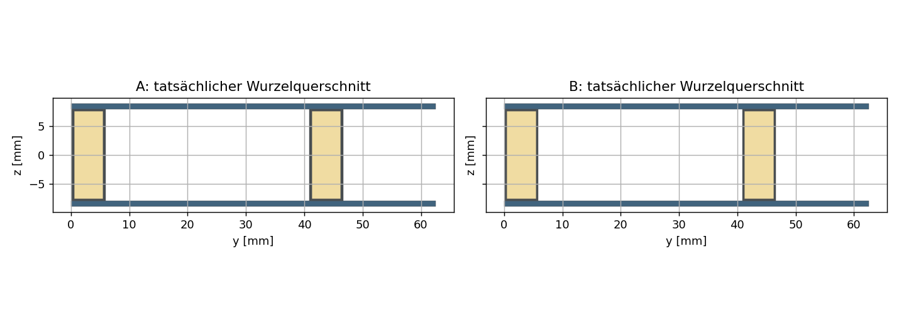


**Lesen:** Die beiden Teilbilder zeigen y und z in mm. Blau: UD-Gurte; beige: Depron; grau: CFK-Schlauch. Die Querpositionen der beiden Stege und der freie Taschenbereich werden geometrisch dargestellt.

**Einordnung:** A und B besitzen dieselben Wurzellagen und damit hier denselben Querschnitt. Ihre Unterschiede entstehen weiter außen. Der große Abstand zwischen Ober- und Untergurt erzeugt die hohe Biegesteifigkeit; die Stege übertragen Schub zwischen den Gurten. Eine gleiche Wurzelgeometrie bedeutet daher nicht gleiche Gesamtverformung oder Gesamtmasse. Ein zusätzlicher Verbinder-Steifigkeitsbeitrag ist nicht enthalten.

### Geometrieskizze und Spitzenquerschnitt

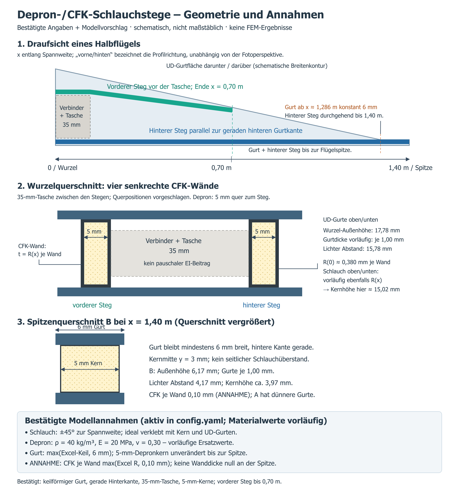


**Lesen:** Draufsicht, Wurzelquerschnitt und vergrößerter Spitzenquerschnitt B. Maßangaben sind maßgebend; die Gesamtzeichnung ist schematisch. Der hintere Steg läuft bis 1,40 m, der vordere bis 0,70 m.

**Einordnung:** Die konstante 6-mm-Gurtbreite schafft Platz für den unverändert 5 mm breiten Kern und den CFK-Schlauch. Der Steg bleibt bis zur Spitze mit beiden Gurten verbunden. Die Mindestwanddicke 0,10 mm ist eine Annahme, kein aus Excel oder Messung bestätigter Fertigungswert. Diese Skizze erläutert Eingaben und enthält selbst kein Solverergebnis.

[Skizze als verlustfrei vergrößerbare SVG öffnen](images/stegannahmen.svg).


**Spitzengeometrie:** Hinterer Steg bis 1,40 m; Gurt mindestens 6 mm. Die CFK-Mindestwanddicke 0,10 mm bleibt eine Annahme. Die reale Flügelschale ist nicht enthalten. Für den Vergleich mit Messwerten müssen Bauzustand und Versuchsaufbau dem Modell entsprechen.

Flug-Spitzenverschiebung bezeichnet den belasteten oberen Gurt; der untere Gurt wird in der JSON/CSV getrennt ausgewiesen. Die Laborversuchswurzel wird als Auswertegröße weiterhin über die obere Gurtfläche im 35-mm-Taschenbereich bei x=0 gemittelt; dies ist kein festgelegter Messpunkt. Laborversuchskraft und Schwingungsmasse werden bei load_region=rear_web auf der oberen Gurtfläche unmittelbar über dem hinteren Steg verteilt: x=-25 bis +25 mm, quer dazu über den 5-mm-Depronkern einschließlich beider CFK-Schlauchwände, Mittelpunkt y=3 mm zur hinteren Gurtkante. Die statische Gesamtkraft bleibt 37,278 N; die gesonderte Schwingungsmasse bleibt 5,58 kg und erzeugt keine zusätzliche statische Gewichtslast. Nichtlineare Statik wird für den großen Fluglastfall versucht; beim kleinen Laborversuch bleibt die Statik linear. [FEM-Ergebnistabelle als CSV](fem_summary.csv).

**Laborversuchslagerung auf unteren Kontaktlinien:** Bei x=±0,896 m gilt u_z=0 ausschließlich für die Knoten auf der unteren Holmoberfläche, über deren Breite. Oberseite und innere Knoten werden nicht vertikal festgehalten. Benachbarte Querschnitte bleiben vertikal frei; die Biegeneigung und das horizontale Gleiten werden bis auf drei skalare Bedingungen zur Starrkörperstabilisierung zugelassen. Die Außenflügel setzen die Auflagerneigung fort. Die 20-mm-Unterteilung um die Auflage ist nur eine Netzunterteilung, keine fixierte Kontaktfläche. Diese bilaterale Kontaktlinie verhindert Abheben und kann Niederhaltekräfte übertragen; sie ist kein einseitiger Kontakt mit Abrollen und kein Nachweis realer Kontaktpressungen. Die reale Flügelschale fehlt weiterhin.

## Messwerte und aktuelle FEM-Ergebnisse im Laborversuch

**Messpunkte im Biegelinienplot (B-Modell):** Excel D146, ΔHöhe=7.02 mm als Absenkung an x=0; Excel D147, ΔTip=5.985 mm als Hebung am Tip. Die Darstellungsseite +L ist eine YAML-Annahme, keine in Excel dokumentierte Messseite. Die genaue Messposition über der Flächentiefe ist nicht dokumentiert; der FEM-Querschnittsmittelwert und die Wurzelauswertung im Taschenband sind nicht automatisch identisch mit dem Messpunkt. Die Werte sind kein automatischer Nachweis identischer Material-, Geometrie- und Lagerannahmen.

| Variante | FEM Wurzel, Taschenmittel [mm] | FEM Tip links, oberer Gurt [mm] | FEM Tip rechts, oberer Gurt [mm] |
|---|---:|---:|---:|
| A | -6.21811 | 6.12389 | 6.12406 |
| B | -5.36273 | 4.9235 | 4.92361 |

## Anhang – FEM-Detailbilder und technische Prüfnachweise

Die wesentlichen Ergebnisse und Vergleiche stehen im Hauptteil oben. Der folgende Anhang dokumentiert die einzelnen FEM-Netzstufen, Verformungen, Spannungen und Schwingungsformen sowie die technischen Prüfungen und die Reproduzierbarkeit der Berechnung.

## FEM-Detailbilder – Fall A

**FEM A: Netzkonvergenz**

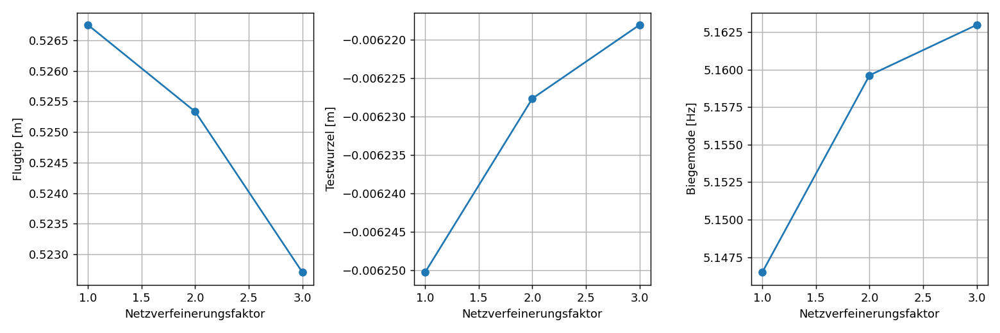


**Lesen:** Drei Teilbilder zeigen Flug-Spitzenverschiebung [m], Laborversuchswurzel [m] und ausgewählte Eigenfrequenz [Hz] gegen den Netzverfeinerungsfaktor. Faktor 3 ist das feinste Netz, keine physische Laststeigerung. Die y-Achsen sind unterschiedlich skaliert.

**Einordnung:** Änderung der letzten beiden Stufen, bezogen auf die feinste: Flugtip 0.503 %, Laborversuchswurzel 0.154 %, ausgewählte Biegemode 0.0651 %. Das konfigurierte Ziel ist erreicht. Der Frequenzgraph zeigt nur eine ausgewählte Form; für den Gesamtstatus werden alle sechs Frequenzen geprüft. Ein optisch flacher Verlauf beweist keine vollständige Konvergenz, insbesondere nicht für lokale Spannungen oder bei Modenwechseln.


### Fall A – Netzstufe 1 – Fluglastfall

**FEM A, Netz 1, Flug, linear: Verformung**


**Lesen:** Grau: unverformte Lage; farbig: verformte Oberfläche mit dem im Bild genannten Faktor. Achsen sind mm. Die Farbe zeigt den realen Betrag |u| [mm], nicht die mit dem Darstellungsfaktor multiplizierte Auslenkung und nicht nur die vertikale Komponente.

**Einordnung:** Die obere Flugtip-Verschiebung uz beträgt 526.8 mm. Ober- und Untergurt bewegen sich durch den durchgehenden Steg gemeinsam. Die lineare Flugverformung ist groß relativ zur Halbspannweite. Der Abschlussstatus der nichtlinearen Vergleichsläufe steht oben; der lineare Wert ist kein bestätigter realer Flugzustand.

**FEM A, Netz 1, Flug, linear: Verformung im Wurzeldetail**


**Lesen:** Wurzelausschnitt derselben Rechnung; keine zusätzliche Laststufe. Grau: unverformte Lage; farbig: verformte Oberfläche mit dem im Bild genannten Faktor. Achsen sind mm. Die Farbe zeigt den realen Betrag |u| [mm], nicht die mit dem Darstellungsfaktor multiplizierte Auslenkung und nicht nur die vertikale Komponente.

**Einordnung:** Die obere Flugtip-Verschiebung uz beträgt 526.8 mm. Ober- und Untergurt bewegen sich durch den durchgehenden Steg gemeinsam. Der Wurzelausschnitt zeigt vor allem lokale Bewegungen und nicht den Verlauf bis zur Spitze. Die lineare Flugverformung ist groß relativ zur Halbspannweite. Der Abschlussstatus der nichtlinearen Vergleichsläufe steht oben; der lineare Wert ist kein bestätigter realer Flugzustand.

**FEM A, Netz 1, Flug, linear: Netz am Wurzeldetail**


**Lesen:** Wurzelausschnitt derselben Rechnung; keine zusätzliche Laststufe. Gezeigt wird die sichtbare Oberfläche des 3D-Netzes mit insgesamt 11,835 Knoten und 2,004 quadratischen C3D20R-Volumenelementen. Achsen in mm; sichtbare Dreieckslinien stammen auch aus der Darstellung der Elementflächen und sind keine Tetraederelemente.

**Einordnung:** Die schmalen CFK-Schichten erzeugen stark unterschiedliche Elementabmessungen. Feinere Netze prüfen deren Einfluss; eine dichte Oberfläche allein beweist keine Genauigkeit. Innerhalb der Abschnitte teilen Materialien Knoten, an Lagensprüngen verbinden interpolierende Gleichungen nichtpassende Flächen. Das Detail hilft, Last-/Lagerband und dünne Schichten zu erkennen; daraus folgt noch kein konvergierter örtlicher Spannungswert.

**FEM A, Netz 1, Flug, linear: Wurzeldetail des Modells**


**Lesen:** Wurzelausschnitt derselben Rechnung; keine zusätzliche Laststufe. Geometrie aus den tatsächlichen CAD-Eingaben; Achsen in mm. Blau sind die Gurte, grau die CFK-Schläuche, beige die Depronkerne. Verdeckte Innenflächen können in der Außenansicht unsichtbar sein.

**Einordnung:** Hier wird die angenommene Bauweise kontrolliert, nicht die Beanspruchung: gerader hinterer Steg bis zur Spitze, vorderer Steg nur im inneren Bereich, diskrete Gurtdicken in A beziehungsweise durchgehende Wurzellagen in B. Im Wurzelausschnitt ist vor allem die Trennung der beiden Stege wichtig; die 6-mm-Spitze ist hier nicht sichtbar. Flügelschale und ein nachgewiesener steifer Verbinder fehlen weiterhin.

**FEM A, Netz 1, Flug, linear: Längsspannung im Wurzeldetail**


**Lesen:** Wurzelausschnitt derselben Rechnung; keine zusätzliche Laststufe. Unverformte Geometrie mit globaler σxx [MPa]: positiv Zug, negativ Druck, gemäß Farbskala. Gezeigt sind Integrationspunktmittelwerte je Element; es wird nicht über Materialgrenzen geglättet.

**Einordnung:** Die gegensinnigen Normalspannungen in Ober- und Untergurt kennzeichnen Biegung. Im unverformten UD-Gurt verläuft die Faserrichtung entlang x. Bei großen nichtlinearen Rotationen ist globales σxx auch dort nicht automatisch die lokale Faserspannung. Im ±45°-Schlauch ist σxx keine lokale Faserspannung und zeigt auch nicht die gesamte Schubbeanspruchung. Lokale Spitzen an Lagensprüngen, Lasten und Lagern sind netzabhängig. Es fehlen CFK-Festigkeitswerte sowie Klebe-, Delaminations- und Beulnachweise; die Farben bedeuten weder sicher noch gebrochen. Wegen der großen linearen Flugverformung sind auch diese Spannungen nur Ergebnisse des linearen Vergleichsmodells.

**FEM A, Netz 1, Flug, linear: Volumennetz**


**Lesen:** Gezeigt wird die sichtbare Oberfläche des 3D-Netzes mit insgesamt 11,835 Knoten und 2,004 quadratischen C3D20R-Volumenelementen. Achsen in mm; sichtbare Dreieckslinien stammen auch aus der Darstellung der Elementflächen und sind keine Tetraederelemente.

**Einordnung:** Die schmalen CFK-Schichten erzeugen stark unterschiedliche Elementabmessungen. Feinere Netze prüfen deren Einfluss; eine dichte Oberfläche allein beweist keine Genauigkeit. Innerhalb der Abschnitte teilen Materialien Knoten, an Lagensprüngen verbinden interpolierende Gleichungen nichtpassende Flächen. Die Modellabmessungen und Lasten sind auf den Netzstufen gleich; nur die Diskretisierung wird verfeinert.

**FEM A, Netz 1, Flug, linear: räumliches Modell**

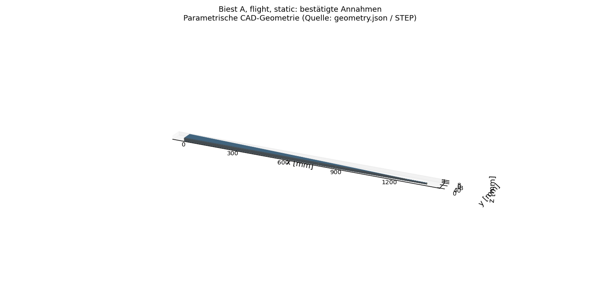


**Lesen:** Geometrie aus den tatsächlichen CAD-Eingaben; Achsen in mm. Blau sind die Gurte, grau die CFK-Schläuche, beige die Depronkerne. Verdeckte Innenflächen können in der Außenansicht unsichtbar sein.

**Einordnung:** Hier wird die angenommene Bauweise kontrolliert, nicht die Beanspruchung: gerader hinterer Steg bis zur Spitze, vorderer Steg nur im inneren Bereich, diskrete Gurtdicken in A beziehungsweise durchgehende Wurzellagen in B. Die äußere Mindestgurtbreite beträgt 6 mm; der Steg verbindet Ober- und Untergurt durchgehend bis zur Spitze. Flügelschale und ein nachgewiesener steifer Verbinder fehlen weiterhin.

**FEM A, Netz 1, Flug, linear: globale Längsspannung**


**Lesen:** Unverformte Geometrie mit globaler σxx [MPa]: positiv Zug, negativ Druck, gemäß Farbskala. Gezeigt sind Integrationspunktmittelwerte je Element; es wird nicht über Materialgrenzen geglättet.

**Einordnung:** Die gegensinnigen Normalspannungen in Ober- und Untergurt kennzeichnen Biegung. Im unverformten UD-Gurt verläuft die Faserrichtung entlang x. Bei großen nichtlinearen Rotationen ist globales σxx auch dort nicht automatisch die lokale Faserspannung. Im ±45°-Schlauch ist σxx keine lokale Faserspannung und zeigt auch nicht die gesamte Schubbeanspruchung. Lokale Spitzen an Lagensprüngen, Lasten und Lagern sind netzabhängig. Es fehlen CFK-Festigkeitswerte sowie Klebe-, Delaminations- und Beulnachweise; die Farben bedeuten weder sicher noch gebrochen. Wegen der großen linearen Flugverformung sind auch diese Spannungen nur Ergebnisse des linearen Vergleichsmodells.


### Fall A – Netzstufe 1 – Laborversuch

**FEM A, Netz 1, Laborversuch, linear: Verformung**


**Lesen:** Grau: unverformte Lage; farbig: verformte Oberfläche mit dem im Bild genannten Faktor. Achsen sind mm. Die Farbe zeigt den realen Betrag |u| [mm], nicht die mit dem Darstellungsfaktor multiplizierte Auslenkung und nicht nur die vertikale Komponente.

**Einordnung:** Die gemittelte vertikale Wurzelverschiebung im Taschenband beträgt -6.25 mm. Die Mitte sinkt ab, freie Überhänge können sich heben. Der größte räumliche Verschiebungsbetrag muss nicht an der Wurzel liegen und darf nicht mit diesem Tabellenwert gleichgesetzt werden. Die Laborversuchslager sind bilateral. Die aktive Lageridealisation ist im FEM-Abschnitt dokumentiert. Bei bottom_contact_line sind nur die Unterseitenknoten auf einer Kontaktlinie vertikal gehalten; die übrigen Querschnittsknoten bleiben vertikal frei und die Außenflügel können die Biegeneigung fortsetzen. Dies ist kein einseitiger Laborversuch mit Kontakt und kein Nachweis realer Kontaktpressungen.

**FEM A, Netz 1, Laborversuch, linear: Verformung im Wurzeldetail**

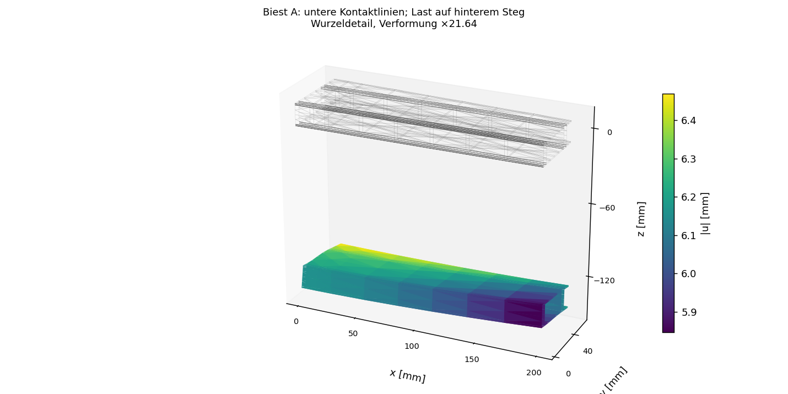


**Lesen:** Wurzelausschnitt derselben Rechnung; keine zusätzliche Laststufe. Grau: unverformte Lage; farbig: verformte Oberfläche mit dem im Bild genannten Faktor. Achsen sind mm. Die Farbe zeigt den realen Betrag |u| [mm], nicht die mit dem Darstellungsfaktor multiplizierte Auslenkung und nicht nur die vertikale Komponente.

**Einordnung:** Die gemittelte vertikale Wurzelverschiebung im Taschenband beträgt -6.25 mm. Die Mitte sinkt ab, freie Überhänge können sich heben. Der größte räumliche Verschiebungsbetrag muss nicht an der Wurzel liegen und darf nicht mit diesem Tabellenwert gleichgesetzt werden. Der Wurzelausschnitt zeigt vor allem lokale Bewegungen und nicht den Verlauf bis zur Spitze. Die Laborversuchslager sind bilateral. Die aktive Lageridealisation ist im FEM-Abschnitt dokumentiert. Bei bottom_contact_line sind nur die Unterseitenknoten auf einer Kontaktlinie vertikal gehalten; die übrigen Querschnittsknoten bleiben vertikal frei und die Außenflügel können die Biegeneigung fortsetzen. Dies ist kein einseitiger Laborversuch mit Kontakt und kein Nachweis realer Kontaktpressungen.

**FEM A, Netz 1, Laborversuch, linear: Netz am Wurzeldetail**


**Lesen:** Wurzelausschnitt derselben Rechnung; keine zusätzliche Laststufe. Gezeigt wird die sichtbare Oberfläche des 3D-Netzes mit insgesamt 23,342 Knoten und 4,008 quadratischen C3D20R-Volumenelementen. Achsen in mm; sichtbare Dreieckslinien stammen auch aus der Darstellung der Elementflächen und sind keine Tetraederelemente.

**Einordnung:** Die schmalen CFK-Schichten erzeugen stark unterschiedliche Elementabmessungen. Feinere Netze prüfen deren Einfluss; eine dichte Oberfläche allein beweist keine Genauigkeit. Innerhalb der Abschnitte teilen Materialien Knoten, an Lagensprüngen verbinden interpolierende Gleichungen nichtpassende Flächen. Das Detail hilft, Last-/Lagerband und dünne Schichten zu erkennen; daraus folgt noch kein konvergierter örtlicher Spannungswert.

**FEM A, Netz 1, Laborversuch, linear: Wurzeldetail des Modells**


**Lesen:** Wurzelausschnitt derselben Rechnung; keine zusätzliche Laststufe. Geometrie aus den tatsächlichen CAD-Eingaben; Achsen in mm. Blau sind die Gurte, grau die CFK-Schläuche, beige die Depronkerne. Verdeckte Innenflächen können in der Außenansicht unsichtbar sein.

**Einordnung:** Hier wird die angenommene Bauweise kontrolliert, nicht die Beanspruchung: gerader hinterer Steg bis zur Spitze, vorderer Steg nur im inneren Bereich, diskrete Gurtdicken in A beziehungsweise durchgehende Wurzellagen in B. Im Wurzelausschnitt ist vor allem die Trennung der beiden Stege wichtig; die 6-mm-Spitze ist hier nicht sichtbar. Flügelschale und ein nachgewiesener steifer Verbinder fehlen weiterhin.

**FEM A, Netz 1, Laborversuch, linear: Längsspannung im Wurzeldetail**


**Lesen:** Wurzelausschnitt derselben Rechnung; keine zusätzliche Laststufe. Unverformte Geometrie mit globaler σxx [MPa]: positiv Zug, negativ Druck, gemäß Farbskala. Gezeigt sind Integrationspunktmittelwerte je Element; es wird nicht über Materialgrenzen geglättet.

**Einordnung:** Die gegensinnigen Normalspannungen in Ober- und Untergurt kennzeichnen Biegung. Im unverformten UD-Gurt verläuft die Faserrichtung entlang x. Bei großen nichtlinearen Rotationen ist globales σxx auch dort nicht automatisch die lokale Faserspannung. Im ±45°-Schlauch ist σxx keine lokale Faserspannung und zeigt auch nicht die gesamte Schubbeanspruchung. Lokale Spitzen an Lagensprüngen, Lasten und Lagern sind netzabhängig. Es fehlen CFK-Festigkeitswerte sowie Klebe-, Delaminations- und Beulnachweise; die Farben bedeuten weder sicher noch gebrochen. Die ideale Verklebung und die jeweiligen Lagerbedingungen beeinflussen die örtliche Lastübertragung.

**FEM A, Netz 1, Laborversuch, linear: Volumennetz**


**Lesen:** Gezeigt wird die sichtbare Oberfläche des 3D-Netzes mit insgesamt 23,342 Knoten und 4,008 quadratischen C3D20R-Volumenelementen. Achsen in mm; sichtbare Dreieckslinien stammen auch aus der Darstellung der Elementflächen und sind keine Tetraederelemente.

**Einordnung:** Die schmalen CFK-Schichten erzeugen stark unterschiedliche Elementabmessungen. Feinere Netze prüfen deren Einfluss; eine dichte Oberfläche allein beweist keine Genauigkeit. Innerhalb der Abschnitte teilen Materialien Knoten, an Lagensprüngen verbinden interpolierende Gleichungen nichtpassende Flächen. Die Modellabmessungen und Lasten sind auf den Netzstufen gleich; nur die Diskretisierung wird verfeinert.

**FEM A, Netz 1, Laborversuch, linear: räumliches Modell**


**Lesen:** Geometrie aus den tatsächlichen CAD-Eingaben; Achsen in mm. Blau sind die Gurte, grau die CFK-Schläuche, beige die Depronkerne. Verdeckte Innenflächen können in der Außenansicht unsichtbar sein.

**Einordnung:** Hier wird die angenommene Bauweise kontrolliert, nicht die Beanspruchung: gerader hinterer Steg bis zur Spitze, vorderer Steg nur im inneren Bereich, diskrete Gurtdicken in A beziehungsweise durchgehende Wurzellagen in B. Die äußere Mindestgurtbreite beträgt 6 mm; der Steg verbindet Ober- und Untergurt durchgehend bis zur Spitze. Flügelschale und ein nachgewiesener steifer Verbinder fehlen weiterhin.

**FEM A, Netz 1, Laborversuch, linear: globale Längsspannung**


**Lesen:** Unverformte Geometrie mit globaler σxx [MPa]: positiv Zug, negativ Druck, gemäß Farbskala. Gezeigt sind Integrationspunktmittelwerte je Element; es wird nicht über Materialgrenzen geglättet.

**Einordnung:** Die gegensinnigen Normalspannungen in Ober- und Untergurt kennzeichnen Biegung. Im unverformten UD-Gurt verläuft die Faserrichtung entlang x. Bei großen nichtlinearen Rotationen ist globales σxx auch dort nicht automatisch die lokale Faserspannung. Im ±45°-Schlauch ist σxx keine lokale Faserspannung und zeigt auch nicht die gesamte Schubbeanspruchung. Lokale Spitzen an Lagensprüngen, Lasten und Lagern sind netzabhängig. Es fehlen CFK-Festigkeitswerte sowie Klebe-, Delaminations- und Beulnachweise; die Farben bedeuten weder sicher noch gebrochen. Die ideale Verklebung und die jeweiligen Lagerbedingungen beeinflussen die örtliche Lastübertragung.


### Fall A – Netzstufe 3 – Fluglastfall

**FEM A, Netz 3, Flug, linear: Verformung**


**Lesen:** Grau: unverformte Lage; farbig: verformte Oberfläche mit dem im Bild genannten Faktor. Achsen sind mm. Die Farbe zeigt den realen Betrag |u| [mm], nicht die mit dem Darstellungsfaktor multiplizierte Auslenkung und nicht nur die vertikale Komponente.

**Einordnung:** Die obere Flugtip-Verschiebung uz beträgt 522.7 mm. Ober- und Untergurt bewegen sich durch den durchgehenden Steg gemeinsam. Die lineare Flugverformung ist groß relativ zur Halbspannweite. Der Abschlussstatus der nichtlinearen Vergleichsläufe steht oben; der lineare Wert ist kein bestätigter realer Flugzustand.

**FEM A, Netz 3, Flug, linear: Verformung im Wurzeldetail**

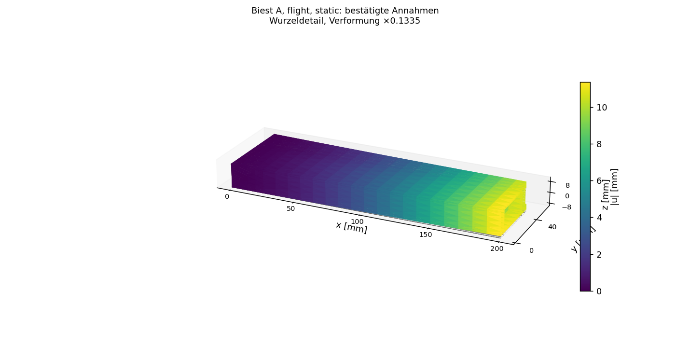


**Lesen:** Wurzelausschnitt derselben Rechnung; keine zusätzliche Laststufe. Grau: unverformte Lage; farbig: verformte Oberfläche mit dem im Bild genannten Faktor. Achsen sind mm. Die Farbe zeigt den realen Betrag |u| [mm], nicht die mit dem Darstellungsfaktor multiplizierte Auslenkung und nicht nur die vertikale Komponente.

**Einordnung:** Die obere Flugtip-Verschiebung uz beträgt 522.7 mm. Ober- und Untergurt bewegen sich durch den durchgehenden Steg gemeinsam. Der Wurzelausschnitt zeigt vor allem lokale Bewegungen und nicht den Verlauf bis zur Spitze. Die lineare Flugverformung ist groß relativ zur Halbspannweite. Der Abschlussstatus der nichtlinearen Vergleichsläufe steht oben; der lineare Wert ist kein bestätigter realer Flugzustand.

**FEM A, Netz 3, Flug, linear: Netz am Wurzeldetail**


**Lesen:** Wurzelausschnitt derselben Rechnung; keine zusätzliche Laststufe. Gezeigt wird die sichtbare Oberfläche des 3D-Netzes mit insgesamt 33,982 Knoten und 6,217 quadratischen C3D20R-Volumenelementen. Achsen in mm; sichtbare Dreieckslinien stammen auch aus der Darstellung der Elementflächen und sind keine Tetraederelemente.

**Einordnung:** Die schmalen CFK-Schichten erzeugen stark unterschiedliche Elementabmessungen. Feinere Netze prüfen deren Einfluss; eine dichte Oberfläche allein beweist keine Genauigkeit. Innerhalb der Abschnitte teilen Materialien Knoten, an Lagensprüngen verbinden interpolierende Gleichungen nichtpassende Flächen. Das Detail hilft, Last-/Lagerband und dünne Schichten zu erkennen; daraus folgt noch kein konvergierter örtlicher Spannungswert.

**FEM A, Netz 3, Flug, linear: Wurzeldetail des Modells**


**Lesen:** Wurzelausschnitt derselben Rechnung; keine zusätzliche Laststufe. Geometrie aus den tatsächlichen CAD-Eingaben; Achsen in mm. Blau sind die Gurte, grau die CFK-Schläuche, beige die Depronkerne. Verdeckte Innenflächen können in der Außenansicht unsichtbar sein.

**Einordnung:** Hier wird die angenommene Bauweise kontrolliert, nicht die Beanspruchung: gerader hinterer Steg bis zur Spitze, vorderer Steg nur im inneren Bereich, diskrete Gurtdicken in A beziehungsweise durchgehende Wurzellagen in B. Im Wurzelausschnitt ist vor allem die Trennung der beiden Stege wichtig; die 6-mm-Spitze ist hier nicht sichtbar. Flügelschale und ein nachgewiesener steifer Verbinder fehlen weiterhin.

**FEM A, Netz 3, Flug, linear: Längsspannung im Wurzeldetail**


**Lesen:** Wurzelausschnitt derselben Rechnung; keine zusätzliche Laststufe. Unverformte Geometrie mit globaler σxx [MPa]: positiv Zug, negativ Druck, gemäß Farbskala. Gezeigt sind Integrationspunktmittelwerte je Element; es wird nicht über Materialgrenzen geglättet.

**Einordnung:** Der größte Betrag an Integrationspunkten im gesamten Modell beträgt 942.8 MPa; er kann außerhalb des Ausschnitts oder über der gemittelten Elementfarbskala liegen. Die gegensinnigen Normalspannungen in Ober- und Untergurt kennzeichnen Biegung. Im unverformten UD-Gurt verläuft die Faserrichtung entlang x. Bei großen nichtlinearen Rotationen ist globales σxx auch dort nicht automatisch die lokale Faserspannung. Im ±45°-Schlauch ist σxx keine lokale Faserspannung und zeigt auch nicht die gesamte Schubbeanspruchung. Lokale Spitzen an Lagensprüngen, Lasten und Lagern sind netzabhängig. Es fehlen CFK-Festigkeitswerte sowie Klebe-, Delaminations- und Beulnachweise; die Farben bedeuten weder sicher noch gebrochen. Wegen der großen linearen Flugverformung sind auch diese Spannungen nur Ergebnisse des linearen Vergleichsmodells.

**FEM A, Netz 3, Flug, linear: Volumennetz**


**Lesen:** Gezeigt wird die sichtbare Oberfläche des 3D-Netzes mit insgesamt 33,982 Knoten und 6,217 quadratischen C3D20R-Volumenelementen. Achsen in mm; sichtbare Dreieckslinien stammen auch aus der Darstellung der Elementflächen und sind keine Tetraederelemente.

**Einordnung:** Die schmalen CFK-Schichten erzeugen stark unterschiedliche Elementabmessungen. Feinere Netze prüfen deren Einfluss; eine dichte Oberfläche allein beweist keine Genauigkeit. Innerhalb der Abschnitte teilen Materialien Knoten, an Lagensprüngen verbinden interpolierende Gleichungen nichtpassende Flächen. Die Modellabmessungen und Lasten sind auf den Netzstufen gleich; nur die Diskretisierung wird verfeinert.

**FEM A, Netz 3, Flug, linear: räumliches Modell**


**Lesen:** Geometrie aus den tatsächlichen CAD-Eingaben; Achsen in mm. Blau sind die Gurte, grau die CFK-Schläuche, beige die Depronkerne. Verdeckte Innenflächen können in der Außenansicht unsichtbar sein.

**Einordnung:** Hier wird die angenommene Bauweise kontrolliert, nicht die Beanspruchung: gerader hinterer Steg bis zur Spitze, vorderer Steg nur im inneren Bereich, diskrete Gurtdicken in A beziehungsweise durchgehende Wurzellagen in B. Die äußere Mindestgurtbreite beträgt 6 mm; der Steg verbindet Ober- und Untergurt durchgehend bis zur Spitze. Flügelschale und ein nachgewiesener steifer Verbinder fehlen weiterhin.

**FEM A, Netz 3, Flug, linear: globale Längsspannung**


**Lesen:** Unverformte Geometrie mit globaler σxx [MPa]: positiv Zug, negativ Druck, gemäß Farbskala. Gezeigt sind Integrationspunktmittelwerte je Element; es wird nicht über Materialgrenzen geglättet.

**Einordnung:** Der größte Betrag an Integrationspunkten im gesamten Modell beträgt 942.8 MPa; er kann außerhalb des Ausschnitts oder über der gemittelten Elementfarbskala liegen. Die gegensinnigen Normalspannungen in Ober- und Untergurt kennzeichnen Biegung. Im unverformten UD-Gurt verläuft die Faserrichtung entlang x. Bei großen nichtlinearen Rotationen ist globales σxx auch dort nicht automatisch die lokale Faserspannung. Im ±45°-Schlauch ist σxx keine lokale Faserspannung und zeigt auch nicht die gesamte Schubbeanspruchung. Lokale Spitzen an Lagensprüngen, Lasten und Lagern sind netzabhängig. Es fehlen CFK-Festigkeitswerte sowie Klebe-, Delaminations- und Beulnachweise; die Farben bedeuten weder sicher noch gebrochen. Wegen der großen linearen Flugverformung sind auch diese Spannungen nur Ergebnisse des linearen Vergleichsmodells.


### Fall A – Netzstufe 3 – Laborversuch

**FEM A, Netz 3, Laborversuch: Eigenform 1, 5.163 Hz**

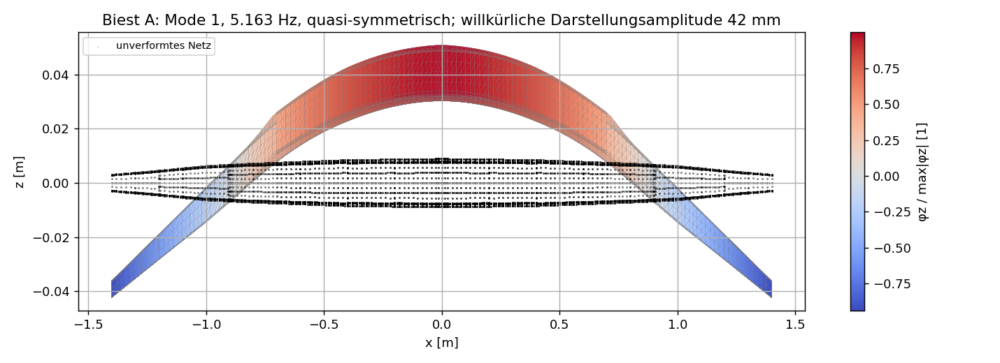


**Lesen:** Seitenprojektion in die x-z-Ebene. Schwarze Punkte: unverformtes Netz; farbige Fläche: Eigenform mit willkürlich gewählter Darstellungsamplitude. Die Farbskala φz/max|φz| ist dimensionslos; die Achsen geben die gezeichneten Koordinaten in m an.

**Einordnung:** Diese Form ist quasi-symmetrisch; der rechnerische Anteil Σuz²/Σ|u|² beträgt 99.9 %. Das ist eine Verschiebungskennzahl, keine effektive Modalmasse oder Energiequote. Sie ist die im Konvergenzgraphen verwendete überwiegend vertikale Form. Formen mit ähnlicher Frequenz können sich bei Netzänderung mischen oder die Reihenfolge wechseln. Die 2D-Projektion zeigt seitliche Bewegung und Torsion nur eingeschränkt. Weder Amplitude noch Vorzeichen sagen eine reale Schwingungsantwort voraus; die Modalanalyse ist unbelastet und linear.

**FEM A, Netz 3, Laborversuch: Eigenform 2, 8.605 Hz**

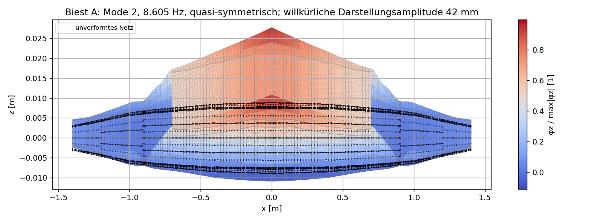


**Lesen:** Seitenprojektion in die x-z-Ebene. Schwarze Punkte: unverformtes Netz; farbige Fläche: Eigenform mit willkürlich gewählter Darstellungsamplitude. Die Farbskala φz/max|φz| ist dimensionslos; die Achsen geben die gezeichneten Koordinaten in m an.

**Einordnung:** Diese Form ist quasi-symmetrisch; der rechnerische Anteil Σuz²/Σ|u|² beträgt 5.44 %. Das ist eine Verschiebungskennzahl, keine effektive Modalmasse oder Energiequote. Sie ist eine weitere räumliche Eigenform und nicht automatisch die gleich nummerierte Balkenmode. Formen mit ähnlicher Frequenz können sich bei Netzänderung mischen oder die Reihenfolge wechseln. Die 2D-Projektion zeigt seitliche Bewegung und Torsion nur eingeschränkt. Weder Amplitude noch Vorzeichen sagen eine reale Schwingungsantwort voraus; die Modalanalyse ist unbelastet und linear.

**FEM A, Netz 3, Laborversuch: Eigenform 3, 51.69 Hz**

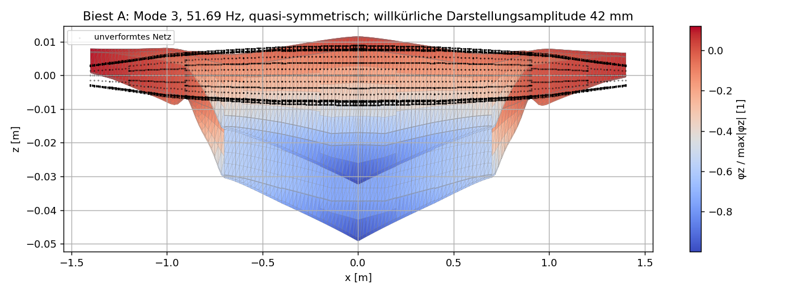


**Lesen:** Seitenprojektion in die x-z-Ebene. Schwarze Punkte: unverformtes Netz; farbige Fläche: Eigenform mit willkürlich gewählter Darstellungsamplitude. Die Farbskala φz/max|φz| ist dimensionslos; die Achsen geben die gezeichneten Koordinaten in m an.

**Einordnung:** Diese Form ist quasi-symmetrisch; der rechnerische Anteil Σuz²/Σ|u|² beträgt 81.8 %. Das ist eine Verschiebungskennzahl, keine effektive Modalmasse oder Energiequote. Sie ist eine weitere räumliche Eigenform und nicht automatisch die gleich nummerierte Balkenmode. Formen mit ähnlicher Frequenz können sich bei Netzänderung mischen oder die Reihenfolge wechseln. Die 2D-Projektion zeigt seitliche Bewegung und Torsion nur eingeschränkt. Weder Amplitude noch Vorzeichen sagen eine reale Schwingungsantwort voraus; die Modalanalyse ist unbelastet und linear.

**FEM A, Netz 3, Laborversuch: Eigenform 4, 93.72 Hz**

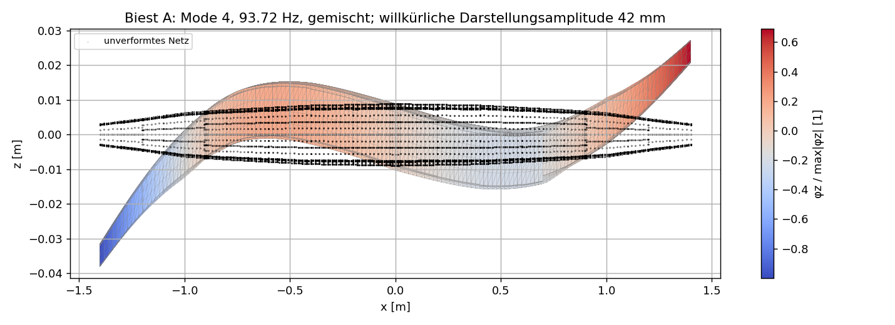


**Lesen:** Seitenprojektion in die x-z-Ebene. Schwarze Punkte: unverformtes Netz; farbige Fläche: Eigenform mit willkürlich gewählter Darstellungsamplitude. Die Farbskala φz/max|φz| ist dimensionslos; die Achsen geben die gezeichneten Koordinaten in m an.

**Einordnung:** Diese Form ist gemischt; der rechnerische Anteil Σuz²/Σ|u|² beträgt 79.2 %. Das ist eine Verschiebungskennzahl, keine effektive Modalmasse oder Energiequote. Sie ist eine weitere räumliche Eigenform und nicht automatisch die gleich nummerierte Balkenmode. Formen mit ähnlicher Frequenz können sich bei Netzänderung mischen oder die Reihenfolge wechseln. Die 2D-Projektion zeigt seitliche Bewegung und Torsion nur eingeschränkt. Weder Amplitude noch Vorzeichen sagen eine reale Schwingungsantwort voraus; die Modalanalyse ist unbelastet und linear.

**FEM A, Netz 3, Laborversuch: Eigenform 5, 97.07 Hz**

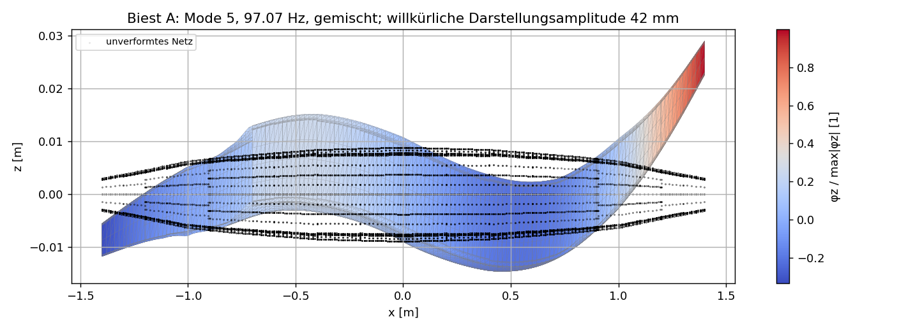


**Lesen:** Seitenprojektion in die x-z-Ebene. Schwarze Punkte: unverformtes Netz; farbige Fläche: Eigenform mit willkürlich gewählter Darstellungsamplitude. Die Farbskala φz/max|φz| ist dimensionslos; die Achsen geben die gezeichneten Koordinaten in m an.

**Einordnung:** Diese Form ist gemischt; der rechnerische Anteil Σuz²/Σ|u|² beträgt 38.4 %. Das ist eine Verschiebungskennzahl, keine effektive Modalmasse oder Energiequote. Sie ist eine weitere räumliche Eigenform und nicht automatisch die gleich nummerierte Balkenmode. Formen mit ähnlicher Frequenz können sich bei Netzänderung mischen oder die Reihenfolge wechseln. Die 2D-Projektion zeigt seitliche Bewegung und Torsion nur eingeschränkt. Weder Amplitude noch Vorzeichen sagen eine reale Schwingungsantwort voraus; die Modalanalyse ist unbelastet und linear.

**FEM A, Netz 3, Laborversuch: Eigenform 6, 123.2 Hz**

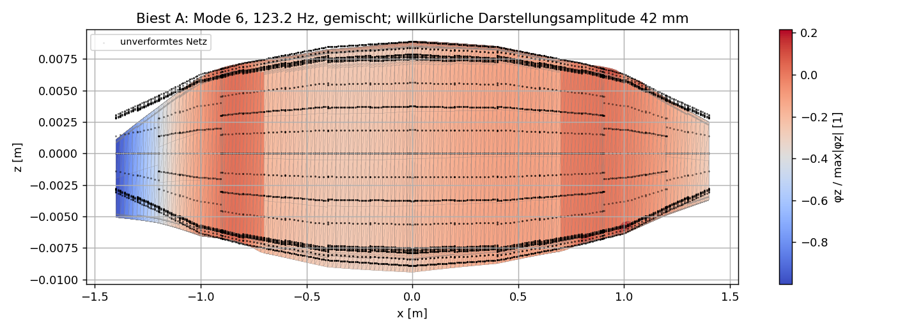


**Lesen:** Seitenprojektion in die x-z-Ebene. Schwarze Punkte: unverformtes Netz; farbige Fläche: Eigenform mit willkürlich gewählter Darstellungsamplitude. Die Farbskala φz/max|φz| ist dimensionslos; die Achsen geben die gezeichneten Koordinaten in m an.

**Einordnung:** Diese Form ist gemischt; der rechnerische Anteil Σuz²/Σ|u|² beträgt 0.452 %. Das ist eine Verschiebungskennzahl, keine effektive Modalmasse oder Energiequote. Sie ist eine weitere räumliche Eigenform und nicht automatisch die gleich nummerierte Balkenmode. Formen mit ähnlicher Frequenz können sich bei Netzänderung mischen oder die Reihenfolge wechseln. Die 2D-Projektion zeigt seitliche Bewegung und Torsion nur eingeschränkt. Weder Amplitude noch Vorzeichen sagen eine reale Schwingungsantwort voraus; die Modalanalyse ist unbelastet und linear.

**FEM A, Netz 3, Laborversuch, linear: Verformung**

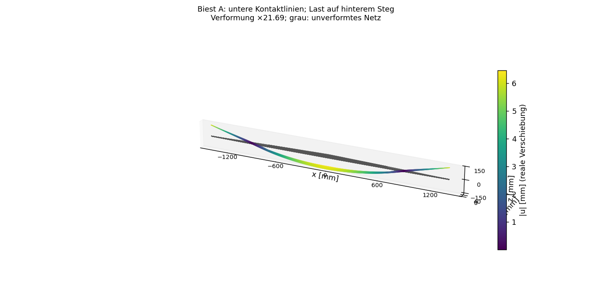


**Lesen:** Grau: unverformte Lage; farbig: verformte Oberfläche mit dem im Bild genannten Faktor. Achsen sind mm. Die Farbe zeigt den realen Betrag |u| [mm], nicht die mit dem Darstellungsfaktor multiplizierte Auslenkung und nicht nur die vertikale Komponente.

**Einordnung:** Die gemittelte vertikale Wurzelverschiebung im Taschenband beträgt -6.218 mm. Die Mitte sinkt ab, freie Überhänge können sich heben. Der größte räumliche Verschiebungsbetrag muss nicht an der Wurzel liegen und darf nicht mit diesem Tabellenwert gleichgesetzt werden. Die Laborversuchslager sind bilateral. Die aktive Lageridealisation ist im FEM-Abschnitt dokumentiert. Bei bottom_contact_line sind nur die Unterseitenknoten auf einer Kontaktlinie vertikal gehalten; die übrigen Querschnittsknoten bleiben vertikal frei und die Außenflügel können die Biegeneigung fortsetzen. Dies ist kein einseitiger Laborversuch mit Kontakt und kein Nachweis realer Kontaktpressungen.

**FEM A, Netz 3, Laborversuch, linear: Verformung im Wurzeldetail**

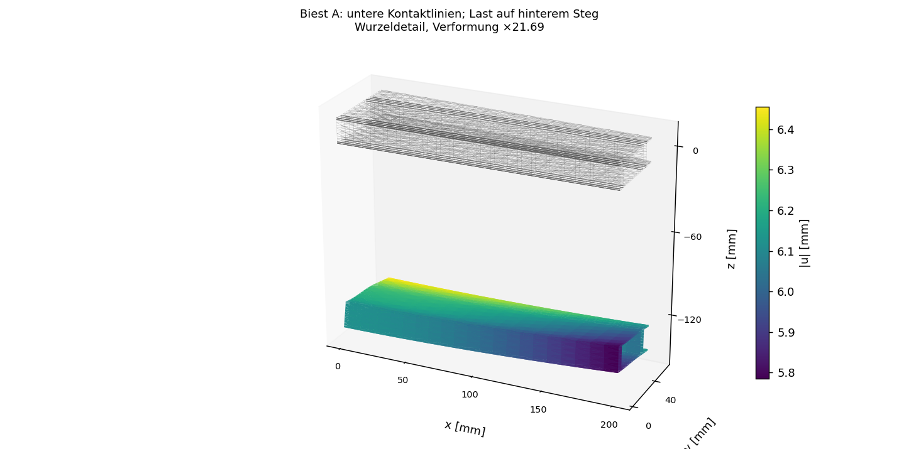


**Lesen:** Wurzelausschnitt derselben Rechnung; keine zusätzliche Laststufe. Grau: unverformte Lage; farbig: verformte Oberfläche mit dem im Bild genannten Faktor. Achsen sind mm. Die Farbe zeigt den realen Betrag |u| [mm], nicht die mit dem Darstellungsfaktor multiplizierte Auslenkung und nicht nur die vertikale Komponente.

**Einordnung:** Die gemittelte vertikale Wurzelverschiebung im Taschenband beträgt -6.218 mm. Die Mitte sinkt ab, freie Überhänge können sich heben. Der größte räumliche Verschiebungsbetrag muss nicht an der Wurzel liegen und darf nicht mit diesem Tabellenwert gleichgesetzt werden. Der Wurzelausschnitt zeigt vor allem lokale Bewegungen und nicht den Verlauf bis zur Spitze. Die Laborversuchslager sind bilateral. Die aktive Lageridealisation ist im FEM-Abschnitt dokumentiert. Bei bottom_contact_line sind nur die Unterseitenknoten auf einer Kontaktlinie vertikal gehalten; die übrigen Querschnittsknoten bleiben vertikal frei und die Außenflügel können die Biegeneigung fortsetzen. Dies ist kein einseitiger Laborversuch mit Kontakt und kein Nachweis realer Kontaktpressungen.

**FEM A, Netz 3, Laborversuch, linear: Netz am Wurzeldetail**


**Lesen:** Wurzelausschnitt derselben Rechnung; keine zusätzliche Laststufe. Gezeigt wird die sichtbare Oberfläche des 3D-Netzes mit insgesamt 67,528 Knoten und 12,434 quadratischen C3D20R-Volumenelementen. Achsen in mm; sichtbare Dreieckslinien stammen auch aus der Darstellung der Elementflächen und sind keine Tetraederelemente.

**Einordnung:** Die schmalen CFK-Schichten erzeugen stark unterschiedliche Elementabmessungen. Feinere Netze prüfen deren Einfluss; eine dichte Oberfläche allein beweist keine Genauigkeit. Innerhalb der Abschnitte teilen Materialien Knoten, an Lagensprüngen verbinden interpolierende Gleichungen nichtpassende Flächen. Das Detail hilft, Last-/Lagerband und dünne Schichten zu erkennen; daraus folgt noch kein konvergierter örtlicher Spannungswert.

**FEM A, Netz 3, Laborversuch, linear: Wurzeldetail des Modells**


**Lesen:** Wurzelausschnitt derselben Rechnung; keine zusätzliche Laststufe. Geometrie aus den tatsächlichen CAD-Eingaben; Achsen in mm. Blau sind die Gurte, grau die CFK-Schläuche, beige die Depronkerne. Verdeckte Innenflächen können in der Außenansicht unsichtbar sein.

**Einordnung:** Hier wird die angenommene Bauweise kontrolliert, nicht die Beanspruchung: gerader hinterer Steg bis zur Spitze, vorderer Steg nur im inneren Bereich, diskrete Gurtdicken in A beziehungsweise durchgehende Wurzellagen in B. Im Wurzelausschnitt ist vor allem die Trennung der beiden Stege wichtig; die 6-mm-Spitze ist hier nicht sichtbar. Flügelschale und ein nachgewiesener steifer Verbinder fehlen weiterhin.

**FEM A, Netz 3, Laborversuch, linear: Längsspannung im Wurzeldetail**

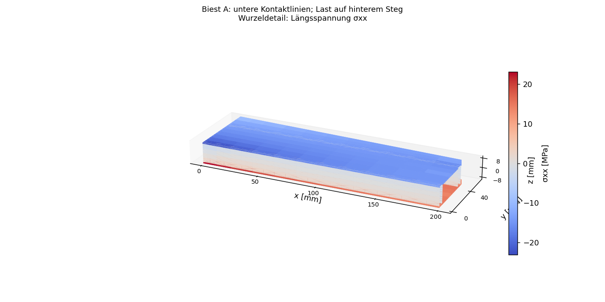


**Lesen:** Wurzelausschnitt derselben Rechnung; keine zusätzliche Laststufe. Unverformte Geometrie mit globaler σxx [MPa]: positiv Zug, negativ Druck, gemäß Farbskala. Gezeigt sind Integrationspunktmittelwerte je Element; es wird nicht über Materialgrenzen geglättet.

**Einordnung:** Der größte Betrag an Integrationspunkten im gesamten Modell beträgt 23.88 MPa; er kann außerhalb des Ausschnitts oder über der gemittelten Elementfarbskala liegen. Die gegensinnigen Normalspannungen in Ober- und Untergurt kennzeichnen Biegung. Im unverformten UD-Gurt verläuft die Faserrichtung entlang x. Bei großen nichtlinearen Rotationen ist globales σxx auch dort nicht automatisch die lokale Faserspannung. Im ±45°-Schlauch ist σxx keine lokale Faserspannung und zeigt auch nicht die gesamte Schubbeanspruchung. Lokale Spitzen an Lagensprüngen, Lasten und Lagern sind netzabhängig. Es fehlen CFK-Festigkeitswerte sowie Klebe-, Delaminations- und Beulnachweise; die Farben bedeuten weder sicher noch gebrochen. Die ideale Verklebung und die jeweiligen Lagerbedingungen beeinflussen die örtliche Lastübertragung.

**FEM A, Netz 3, Laborversuch, linear: Volumennetz**


**Lesen:** Gezeigt wird die sichtbare Oberfläche des 3D-Netzes mit insgesamt 67,528 Knoten und 12,434 quadratischen C3D20R-Volumenelementen. Achsen in mm; sichtbare Dreieckslinien stammen auch aus der Darstellung der Elementflächen und sind keine Tetraederelemente.

**Einordnung:** Die schmalen CFK-Schichten erzeugen stark unterschiedliche Elementabmessungen. Feinere Netze prüfen deren Einfluss; eine dichte Oberfläche allein beweist keine Genauigkeit. Innerhalb der Abschnitte teilen Materialien Knoten, an Lagensprüngen verbinden interpolierende Gleichungen nichtpassende Flächen. Die Modellabmessungen und Lasten sind auf den Netzstufen gleich; nur die Diskretisierung wird verfeinert.

**FEM A, Netz 3, Laborversuch, linear: räumliches Modell**

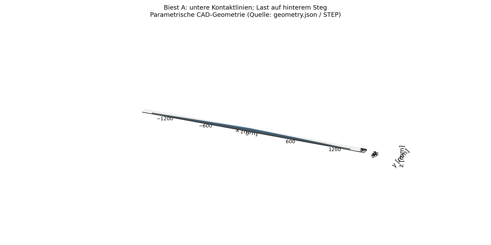


**Lesen:** Geometrie aus den tatsächlichen CAD-Eingaben; Achsen in mm. Blau sind die Gurte, grau die CFK-Schläuche, beige die Depronkerne. Verdeckte Innenflächen können in der Außenansicht unsichtbar sein.

**Einordnung:** Hier wird die angenommene Bauweise kontrolliert, nicht die Beanspruchung: gerader hinterer Steg bis zur Spitze, vorderer Steg nur im inneren Bereich, diskrete Gurtdicken in A beziehungsweise durchgehende Wurzellagen in B. Die äußere Mindestgurtbreite beträgt 6 mm; der Steg verbindet Ober- und Untergurt durchgehend bis zur Spitze. Flügelschale und ein nachgewiesener steifer Verbinder fehlen weiterhin.

**FEM A, Netz 3, Laborversuch, linear: globale Längsspannung**

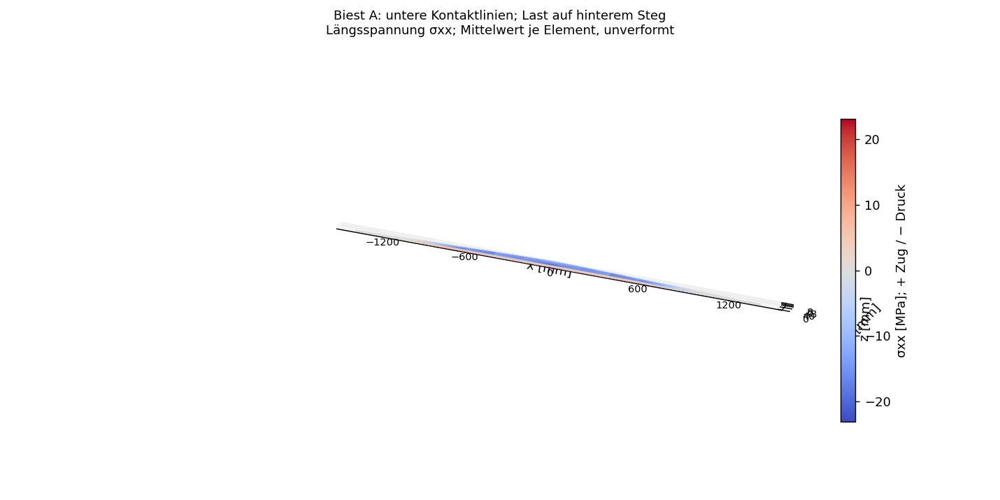


**Lesen:** Unverformte Geometrie mit globaler σxx [MPa]: positiv Zug, negativ Druck, gemäß Farbskala. Gezeigt sind Integrationspunktmittelwerte je Element; es wird nicht über Materialgrenzen geglättet.

**Einordnung:** Der größte Betrag an Integrationspunkten im gesamten Modell beträgt 23.88 MPa; er kann außerhalb des Ausschnitts oder über der gemittelten Elementfarbskala liegen. Die gegensinnigen Normalspannungen in Ober- und Untergurt kennzeichnen Biegung. Im unverformten UD-Gurt verläuft die Faserrichtung entlang x. Bei großen nichtlinearen Rotationen ist globales σxx auch dort nicht automatisch die lokale Faserspannung. Im ±45°-Schlauch ist σxx keine lokale Faserspannung und zeigt auch nicht die gesamte Schubbeanspruchung. Lokale Spitzen an Lagensprüngen, Lasten und Lagern sind netzabhängig. Es fehlen CFK-Festigkeitswerte sowie Klebe-, Delaminations- und Beulnachweise; die Farben bedeuten weder sicher noch gebrochen. Die ideale Verklebung und die jeweiligen Lagerbedingungen beeinflussen die örtliche Lastübertragung.


## FEM-Detailbilder – Fall B

**FEM B: Netzkonvergenz**

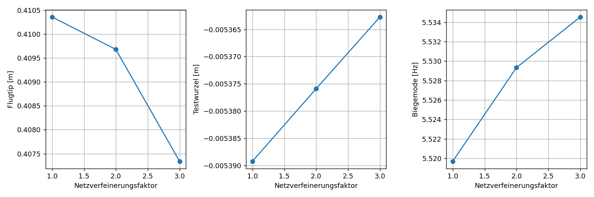


**Lesen:** Drei Teilbilder zeigen Flug-Spitzenverschiebung [m], Laborversuchswurzel [m] und ausgewählte Eigenfrequenz [Hz] gegen den Netzverfeinerungsfaktor. Faktor 3 ist das feinste Netz, keine physische Laststeigerung. Die y-Achsen sind unterschiedlich skaliert.

**Einordnung:** Änderung der letzten beiden Stufen, bezogen auf die feinste: Flugtip 0.574 %, Laborversuchswurzel 0.246 %, ausgewählte Biegemode 0.0939 %. Das konfigurierte Ziel ist erreicht. Der Frequenzgraph zeigt nur eine ausgewählte Form; für den Gesamtstatus werden alle sechs Frequenzen geprüft. Ein optisch flacher Verlauf beweist keine vollständige Konvergenz, insbesondere nicht für lokale Spannungen oder bei Modenwechseln.


### Fall B – Netzstufe 1 – Fluglastfall

**FEM B, Netz 1, Flug, geometrisch nichtlinear: Verformung**

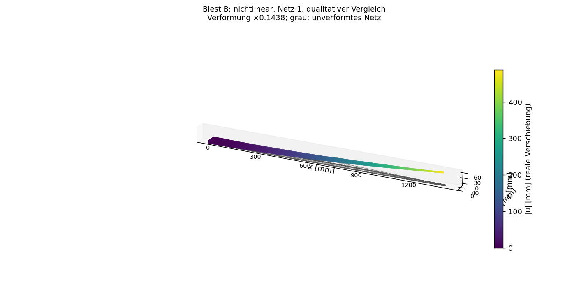


**Lesen:** Grau: unverformte Lage; farbig: verformte Oberfläche mit dem im Bild genannten Faktor. Achsen sind mm. Die Farbe zeigt den realen Betrag |u| [mm], nicht die mit dem Darstellungsfaktor multiplizierte Auslenkung und nicht nur die vertikale Komponente.

**Einordnung:** Die obere Flugtip-Verschiebung uz beträgt 472 mm. Ober- und Untergurt bewegen sich durch den durchgehenden Steg gemeinsam. Geometrisch nichtlinearer Vergleich auf dieser Netzstufe; kein netzkonvergierter nichtlinearer oder CFK-Festigkeitsnachweis.

**FEM B, Netz 1, Flug, geometrisch nichtlinear: Verformung im Wurzeldetail**

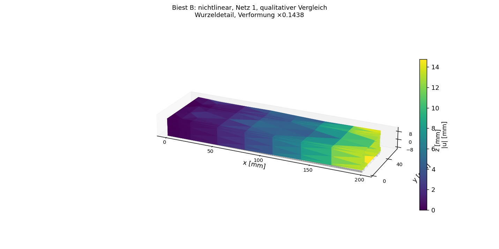


**Lesen:** Wurzelausschnitt derselben Rechnung; keine zusätzliche Laststufe. Grau: unverformte Lage; farbig: verformte Oberfläche mit dem im Bild genannten Faktor. Achsen sind mm. Die Farbe zeigt den realen Betrag |u| [mm], nicht die mit dem Darstellungsfaktor multiplizierte Auslenkung und nicht nur die vertikale Komponente.

**Einordnung:** Die obere Flugtip-Verschiebung uz beträgt 472 mm. Ober- und Untergurt bewegen sich durch den durchgehenden Steg gemeinsam. Der Wurzelausschnitt zeigt vor allem lokale Bewegungen und nicht den Verlauf bis zur Spitze. Geometrisch nichtlinearer Vergleich auf dieser Netzstufe; kein netzkonvergierter nichtlinearer oder CFK-Festigkeitsnachweis.

**FEM B, Netz 1, Flug, geometrisch nichtlinear: Netz am Wurzeldetail**


**Lesen:** Wurzelausschnitt derselben Rechnung; keine zusätzliche Laststufe. Gezeigt wird die sichtbare Oberfläche des 3D-Netzes mit insgesamt 10,536 Knoten und 1,979 quadratischen C3D20R-Volumenelementen. Achsen in mm; sichtbare Dreieckslinien stammen auch aus der Darstellung der Elementflächen und sind keine Tetraederelemente.

**Einordnung:** Die schmalen CFK-Schichten erzeugen stark unterschiedliche Elementabmessungen. Feinere Netze prüfen deren Einfluss; eine dichte Oberfläche allein beweist keine Genauigkeit. Innerhalb der Abschnitte teilen Materialien Knoten, an Lagensprüngen verbinden interpolierende Gleichungen nichtpassende Flächen. Das Detail hilft, Last-/Lagerband und dünne Schichten zu erkennen; daraus folgt noch kein konvergierter örtlicher Spannungswert.

**FEM B, Netz 1, Flug, geometrisch nichtlinear: Wurzeldetail des Modells**

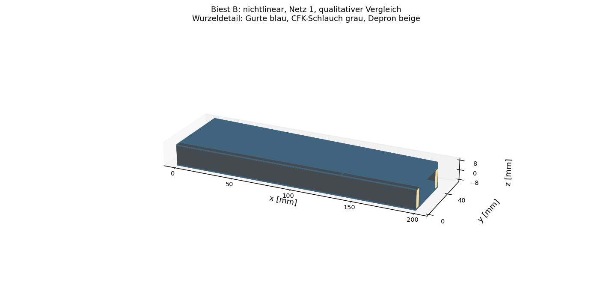


**Lesen:** Wurzelausschnitt derselben Rechnung; keine zusätzliche Laststufe. Geometrie aus den tatsächlichen CAD-Eingaben; Achsen in mm. Blau sind die Gurte, grau die CFK-Schläuche, beige die Depronkerne. Verdeckte Innenflächen können in der Außenansicht unsichtbar sein.

**Einordnung:** Hier wird die angenommene Bauweise kontrolliert, nicht die Beanspruchung: gerader hinterer Steg bis zur Spitze, vorderer Steg nur im inneren Bereich, diskrete Gurtdicken in A beziehungsweise durchgehende Wurzellagen in B. Im Wurzelausschnitt ist vor allem die Trennung der beiden Stege wichtig; die 6-mm-Spitze ist hier nicht sichtbar. Flügelschale und ein nachgewiesener steifer Verbinder fehlen weiterhin.

**FEM B, Netz 1, Flug, geometrisch nichtlinear: Längsspannung im Wurzeldetail**


**Lesen:** Wurzelausschnitt derselben Rechnung; keine zusätzliche Laststufe. Unverformte Geometrie mit globaler σxx [MPa]: positiv Zug, negativ Druck, gemäß Farbskala. Gezeigt sind Integrationspunktmittelwerte je Element; es wird nicht über Materialgrenzen geglättet.

**Einordnung:** Die gegensinnigen Normalspannungen in Ober- und Untergurt kennzeichnen Biegung. Im unverformten UD-Gurt verläuft die Faserrichtung entlang x. Bei großen nichtlinearen Rotationen ist globales σxx auch dort nicht automatisch die lokale Faserspannung. Im ±45°-Schlauch ist σxx keine lokale Faserspannung und zeigt auch nicht die gesamte Schubbeanspruchung. Lokale Spitzen an Lagensprüngen, Lasten und Lagern sind netzabhängig. Es fehlen CFK-Festigkeitswerte sowie Klebe-, Delaminations- und Beulnachweise; die Farben bedeuten weder sicher noch gebrochen. Die ideale Verklebung und die jeweiligen Lagerbedingungen beeinflussen die örtliche Lastübertragung.

**FEM B, Netz 1, Flug, geometrisch nichtlinear: Volumennetz**

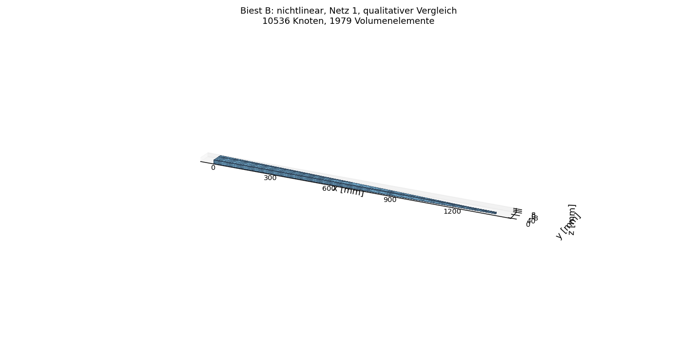


**Lesen:** Gezeigt wird die sichtbare Oberfläche des 3D-Netzes mit insgesamt 10,536 Knoten und 1,979 quadratischen C3D20R-Volumenelementen. Achsen in mm; sichtbare Dreieckslinien stammen auch aus der Darstellung der Elementflächen und sind keine Tetraederelemente.

**Einordnung:** Die schmalen CFK-Schichten erzeugen stark unterschiedliche Elementabmessungen. Feinere Netze prüfen deren Einfluss; eine dichte Oberfläche allein beweist keine Genauigkeit. Innerhalb der Abschnitte teilen Materialien Knoten, an Lagensprüngen verbinden interpolierende Gleichungen nichtpassende Flächen. Die Modellabmessungen und Lasten sind auf den Netzstufen gleich; nur die Diskretisierung wird verfeinert.

**FEM B, Netz 1, Flug, geometrisch nichtlinear: räumliches Modell**


**Lesen:** Geometrie aus den tatsächlichen CAD-Eingaben; Achsen in mm. Blau sind die Gurte, grau die CFK-Schläuche, beige die Depronkerne. Verdeckte Innenflächen können in der Außenansicht unsichtbar sein.

**Einordnung:** Hier wird die angenommene Bauweise kontrolliert, nicht die Beanspruchung: gerader hinterer Steg bis zur Spitze, vorderer Steg nur im inneren Bereich, diskrete Gurtdicken in A beziehungsweise durchgehende Wurzellagen in B. Die äußere Mindestgurtbreite beträgt 6 mm; der Steg verbindet Ober- und Untergurt durchgehend bis zur Spitze. Flügelschale und ein nachgewiesener steifer Verbinder fehlen weiterhin.

**FEM B, Netz 1, Flug, geometrisch nichtlinear: globale Längsspannung**

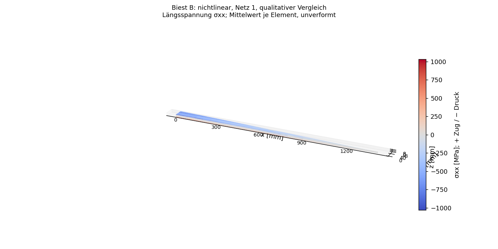


**Lesen:** Unverformte Geometrie mit globaler σxx [MPa]: positiv Zug, negativ Druck, gemäß Farbskala. Gezeigt sind Integrationspunktmittelwerte je Element; es wird nicht über Materialgrenzen geglättet.

**Einordnung:** Die gegensinnigen Normalspannungen in Ober- und Untergurt kennzeichnen Biegung. Im unverformten UD-Gurt verläuft die Faserrichtung entlang x. Bei großen nichtlinearen Rotationen ist globales σxx auch dort nicht automatisch die lokale Faserspannung. Im ±45°-Schlauch ist σxx keine lokale Faserspannung und zeigt auch nicht die gesamte Schubbeanspruchung. Lokale Spitzen an Lagensprüngen, Lasten und Lagern sind netzabhängig. Es fehlen CFK-Festigkeitswerte sowie Klebe-, Delaminations- und Beulnachweise; die Farben bedeuten weder sicher noch gebrochen. Die ideale Verklebung und die jeweiligen Lagerbedingungen beeinflussen die örtliche Lastübertragung.

**FEM B, Netz 1, Flug, linear: Verformung**


**Lesen:** Grau: unverformte Lage; farbig: verformte Oberfläche mit dem im Bild genannten Faktor. Achsen sind mm. Die Farbe zeigt den realen Betrag |u| [mm], nicht die mit dem Darstellungsfaktor multiplizierte Auslenkung und nicht nur die vertikale Komponente.

**Einordnung:** Die obere Flugtip-Verschiebung uz beträgt 410.4 mm. Ober- und Untergurt bewegen sich durch den durchgehenden Steg gemeinsam. Die lineare Flugverformung ist groß relativ zur Halbspannweite. Der Abschlussstatus der nichtlinearen Vergleichsläufe steht oben; der lineare Wert ist kein bestätigter realer Flugzustand.

**FEM B, Netz 1, Flug, linear: Verformung im Wurzeldetail**

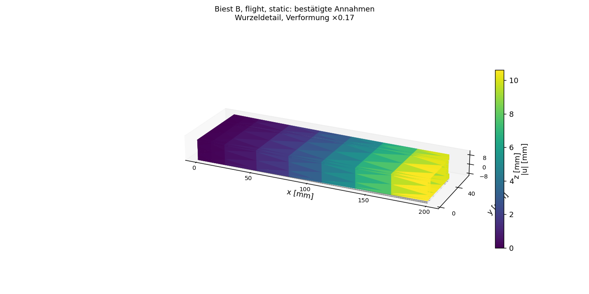


**Lesen:** Wurzelausschnitt derselben Rechnung; keine zusätzliche Laststufe. Grau: unverformte Lage; farbig: verformte Oberfläche mit dem im Bild genannten Faktor. Achsen sind mm. Die Farbe zeigt den realen Betrag |u| [mm], nicht die mit dem Darstellungsfaktor multiplizierte Auslenkung und nicht nur die vertikale Komponente.

**Einordnung:** Die obere Flugtip-Verschiebung uz beträgt 410.4 mm. Ober- und Untergurt bewegen sich durch den durchgehenden Steg gemeinsam. Der Wurzelausschnitt zeigt vor allem lokale Bewegungen und nicht den Verlauf bis zur Spitze. Die lineare Flugverformung ist groß relativ zur Halbspannweite. Der Abschlussstatus der nichtlinearen Vergleichsläufe steht oben; der lineare Wert ist kein bestätigter realer Flugzustand.

**FEM B, Netz 1, Flug, linear: Netz am Wurzeldetail**


**Lesen:** Wurzelausschnitt derselben Rechnung; keine zusätzliche Laststufe. Gezeigt wird die sichtbare Oberfläche des 3D-Netzes mit insgesamt 10,536 Knoten und 1,979 quadratischen C3D20R-Volumenelementen. Achsen in mm; sichtbare Dreieckslinien stammen auch aus der Darstellung der Elementflächen und sind keine Tetraederelemente.

**Einordnung:** Die schmalen CFK-Schichten erzeugen stark unterschiedliche Elementabmessungen. Feinere Netze prüfen deren Einfluss; eine dichte Oberfläche allein beweist keine Genauigkeit. Innerhalb der Abschnitte teilen Materialien Knoten, an Lagensprüngen verbinden interpolierende Gleichungen nichtpassende Flächen. Das Detail hilft, Last-/Lagerband und dünne Schichten zu erkennen; daraus folgt noch kein konvergierter örtlicher Spannungswert.

**FEM B, Netz 1, Flug, linear: Wurzeldetail des Modells**


**Lesen:** Wurzelausschnitt derselben Rechnung; keine zusätzliche Laststufe. Geometrie aus den tatsächlichen CAD-Eingaben; Achsen in mm. Blau sind die Gurte, grau die CFK-Schläuche, beige die Depronkerne. Verdeckte Innenflächen können in der Außenansicht unsichtbar sein.

**Einordnung:** Hier wird die angenommene Bauweise kontrolliert, nicht die Beanspruchung: gerader hinterer Steg bis zur Spitze, vorderer Steg nur im inneren Bereich, diskrete Gurtdicken in A beziehungsweise durchgehende Wurzellagen in B. Im Wurzelausschnitt ist vor allem die Trennung der beiden Stege wichtig; die 6-mm-Spitze ist hier nicht sichtbar. Flügelschale und ein nachgewiesener steifer Verbinder fehlen weiterhin.

**FEM B, Netz 1, Flug, linear: Längsspannung im Wurzeldetail**


**Lesen:** Wurzelausschnitt derselben Rechnung; keine zusätzliche Laststufe. Unverformte Geometrie mit globaler σxx [MPa]: positiv Zug, negativ Druck, gemäß Farbskala. Gezeigt sind Integrationspunktmittelwerte je Element; es wird nicht über Materialgrenzen geglättet.

**Einordnung:** Die gegensinnigen Normalspannungen in Ober- und Untergurt kennzeichnen Biegung. Im unverformten UD-Gurt verläuft die Faserrichtung entlang x. Bei großen nichtlinearen Rotationen ist globales σxx auch dort nicht automatisch die lokale Faserspannung. Im ±45°-Schlauch ist σxx keine lokale Faserspannung und zeigt auch nicht die gesamte Schubbeanspruchung. Lokale Spitzen an Lagensprüngen, Lasten und Lagern sind netzabhängig. Es fehlen CFK-Festigkeitswerte sowie Klebe-, Delaminations- und Beulnachweise; die Farben bedeuten weder sicher noch gebrochen. Wegen der großen linearen Flugverformung sind auch diese Spannungen nur Ergebnisse des linearen Vergleichsmodells.

**FEM B, Netz 1, Flug, linear: Volumennetz**

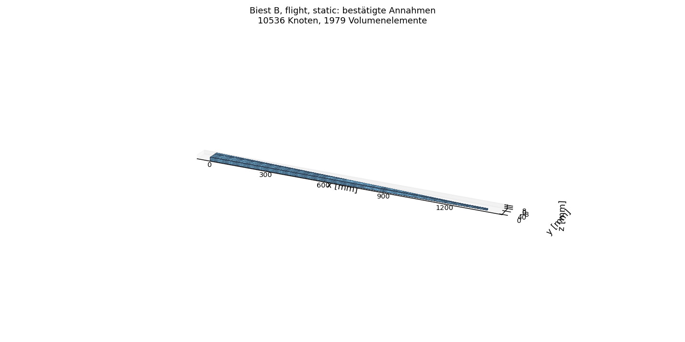


**Lesen:** Gezeigt wird die sichtbare Oberfläche des 3D-Netzes mit insgesamt 10,536 Knoten und 1,979 quadratischen C3D20R-Volumenelementen. Achsen in mm; sichtbare Dreieckslinien stammen auch aus der Darstellung der Elementflächen und sind keine Tetraederelemente.

**Einordnung:** Die schmalen CFK-Schichten erzeugen stark unterschiedliche Elementabmessungen. Feinere Netze prüfen deren Einfluss; eine dichte Oberfläche allein beweist keine Genauigkeit. Innerhalb der Abschnitte teilen Materialien Knoten, an Lagensprüngen verbinden interpolierende Gleichungen nichtpassende Flächen. Die Modellabmessungen und Lasten sind auf den Netzstufen gleich; nur die Diskretisierung wird verfeinert.

**FEM B, Netz 1, Flug, linear: räumliches Modell**


**Lesen:** Geometrie aus den tatsächlichen CAD-Eingaben; Achsen in mm. Blau sind die Gurte, grau die CFK-Schläuche, beige die Depronkerne. Verdeckte Innenflächen können in der Außenansicht unsichtbar sein.

**Einordnung:** Hier wird die angenommene Bauweise kontrolliert, nicht die Beanspruchung: gerader hinterer Steg bis zur Spitze, vorderer Steg nur im inneren Bereich, diskrete Gurtdicken in A beziehungsweise durchgehende Wurzellagen in B. Die äußere Mindestgurtbreite beträgt 6 mm; der Steg verbindet Ober- und Untergurt durchgehend bis zur Spitze. Flügelschale und ein nachgewiesener steifer Verbinder fehlen weiterhin.

**FEM B, Netz 1, Flug, linear: globale Längsspannung**

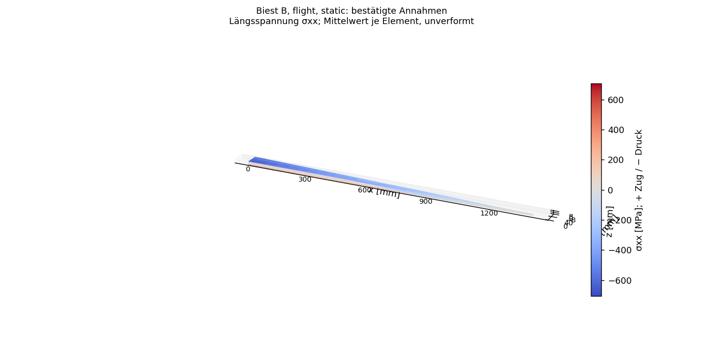


**Lesen:** Unverformte Geometrie mit globaler σxx [MPa]: positiv Zug, negativ Druck, gemäß Farbskala. Gezeigt sind Integrationspunktmittelwerte je Element; es wird nicht über Materialgrenzen geglättet.

**Einordnung:** Die gegensinnigen Normalspannungen in Ober- und Untergurt kennzeichnen Biegung. Im unverformten UD-Gurt verläuft die Faserrichtung entlang x. Bei großen nichtlinearen Rotationen ist globales σxx auch dort nicht automatisch die lokale Faserspannung. Im ±45°-Schlauch ist σxx keine lokale Faserspannung und zeigt auch nicht die gesamte Schubbeanspruchung. Lokale Spitzen an Lagensprüngen, Lasten und Lagern sind netzabhängig. Es fehlen CFK-Festigkeitswerte sowie Klebe-, Delaminations- und Beulnachweise; die Farben bedeuten weder sicher noch gebrochen. Wegen der großen linearen Flugverformung sind auch diese Spannungen nur Ergebnisse des linearen Vergleichsmodells.


### Fall B – Netzstufe 1 – Laborversuch

**FEM B, Netz 1, Laborversuch, linear: Verformung**


**Lesen:** Grau: unverformte Lage; farbig: verformte Oberfläche mit dem im Bild genannten Faktor. Achsen sind mm. Die Farbe zeigt den realen Betrag |u| [mm], nicht die mit dem Darstellungsfaktor multiplizierte Auslenkung und nicht nur die vertikale Komponente.

**Einordnung:** Die gemittelte vertikale Wurzelverschiebung im Taschenband beträgt -5.389 mm. Die Mitte sinkt ab, freie Überhänge können sich heben. Der größte räumliche Verschiebungsbetrag muss nicht an der Wurzel liegen und darf nicht mit diesem Tabellenwert gleichgesetzt werden. Die Laborversuchslager sind bilateral. Die aktive Lageridealisation ist im FEM-Abschnitt dokumentiert. Bei bottom_contact_line sind nur die Unterseitenknoten auf einer Kontaktlinie vertikal gehalten; die übrigen Querschnittsknoten bleiben vertikal frei und die Außenflügel können die Biegeneigung fortsetzen. Dies ist kein einseitiger Laborversuch mit Kontakt und kein Nachweis realer Kontaktpressungen.

**FEM B, Netz 1, Laborversuch, linear: Verformung im Wurzeldetail**

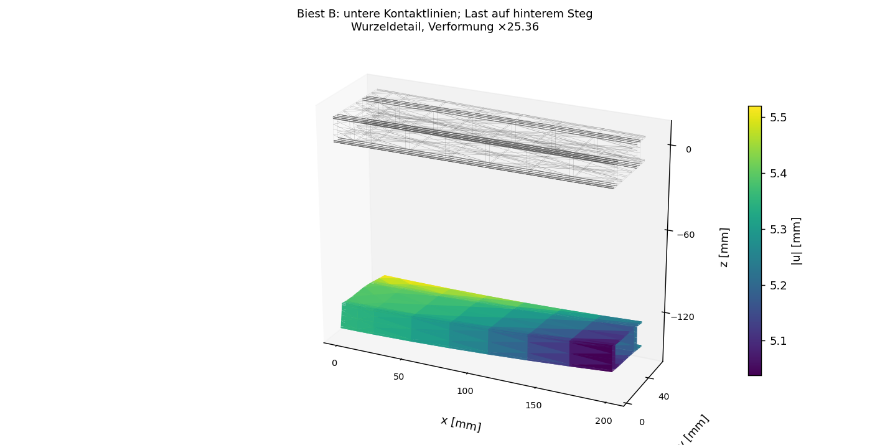


**Lesen:** Wurzelausschnitt derselben Rechnung; keine zusätzliche Laststufe. Grau: unverformte Lage; farbig: verformte Oberfläche mit dem im Bild genannten Faktor. Achsen sind mm. Die Farbe zeigt den realen Betrag |u| [mm], nicht die mit dem Darstellungsfaktor multiplizierte Auslenkung und nicht nur die vertikale Komponente.

**Einordnung:** Die gemittelte vertikale Wurzelverschiebung im Taschenband beträgt -5.389 mm. Die Mitte sinkt ab, freie Überhänge können sich heben. Der größte räumliche Verschiebungsbetrag muss nicht an der Wurzel liegen und darf nicht mit diesem Tabellenwert gleichgesetzt werden. Der Wurzelausschnitt zeigt vor allem lokale Bewegungen und nicht den Verlauf bis zur Spitze. Die Laborversuchslager sind bilateral. Die aktive Lageridealisation ist im FEM-Abschnitt dokumentiert. Bei bottom_contact_line sind nur die Unterseitenknoten auf einer Kontaktlinie vertikal gehalten; die übrigen Querschnittsknoten bleiben vertikal frei und die Außenflügel können die Biegeneigung fortsetzen. Dies ist kein einseitiger Laborversuch mit Kontakt und kein Nachweis realer Kontaktpressungen.

**FEM B, Netz 1, Laborversuch, linear: Netz am Wurzeldetail**


**Lesen:** Wurzelausschnitt derselben Rechnung; keine zusätzliche Laststufe. Gezeigt wird die sichtbare Oberfläche des 3D-Netzes mit insgesamt 20,744 Knoten und 3,958 quadratischen C3D20R-Volumenelementen. Achsen in mm; sichtbare Dreieckslinien stammen auch aus der Darstellung der Elementflächen und sind keine Tetraederelemente.

**Einordnung:** Die schmalen CFK-Schichten erzeugen stark unterschiedliche Elementabmessungen. Feinere Netze prüfen deren Einfluss; eine dichte Oberfläche allein beweist keine Genauigkeit. Innerhalb der Abschnitte teilen Materialien Knoten, an Lagensprüngen verbinden interpolierende Gleichungen nichtpassende Flächen. Das Detail hilft, Last-/Lagerband und dünne Schichten zu erkennen; daraus folgt noch kein konvergierter örtlicher Spannungswert.

**FEM B, Netz 1, Laborversuch, linear: Wurzeldetail des Modells**


**Lesen:** Wurzelausschnitt derselben Rechnung; keine zusätzliche Laststufe. Geometrie aus den tatsächlichen CAD-Eingaben; Achsen in mm. Blau sind die Gurte, grau die CFK-Schläuche, beige die Depronkerne. Verdeckte Innenflächen können in der Außenansicht unsichtbar sein.

**Einordnung:** Hier wird die angenommene Bauweise kontrolliert, nicht die Beanspruchung: gerader hinterer Steg bis zur Spitze, vorderer Steg nur im inneren Bereich, diskrete Gurtdicken in A beziehungsweise durchgehende Wurzellagen in B. Im Wurzelausschnitt ist vor allem die Trennung der beiden Stege wichtig; die 6-mm-Spitze ist hier nicht sichtbar. Flügelschale und ein nachgewiesener steifer Verbinder fehlen weiterhin.

**FEM B, Netz 1, Laborversuch, linear: Längsspannung im Wurzeldetail**

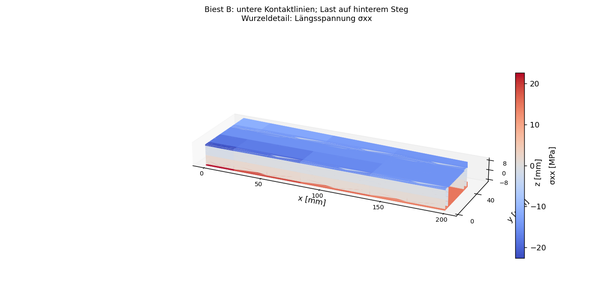


**Lesen:** Wurzelausschnitt derselben Rechnung; keine zusätzliche Laststufe. Unverformte Geometrie mit globaler σxx [MPa]: positiv Zug, negativ Druck, gemäß Farbskala. Gezeigt sind Integrationspunktmittelwerte je Element; es wird nicht über Materialgrenzen geglättet.

**Einordnung:** Die gegensinnigen Normalspannungen in Ober- und Untergurt kennzeichnen Biegung. Im unverformten UD-Gurt verläuft die Faserrichtung entlang x. Bei großen nichtlinearen Rotationen ist globales σxx auch dort nicht automatisch die lokale Faserspannung. Im ±45°-Schlauch ist σxx keine lokale Faserspannung und zeigt auch nicht die gesamte Schubbeanspruchung. Lokale Spitzen an Lagensprüngen, Lasten und Lagern sind netzabhängig. Es fehlen CFK-Festigkeitswerte sowie Klebe-, Delaminations- und Beulnachweise; die Farben bedeuten weder sicher noch gebrochen. Die ideale Verklebung und die jeweiligen Lagerbedingungen beeinflussen die örtliche Lastübertragung.

**FEM B, Netz 1, Laborversuch, linear: Volumennetz**

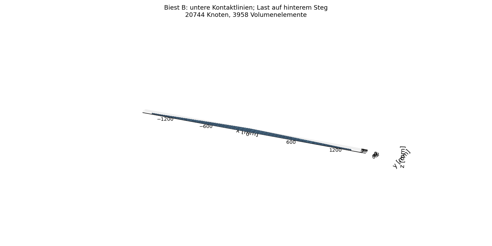


**Lesen:** Gezeigt wird die sichtbare Oberfläche des 3D-Netzes mit insgesamt 20,744 Knoten und 3,958 quadratischen C3D20R-Volumenelementen. Achsen in mm; sichtbare Dreieckslinien stammen auch aus der Darstellung der Elementflächen und sind keine Tetraederelemente.

**Einordnung:** Die schmalen CFK-Schichten erzeugen stark unterschiedliche Elementabmessungen. Feinere Netze prüfen deren Einfluss; eine dichte Oberfläche allein beweist keine Genauigkeit. Innerhalb der Abschnitte teilen Materialien Knoten, an Lagensprüngen verbinden interpolierende Gleichungen nichtpassende Flächen. Die Modellabmessungen und Lasten sind auf den Netzstufen gleich; nur die Diskretisierung wird verfeinert.

**FEM B, Netz 1, Laborversuch, linear: räumliches Modell**


**Lesen:** Geometrie aus den tatsächlichen CAD-Eingaben; Achsen in mm. Blau sind die Gurte, grau die CFK-Schläuche, beige die Depronkerne. Verdeckte Innenflächen können in der Außenansicht unsichtbar sein.

**Einordnung:** Hier wird die angenommene Bauweise kontrolliert, nicht die Beanspruchung: gerader hinterer Steg bis zur Spitze, vorderer Steg nur im inneren Bereich, diskrete Gurtdicken in A beziehungsweise durchgehende Wurzellagen in B. Die äußere Mindestgurtbreite beträgt 6 mm; der Steg verbindet Ober- und Untergurt durchgehend bis zur Spitze. Flügelschale und ein nachgewiesener steifer Verbinder fehlen weiterhin.

**FEM B, Netz 1, Laborversuch, linear: globale Längsspannung**

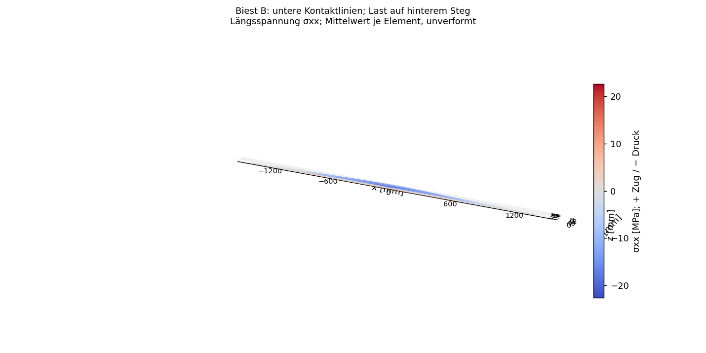


**Lesen:** Unverformte Geometrie mit globaler σxx [MPa]: positiv Zug, negativ Druck, gemäß Farbskala. Gezeigt sind Integrationspunktmittelwerte je Element; es wird nicht über Materialgrenzen geglättet.

**Einordnung:** Die gegensinnigen Normalspannungen in Ober- und Untergurt kennzeichnen Biegung. Im unverformten UD-Gurt verläuft die Faserrichtung entlang x. Bei großen nichtlinearen Rotationen ist globales σxx auch dort nicht automatisch die lokale Faserspannung. Im ±45°-Schlauch ist σxx keine lokale Faserspannung und zeigt auch nicht die gesamte Schubbeanspruchung. Lokale Spitzen an Lagensprüngen, Lasten und Lagern sind netzabhängig. Es fehlen CFK-Festigkeitswerte sowie Klebe-, Delaminations- und Beulnachweise; die Farben bedeuten weder sicher noch gebrochen. Die ideale Verklebung und die jeweiligen Lagerbedingungen beeinflussen die örtliche Lastübertragung.


### Fall B – Netzstufe 3 – Fluglastfall

**FEM B, Netz 3, Flug, linear: Verformung**


**Lesen:** Grau: unverformte Lage; farbig: verformte Oberfläche mit dem im Bild genannten Faktor. Achsen sind mm. Die Farbe zeigt den realen Betrag |u| [mm], nicht die mit dem Darstellungsfaktor multiplizierte Auslenkung und nicht nur die vertikale Komponente.

**Einordnung:** Die obere Flugtip-Verschiebung uz beträgt 407.3 mm. Ober- und Untergurt bewegen sich durch den durchgehenden Steg gemeinsam. Die lineare Flugverformung ist groß relativ zur Halbspannweite. Der Abschlussstatus der nichtlinearen Vergleichsläufe steht oben; der lineare Wert ist kein bestätigter realer Flugzustand.

**FEM B, Netz 3, Flug, linear: Verformung im Wurzeldetail**


**Lesen:** Wurzelausschnitt derselben Rechnung; keine zusätzliche Laststufe. Grau: unverformte Lage; farbig: verformte Oberfläche mit dem im Bild genannten Faktor. Achsen sind mm. Die Farbe zeigt den realen Betrag |u| [mm], nicht die mit dem Darstellungsfaktor multiplizierte Auslenkung und nicht nur die vertikale Komponente.

**Einordnung:** Die obere Flugtip-Verschiebung uz beträgt 407.3 mm. Ober- und Untergurt bewegen sich durch den durchgehenden Steg gemeinsam. Der Wurzelausschnitt zeigt vor allem lokale Bewegungen und nicht den Verlauf bis zur Spitze. Die lineare Flugverformung ist groß relativ zur Halbspannweite. Der Abschlussstatus der nichtlinearen Vergleichsläufe steht oben; der lineare Wert ist kein bestätigter realer Flugzustand.

**FEM B, Netz 3, Flug, linear: Netz am Wurzeldetail**

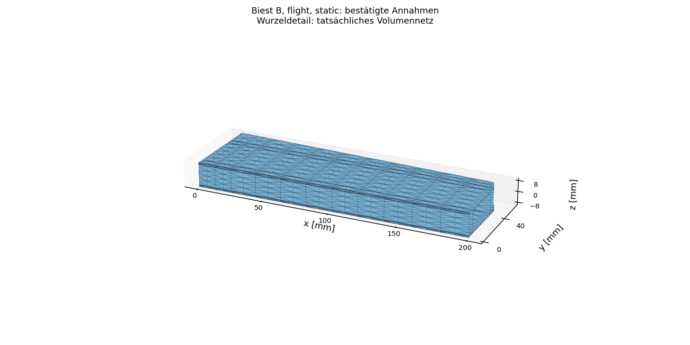


**Lesen:** Wurzelausschnitt derselben Rechnung; keine zusätzliche Laststufe. Gezeigt wird die sichtbare Oberfläche des 3D-Netzes mit insgesamt 32,134 Knoten und 6,147 quadratischen C3D20R-Volumenelementen. Achsen in mm; sichtbare Dreieckslinien stammen auch aus der Darstellung der Elementflächen und sind keine Tetraederelemente.

**Einordnung:** Die schmalen CFK-Schichten erzeugen stark unterschiedliche Elementabmessungen. Feinere Netze prüfen deren Einfluss; eine dichte Oberfläche allein beweist keine Genauigkeit. Innerhalb der Abschnitte teilen Materialien Knoten, an Lagensprüngen verbinden interpolierende Gleichungen nichtpassende Flächen. Das Detail hilft, Last-/Lagerband und dünne Schichten zu erkennen; daraus folgt noch kein konvergierter örtlicher Spannungswert.

**FEM B, Netz 3, Flug, linear: Wurzeldetail des Modells**


**Lesen:** Wurzelausschnitt derselben Rechnung; keine zusätzliche Laststufe. Geometrie aus den tatsächlichen CAD-Eingaben; Achsen in mm. Blau sind die Gurte, grau die CFK-Schläuche, beige die Depronkerne. Verdeckte Innenflächen können in der Außenansicht unsichtbar sein.

**Einordnung:** Hier wird die angenommene Bauweise kontrolliert, nicht die Beanspruchung: gerader hinterer Steg bis zur Spitze, vorderer Steg nur im inneren Bereich, diskrete Gurtdicken in A beziehungsweise durchgehende Wurzellagen in B. Im Wurzelausschnitt ist vor allem die Trennung der beiden Stege wichtig; die 6-mm-Spitze ist hier nicht sichtbar. Flügelschale und ein nachgewiesener steifer Verbinder fehlen weiterhin.

**FEM B, Netz 3, Flug, linear: Längsspannung im Wurzeldetail**

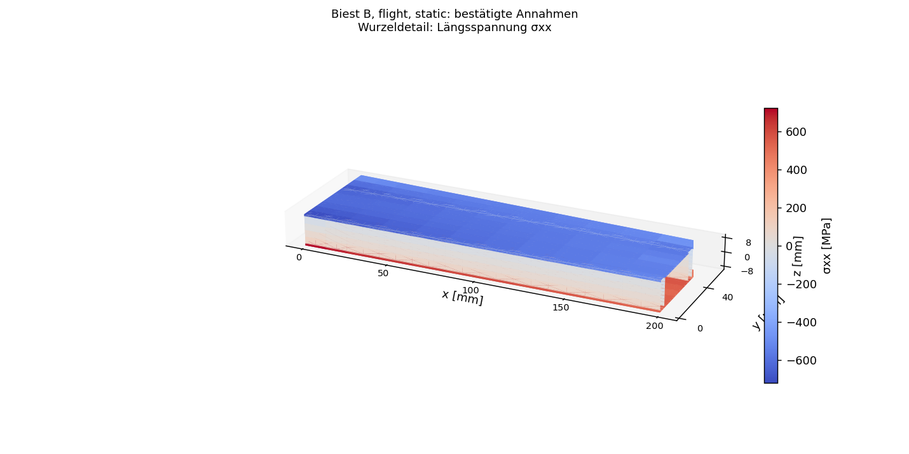


**Lesen:** Wurzelausschnitt derselben Rechnung; keine zusätzliche Laststufe. Unverformte Geometrie mit globaler σxx [MPa]: positiv Zug, negativ Druck, gemäß Farbskala. Gezeigt sind Integrationspunktmittelwerte je Element; es wird nicht über Materialgrenzen geglättet.

**Einordnung:** Der größte Betrag an Integrationspunkten im gesamten Modell beträgt 777.6 MPa; er kann außerhalb des Ausschnitts oder über der gemittelten Elementfarbskala liegen. Die gegensinnigen Normalspannungen in Ober- und Untergurt kennzeichnen Biegung. Im unverformten UD-Gurt verläuft die Faserrichtung entlang x. Bei großen nichtlinearen Rotationen ist globales σxx auch dort nicht automatisch die lokale Faserspannung. Im ±45°-Schlauch ist σxx keine lokale Faserspannung und zeigt auch nicht die gesamte Schubbeanspruchung. Lokale Spitzen an Lagensprüngen, Lasten und Lagern sind netzabhängig. Es fehlen CFK-Festigkeitswerte sowie Klebe-, Delaminations- und Beulnachweise; die Farben bedeuten weder sicher noch gebrochen. Wegen der großen linearen Flugverformung sind auch diese Spannungen nur Ergebnisse des linearen Vergleichsmodells.

**FEM B, Netz 3, Flug, linear: Volumennetz**


**Lesen:** Gezeigt wird die sichtbare Oberfläche des 3D-Netzes mit insgesamt 32,134 Knoten und 6,147 quadratischen C3D20R-Volumenelementen. Achsen in mm; sichtbare Dreieckslinien stammen auch aus der Darstellung der Elementflächen und sind keine Tetraederelemente.

**Einordnung:** Die schmalen CFK-Schichten erzeugen stark unterschiedliche Elementabmessungen. Feinere Netze prüfen deren Einfluss; eine dichte Oberfläche allein beweist keine Genauigkeit. Innerhalb der Abschnitte teilen Materialien Knoten, an Lagensprüngen verbinden interpolierende Gleichungen nichtpassende Flächen. Die Modellabmessungen und Lasten sind auf den Netzstufen gleich; nur die Diskretisierung wird verfeinert.

**FEM B, Netz 3, Flug, linear: räumliches Modell**


**Lesen:** Geometrie aus den tatsächlichen CAD-Eingaben; Achsen in mm. Blau sind die Gurte, grau die CFK-Schläuche, beige die Depronkerne. Verdeckte Innenflächen können in der Außenansicht unsichtbar sein.

**Einordnung:** Hier wird die angenommene Bauweise kontrolliert, nicht die Beanspruchung: gerader hinterer Steg bis zur Spitze, vorderer Steg nur im inneren Bereich, diskrete Gurtdicken in A beziehungsweise durchgehende Wurzellagen in B. Die äußere Mindestgurtbreite beträgt 6 mm; der Steg verbindet Ober- und Untergurt durchgehend bis zur Spitze. Flügelschale und ein nachgewiesener steifer Verbinder fehlen weiterhin.

**FEM B, Netz 3, Flug, linear: globale Längsspannung**


**Lesen:** Unverformte Geometrie mit globaler σxx [MPa]: positiv Zug, negativ Druck, gemäß Farbskala. Gezeigt sind Integrationspunktmittelwerte je Element; es wird nicht über Materialgrenzen geglättet.

**Einordnung:** Der größte Betrag an Integrationspunkten im gesamten Modell beträgt 777.6 MPa; er kann außerhalb des Ausschnitts oder über der gemittelten Elementfarbskala liegen. Die gegensinnigen Normalspannungen in Ober- und Untergurt kennzeichnen Biegung. Im unverformten UD-Gurt verläuft die Faserrichtung entlang x. Bei großen nichtlinearen Rotationen ist globales σxx auch dort nicht automatisch die lokale Faserspannung. Im ±45°-Schlauch ist σxx keine lokale Faserspannung und zeigt auch nicht die gesamte Schubbeanspruchung. Lokale Spitzen an Lagensprüngen, Lasten und Lagern sind netzabhängig. Es fehlen CFK-Festigkeitswerte sowie Klebe-, Delaminations- und Beulnachweise; die Farben bedeuten weder sicher noch gebrochen. Wegen der großen linearen Flugverformung sind auch diese Spannungen nur Ergebnisse des linearen Vergleichsmodells.


### Fall B – Netzstufe 3 – Laborversuch

**FEM B, Netz 3, Laborversuch: Eigenform 1, 5.535 Hz**

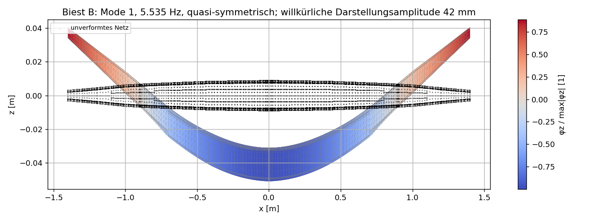


**Lesen:** Seitenprojektion in die x-z-Ebene. Schwarze Punkte: unverformtes Netz; farbige Fläche: Eigenform mit willkürlich gewählter Darstellungsamplitude. Die Farbskala φz/max|φz| ist dimensionslos; die Achsen geben die gezeichneten Koordinaten in m an.

**Einordnung:** Diese Form ist quasi-symmetrisch; der rechnerische Anteil Σuz²/Σ|u|² beträgt 99.9 %. Das ist eine Verschiebungskennzahl, keine effektive Modalmasse oder Energiequote. Sie ist die im Konvergenzgraphen verwendete überwiegend vertikale Form. Formen mit ähnlicher Frequenz können sich bei Netzänderung mischen oder die Reihenfolge wechseln. Die 2D-Projektion zeigt seitliche Bewegung und Torsion nur eingeschränkt. Weder Amplitude noch Vorzeichen sagen eine reale Schwingungsantwort voraus; die Modalanalyse ist unbelastet und linear.

**FEM B, Netz 3, Laborversuch: Eigenform 2, 9.522 Hz**

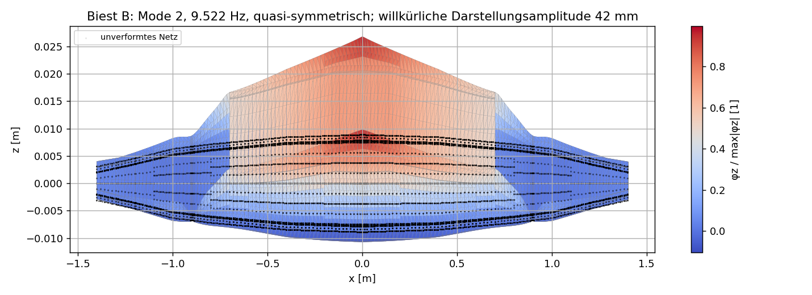


**Lesen:** Seitenprojektion in die x-z-Ebene. Schwarze Punkte: unverformtes Netz; farbige Fläche: Eigenform mit willkürlich gewählter Darstellungsamplitude. Die Farbskala φz/max|φz| ist dimensionslos; die Achsen geben die gezeichneten Koordinaten in m an.

**Einordnung:** Diese Form ist quasi-symmetrisch; der rechnerische Anteil Σuz²/Σ|u|² beträgt 5.04 %. Das ist eine Verschiebungskennzahl, keine effektive Modalmasse oder Energiequote. Sie ist eine weitere räumliche Eigenform und nicht automatisch die gleich nummerierte Balkenmode. Formen mit ähnlicher Frequenz können sich bei Netzänderung mischen oder die Reihenfolge wechseln. Die 2D-Projektion zeigt seitliche Bewegung und Torsion nur eingeschränkt. Weder Amplitude noch Vorzeichen sagen eine reale Schwingungsantwort voraus; die Modalanalyse ist unbelastet und linear.

**FEM B, Netz 3, Laborversuch: Eigenform 3, 55.82 Hz**

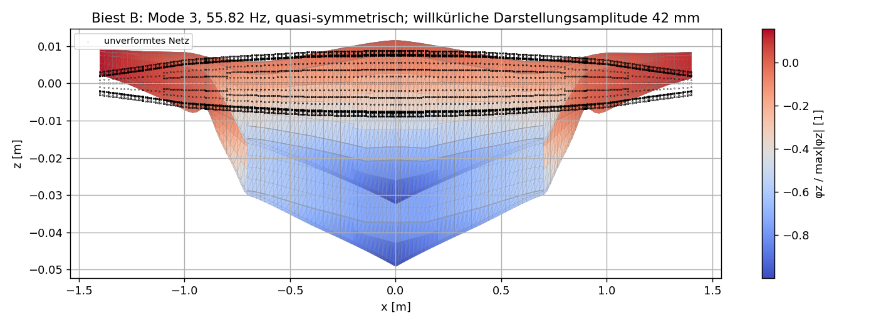


**Lesen:** Seitenprojektion in die x-z-Ebene. Schwarze Punkte: unverformtes Netz; farbige Fläche: Eigenform mit willkürlich gewählter Darstellungsamplitude. Die Farbskala φz/max|φz| ist dimensionslos; die Achsen geben die gezeichneten Koordinaten in m an.

**Einordnung:** Diese Form ist quasi-symmetrisch; der rechnerische Anteil Σuz²/Σ|u|² beträgt 83.2 %. Das ist eine Verschiebungskennzahl, keine effektive Modalmasse oder Energiequote. Sie ist eine weitere räumliche Eigenform und nicht automatisch die gleich nummerierte Balkenmode. Formen mit ähnlicher Frequenz können sich bei Netzänderung mischen oder die Reihenfolge wechseln. Die 2D-Projektion zeigt seitliche Bewegung und Torsion nur eingeschränkt. Weder Amplitude noch Vorzeichen sagen eine reale Schwingungsantwort voraus; die Modalanalyse ist unbelastet und linear.

**FEM B, Netz 3, Laborversuch: Eigenform 4, 92.16 Hz**

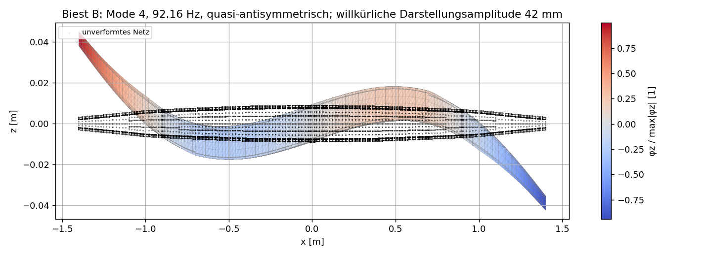


**Lesen:** Seitenprojektion in die x-z-Ebene. Schwarze Punkte: unverformtes Netz; farbige Fläche: Eigenform mit willkürlich gewählter Darstellungsamplitude. Die Farbskala φz/max|φz| ist dimensionslos; die Achsen geben die gezeichneten Koordinaten in m an.

**Einordnung:** Diese Form ist quasi-antisymmetrisch; der rechnerische Anteil Σuz²/Σ|u|² beträgt 99.4 %. Das ist eine Verschiebungskennzahl, keine effektive Modalmasse oder Energiequote. Sie ist eine weitere räumliche Eigenform und nicht automatisch die gleich nummerierte Balkenmode. Formen mit ähnlicher Frequenz können sich bei Netzänderung mischen oder die Reihenfolge wechseln. Die 2D-Projektion zeigt seitliche Bewegung und Torsion nur eingeschränkt. Weder Amplitude noch Vorzeichen sagen eine reale Schwingungsantwort voraus; die Modalanalyse ist unbelastet und linear.

**FEM B, Netz 3, Laborversuch: Eigenform 5, 102.1 Hz**

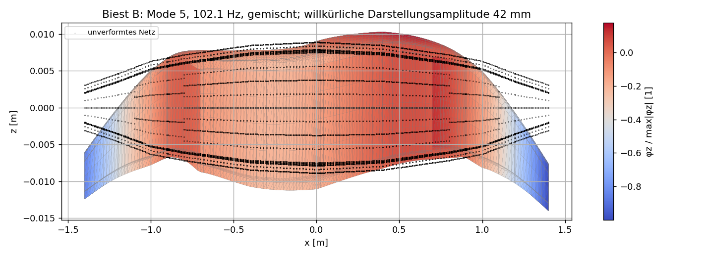


**Lesen:** Seitenprojektion in die x-z-Ebene. Schwarze Punkte: unverformtes Netz; farbige Fläche: Eigenform mit willkürlich gewählter Darstellungsamplitude. Die Farbskala φz/max|φz| ist dimensionslos; die Achsen geben die gezeichneten Koordinaten in m an.

**Einordnung:** Diese Form ist gemischt; der rechnerische Anteil Σuz²/Σ|u|² beträgt 9.49 %. Das ist eine Verschiebungskennzahl, keine effektive Modalmasse oder Energiequote. Sie ist eine weitere räumliche Eigenform und nicht automatisch die gleich nummerierte Balkenmode. Formen mit ähnlicher Frequenz können sich bei Netzänderung mischen oder die Reihenfolge wechseln. Die 2D-Projektion zeigt seitliche Bewegung und Torsion nur eingeschränkt. Weder Amplitude noch Vorzeichen sagen eine reale Schwingungsantwort voraus; die Modalanalyse ist unbelastet und linear.

**FEM B, Netz 3, Laborversuch: Eigenform 6, 115.2 Hz**

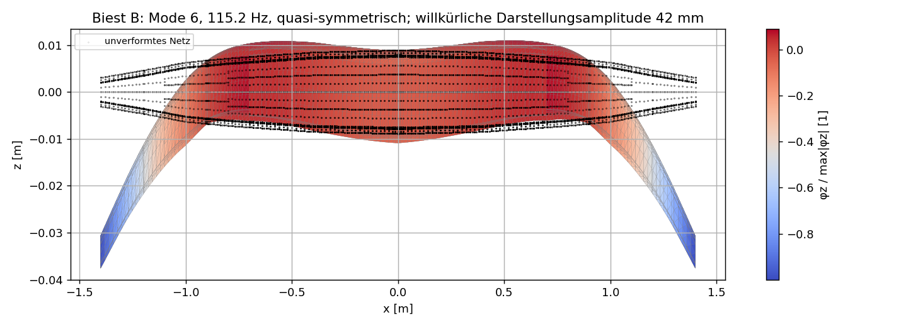


**Lesen:** Seitenprojektion in die x-z-Ebene. Schwarze Punkte: unverformtes Netz; farbige Fläche: Eigenform mit willkürlich gewählter Darstellungsamplitude. Die Farbskala φz/max|φz| ist dimensionslos; die Achsen geben die gezeichneten Koordinaten in m an.

**Einordnung:** Diese Form ist quasi-symmetrisch; der rechnerische Anteil Σuz²/Σ|u|² beträgt 84 %. Das ist eine Verschiebungskennzahl, keine effektive Modalmasse oder Energiequote. Sie ist eine weitere räumliche Eigenform und nicht automatisch die gleich nummerierte Balkenmode. Formen mit ähnlicher Frequenz können sich bei Netzänderung mischen oder die Reihenfolge wechseln. Die 2D-Projektion zeigt seitliche Bewegung und Torsion nur eingeschränkt. Weder Amplitude noch Vorzeichen sagen eine reale Schwingungsantwort voraus; die Modalanalyse ist unbelastet und linear.

**FEM B, Netz 3, Laborversuch, linear: Verformung**

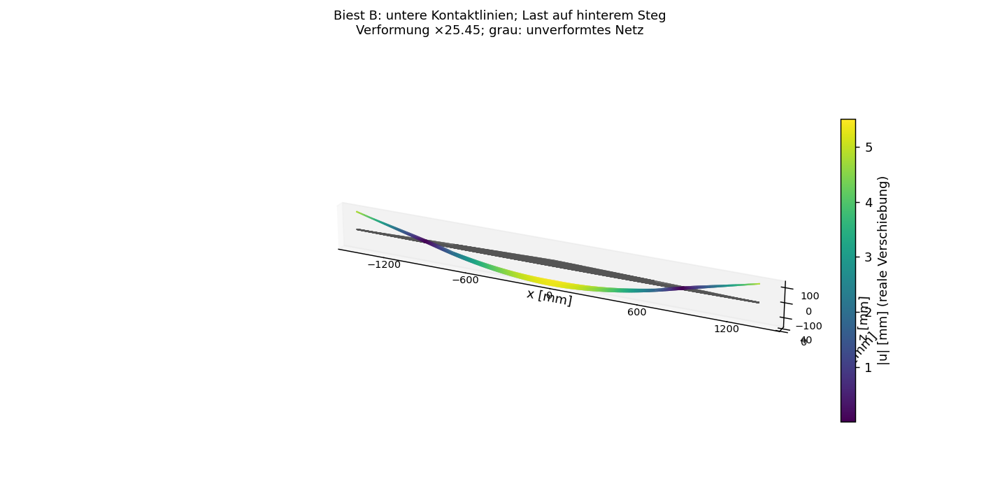


**Lesen:** Grau: unverformte Lage; farbig: verformte Oberfläche mit dem im Bild genannten Faktor. Achsen sind mm. Die Farbe zeigt den realen Betrag |u| [mm], nicht die mit dem Darstellungsfaktor multiplizierte Auslenkung und nicht nur die vertikale Komponente.

**Einordnung:** Die gemittelte vertikale Wurzelverschiebung im Taschenband beträgt -5.363 mm. Die Mitte sinkt ab, freie Überhänge können sich heben. Der größte räumliche Verschiebungsbetrag muss nicht an der Wurzel liegen und darf nicht mit diesem Tabellenwert gleichgesetzt werden. Die Laborversuchslager sind bilateral. Die aktive Lageridealisation ist im FEM-Abschnitt dokumentiert. Bei bottom_contact_line sind nur die Unterseitenknoten auf einer Kontaktlinie vertikal gehalten; die übrigen Querschnittsknoten bleiben vertikal frei und die Außenflügel können die Biegeneigung fortsetzen. Dies ist kein einseitiger Laborversuch mit Kontakt und kein Nachweis realer Kontaktpressungen.

**FEM B, Netz 3, Laborversuch, linear: Verformung im Wurzeldetail**

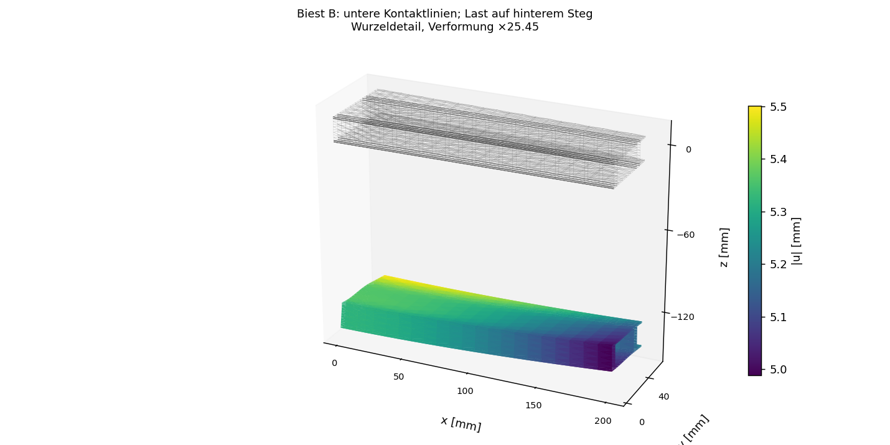


**Lesen:** Wurzelausschnitt derselben Rechnung; keine zusätzliche Laststufe. Grau: unverformte Lage; farbig: verformte Oberfläche mit dem im Bild genannten Faktor. Achsen sind mm. Die Farbe zeigt den realen Betrag |u| [mm], nicht die mit dem Darstellungsfaktor multiplizierte Auslenkung und nicht nur die vertikale Komponente.

**Einordnung:** Die gemittelte vertikale Wurzelverschiebung im Taschenband beträgt -5.363 mm. Die Mitte sinkt ab, freie Überhänge können sich heben. Der größte räumliche Verschiebungsbetrag muss nicht an der Wurzel liegen und darf nicht mit diesem Tabellenwert gleichgesetzt werden. Der Wurzelausschnitt zeigt vor allem lokale Bewegungen und nicht den Verlauf bis zur Spitze. Die Laborversuchslager sind bilateral. Die aktive Lageridealisation ist im FEM-Abschnitt dokumentiert. Bei bottom_contact_line sind nur die Unterseitenknoten auf einer Kontaktlinie vertikal gehalten; die übrigen Querschnittsknoten bleiben vertikal frei und die Außenflügel können die Biegeneigung fortsetzen. Dies ist kein einseitiger Laborversuch mit Kontakt und kein Nachweis realer Kontaktpressungen.

**FEM B, Netz 3, Laborversuch, linear: Netz am Wurzeldetail**


**Lesen:** Wurzelausschnitt derselben Rechnung; keine zusätzliche Laststufe. Gezeigt wird die sichtbare Oberfläche des 3D-Netzes mit insgesamt 63,832 Knoten und 12,294 quadratischen C3D20R-Volumenelementen. Achsen in mm; sichtbare Dreieckslinien stammen auch aus der Darstellung der Elementflächen und sind keine Tetraederelemente.

**Einordnung:** Die schmalen CFK-Schichten erzeugen stark unterschiedliche Elementabmessungen. Feinere Netze prüfen deren Einfluss; eine dichte Oberfläche allein beweist keine Genauigkeit. Innerhalb der Abschnitte teilen Materialien Knoten, an Lagensprüngen verbinden interpolierende Gleichungen nichtpassende Flächen. Das Detail hilft, Last-/Lagerband und dünne Schichten zu erkennen; daraus folgt noch kein konvergierter örtlicher Spannungswert.

**FEM B, Netz 3, Laborversuch, linear: Wurzeldetail des Modells**


**Lesen:** Wurzelausschnitt derselben Rechnung; keine zusätzliche Laststufe. Geometrie aus den tatsächlichen CAD-Eingaben; Achsen in mm. Blau sind die Gurte, grau die CFK-Schläuche, beige die Depronkerne. Verdeckte Innenflächen können in der Außenansicht unsichtbar sein.

**Einordnung:** Hier wird die angenommene Bauweise kontrolliert, nicht die Beanspruchung: gerader hinterer Steg bis zur Spitze, vorderer Steg nur im inneren Bereich, diskrete Gurtdicken in A beziehungsweise durchgehende Wurzellagen in B. Im Wurzelausschnitt ist vor allem die Trennung der beiden Stege wichtig; die 6-mm-Spitze ist hier nicht sichtbar. Flügelschale und ein nachgewiesener steifer Verbinder fehlen weiterhin.

**FEM B, Netz 3, Laborversuch, linear: Längsspannung im Wurzeldetail**


**Lesen:** Wurzelausschnitt derselben Rechnung; keine zusätzliche Laststufe. Unverformte Geometrie mit globaler σxx [MPa]: positiv Zug, negativ Druck, gemäß Farbskala. Gezeigt sind Integrationspunktmittelwerte je Element; es wird nicht über Materialgrenzen geglättet.

**Einordnung:** Der größte Betrag an Integrationspunkten im gesamten Modell beträgt 23.89 MPa; er kann außerhalb des Ausschnitts oder über der gemittelten Elementfarbskala liegen. Die gegensinnigen Normalspannungen in Ober- und Untergurt kennzeichnen Biegung. Im unverformten UD-Gurt verläuft die Faserrichtung entlang x. Bei großen nichtlinearen Rotationen ist globales σxx auch dort nicht automatisch die lokale Faserspannung. Im ±45°-Schlauch ist σxx keine lokale Faserspannung und zeigt auch nicht die gesamte Schubbeanspruchung. Lokale Spitzen an Lagensprüngen, Lasten und Lagern sind netzabhängig. Es fehlen CFK-Festigkeitswerte sowie Klebe-, Delaminations- und Beulnachweise; die Farben bedeuten weder sicher noch gebrochen. Die ideale Verklebung und die jeweiligen Lagerbedingungen beeinflussen die örtliche Lastübertragung.

**FEM B, Netz 3, Laborversuch, linear: Volumennetz**

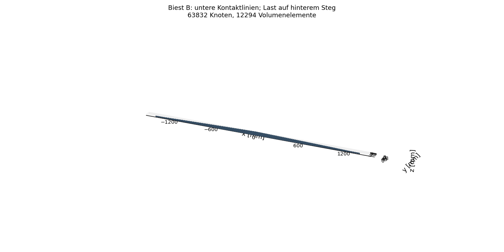


**Lesen:** Gezeigt wird die sichtbare Oberfläche des 3D-Netzes mit insgesamt 63,832 Knoten und 12,294 quadratischen C3D20R-Volumenelementen. Achsen in mm; sichtbare Dreieckslinien stammen auch aus der Darstellung der Elementflächen und sind keine Tetraederelemente.

**Einordnung:** Die schmalen CFK-Schichten erzeugen stark unterschiedliche Elementabmessungen. Feinere Netze prüfen deren Einfluss; eine dichte Oberfläche allein beweist keine Genauigkeit. Innerhalb der Abschnitte teilen Materialien Knoten, an Lagensprüngen verbinden interpolierende Gleichungen nichtpassende Flächen. Die Modellabmessungen und Lasten sind auf den Netzstufen gleich; nur die Diskretisierung wird verfeinert.

**FEM B, Netz 3, Laborversuch, linear: räumliches Modell**

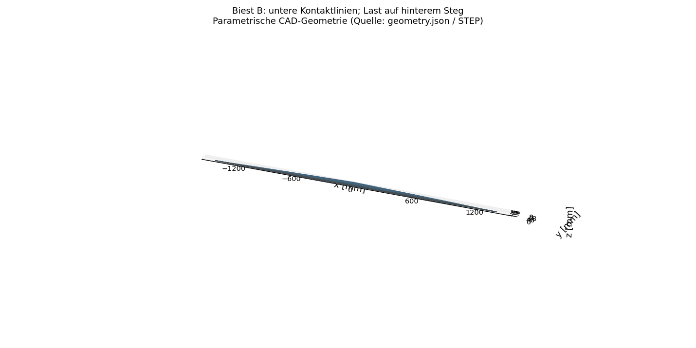


**Lesen:** Geometrie aus den tatsächlichen CAD-Eingaben; Achsen in mm. Blau sind die Gurte, grau die CFK-Schläuche, beige die Depronkerne. Verdeckte Innenflächen können in der Außenansicht unsichtbar sein.

**Einordnung:** Hier wird die angenommene Bauweise kontrolliert, nicht die Beanspruchung: gerader hinterer Steg bis zur Spitze, vorderer Steg nur im inneren Bereich, diskrete Gurtdicken in A beziehungsweise durchgehende Wurzellagen in B. Die äußere Mindestgurtbreite beträgt 6 mm; der Steg verbindet Ober- und Untergurt durchgehend bis zur Spitze. Flügelschale und ein nachgewiesener steifer Verbinder fehlen weiterhin.

**FEM B, Netz 3, Laborversuch, linear: globale Längsspannung**


**Lesen:** Unverformte Geometrie mit globaler σxx [MPa]: positiv Zug, negativ Druck, gemäß Farbskala. Gezeigt sind Integrationspunktmittelwerte je Element; es wird nicht über Materialgrenzen geglättet.

**Einordnung:** Der größte Betrag an Integrationspunkten im gesamten Modell beträgt 23.89 MPa; er kann außerhalb des Ausschnitts oder über der gemittelten Elementfarbskala liegen. Die gegensinnigen Normalspannungen in Ober- und Untergurt kennzeichnen Biegung. Im unverformten UD-Gurt verläuft die Faserrichtung entlang x. Bei großen nichtlinearen Rotationen ist globales σxx auch dort nicht automatisch die lokale Faserspannung. Im ±45°-Schlauch ist σxx keine lokale Faserspannung und zeigt auch nicht die gesamte Schubbeanspruchung. Lokale Spitzen an Lagensprüngen, Lasten und Lagern sind netzabhängig. Es fehlen CFK-Festigkeitswerte sowie Klebe-, Delaminations- und Beulnachweise; die Farben bedeuten weder sicher noch gebrochen. Die ideale Verklebung und die jeweiligen Lagerbedingungen beeinflussen die örtliche Lastübertragung.


## FEM-Bilder des synthetischen Prüffalls – keine Biest-Ergebnisse

**Diese Modelle, Netze und Solverergebnisse gehören ausschließlich zum synthetischen Software-Prüffall. Sie sind kein FEM-Nachweis der Excel-Holmauslegung und kein A/B-Vergleich des Biest-Holms.**
Gezeigt wird der vorhandene homogene I-Holm-Prüffall (L=0,15 m je Halbflügel, E=70 GPa, ν=0,3, ρ=2700 kg/m³) auf seiner feinsten vorhandenen Netzstufe. Die Statik wurde für die Spannungsanforderung erneut mit CalculiX gerechnet. Das 2-%-Konvergenzziel des Laborversuchs war noch nicht erreicht; insbesondere Spannungen an Last- und Lagerstellen sind netzabhängig.
Modellbilder zeigen die parametrischen Körper aus den tatsächlichen CAD-Eingaben; Netzbilder zeigen die zugehörigen quadratischen Tetraeder. Verformungsbilder überlagern das unverformte Netz; Farbskala und Vergrößerungsfaktor sind getrennt angegeben.
Spannungsbilder zeigen globale Längsspannung σxx in MPa, positiv bei Zug und negativ bei Druck. x entspricht der UD-Gurtfaserrichtung; im ±45°-Schlauch ist σxx keine lokale Faserspannung. Dargestellt werden Mittelwerte der echten Integrationspunktspannungen innerhalb jedes Elements, ohne Glättung über Materialgrenzen. Die Farbskala enthält daher nicht zwingend die Integrationspunktspitze. Eine Spannungsdarstellung ist kein CFK-Festigkeitsnachweis.

### Synthetischer Prueffall: Flug-Halbmodell

1846 Knoten, 867 C3D10-Elemente; max. reale Verschiebung 0.0091631 mm. Max. |σxx| an Integrationspunkten: 1.2645 MPa.
[Solverdaten und Herkunft](fem_reference/flight/gallery.json); [CalculiX-Ergebnisdatei](fem_reference/flight/gallery_static.dat).

**Parametrisches räumliches Modell**

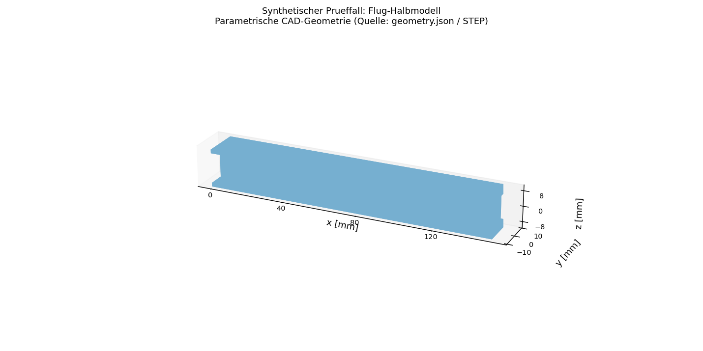

**Lesen:** Achsen in mm; dargestellt ist die parametrische Geometrie des homogenen Referenz-I-Holms.

**Einordnung:** Der einfache, ausdrücklich definierte Querschnitt dient der Softwareprüfung. Seine Steifigkeit und Lastübertragung sind nicht die des CFK-/Depron-Holms; dieses Bild validiert keine Biest-Geometrie.


**Quadratisches Volumennetz**


**Lesen:** Die Drahtdarstellung zeigt die Oberfläche des quadratischen C3D10-Tetraedernetzes; Achsen in mm.

**Einordnung:** Hier wird ein anderer Netz-/Elementadapter als beim aktuellen C3D20R-Biest-Modell geprüft. Die Netzfeinheit und die Genauigkeit des Referenzfalls dürfen nicht auf das Originalmodell übertragen werden.


**Verformung aus CalculiX**

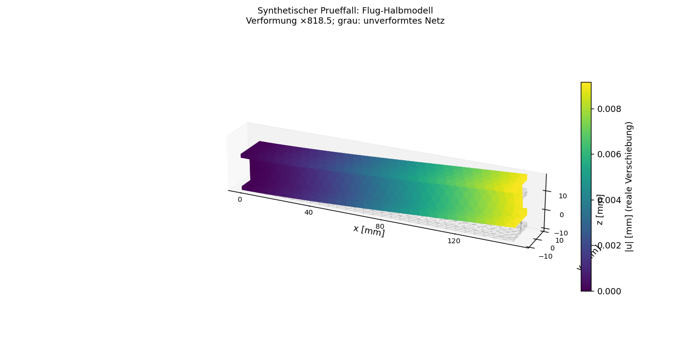

**Lesen:** Grau ist die unverformte Lage; Farbe ist der reale Betrag |u| in mm. Der gezeichnete Weg ist mit dem Bildfaktor vergrößert.

**Einordnung:** Die maximale reale Verschiebung dieses Referenzfalls beträgt 0.009163 mm; die große sichtbare Biegung ist eine Darstellungsvergrößerung. Diese Antwort prüft den definierten Referenzlastfall und ist keine Vorhersage für den Biest-Holm.


**Längsspannung σxx aus CalculiX**


**Lesen:** Globale σxx in MPa auf der unverformten Geometrie; positiv Zug, negativ Druck; Mittelwerte je Element.

**Einordnung:** Maximaler Betrag an Integrationspunkten: 1.264 MPa. Der Zug-/Druckwechsel zwischen den Gurten ist mit Biegung vereinbar. Lokale Spitzen hängen vom Netz und der Lasteinleitung ab. Dies prüft Spannungsexport und Darstellung; es ist kein CFK-Festigkeitsnachweis.


### Synthetischer Prueffall: Laborversuch-Vollmodell

3630 Knoten, 1721 C3D10-Elemente; max. reale Verschiebung 0.0019459 mm. Max. |σxx| an Integrationspunkten: 0.46719 MPa.
[Solverdaten und Herkunft](fem_reference/test/gallery.json); [CalculiX-Ergebnisdatei](fem_reference/test/gallery_static.dat).

**Parametrisches räumliches Modell**


**Lesen:** Achsen in mm; dargestellt ist die parametrische Geometrie des homogenen Referenz-I-Holms.

**Einordnung:** Der einfache, ausdrücklich definierte Querschnitt dient der Softwareprüfung. Seine Steifigkeit und Lastübertragung sind nicht die des CFK-/Depron-Holms; dieses Bild validiert keine Biest-Geometrie.


**Quadratisches Volumennetz**


**Lesen:** Die Drahtdarstellung zeigt die Oberfläche des quadratischen C3D10-Tetraedernetzes; Achsen in mm.

**Einordnung:** Hier wird ein anderer Netz-/Elementadapter als beim aktuellen C3D20R-Biest-Modell geprüft. Die Netzfeinheit und die Genauigkeit des Referenzfalls dürfen nicht auf das Originalmodell übertragen werden.


**Verformung aus CalculiX**


**Lesen:** Grau ist die unverformte Lage; Farbe ist der reale Betrag |u| in mm. Der gezeichnete Weg ist mit dem Bildfaktor vergrößert.

**Einordnung:** Die maximale reale Verschiebung dieses Referenzfalls beträgt 0.001946 mm; die große sichtbare Biegung ist eine Darstellungsvergrößerung. Diese Antwort prüft den definierten Referenzlastfall und ist keine Vorhersage für den Biest-Holm.


**Längsspannung σxx aus CalculiX**

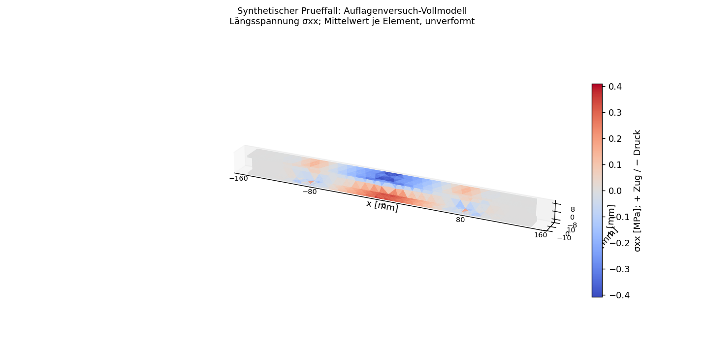

**Lesen:** Globale σxx in MPa auf der unverformten Geometrie; positiv Zug, negativ Druck; Mittelwerte je Element.

**Einordnung:** Maximaler Betrag an Integrationspunkten: 0.4672 MPa. Der Zug-/Druckwechsel zwischen den Gurten ist mit Biegung vereinbar. Lokale Spitzen hängen vom Netz und der Lasteinleitung ab. Dies prüft Spannungsexport und Darstellung; es ist kein CFK-Festigkeitsnachweis.


## Versionen und Reproduzierbarkeit

```json
{
  "python": "3.9.7 (tags/v3.9.7:1016ef3, Aug 30 2021, 20:19:38) [MSC v.1929 64 bit (AMD64)]",
  "packages": {
    "numpy": "2.0.2",
    "scipy": "1.13.1",
    "matplotlib": "3.9.4",
    "xlrd": "2.0.2",
    "openpyxl": "3.1.5",
    "PyYAML": "6.0.3"
  },
  "freecad_python": {
    "path": "C:/Program Files/FreeCAD 1.1/bin/python.exe",
    "available": true,
    "returncode": 0,
    "version": "['1', '1', '4', '20260928 (Git shallow)', 'Unknown', '2026/09/28 13:46:34', '(HEAD detached at 4fd3bf320)', '4fd3bf320d9566a27e60069fc8387448aaa3a094']"
  },
  "calculix": {
    "path": "C:/Program Files/FreeCAD 1.1/bin/ccx.exe",
    "available": true,
    "returncode": 201,
    "version": "This is Version 2.22"
  },
  "gmsh": {
    "path": "C:/Program Files/FreeCAD 1.1/bin/gmsh.exe",
    "available": true,
    "returncode": 0,
    "version": "4.15.0"
  }
}
```

## Offizielle technische Quellen

- [CalculiX 2.22 Handbuch](https://www.dhondt.de/ccx_2.22.pdf): C3D10, C3D20R, *ELASTIC / ENGINEERING CONSTANTS, *ORIENTATION, *SOLID SECTION, *EQUATION, *FREQUENCY, *MASS, *NODE PRINT und *EL PRINT.
- [FreeCAD Part-Scripting](https://github.com/FreeCAD/FreeCAD-documentation/blob/main/wiki/Topological_data_scripting.md): Part-Geometrie und Export.
- [Gmsh-Handbuch](https://gmsh.info/doc/texinfo/gmsh.html): STEP-Import, MSH2, quadratische Tetraeder und Knotenreihenfolge.

Quelle der Excel-Auslegung: Christian Baron, 11/2013; Bearbeitungen und Kommentare der gelieferten Arbeitsmappe bleiben unverändert.

## Separater Software-Prüfnachweis

[Referenztests und tatsächlich ausgeführte synthetische Solverläufe](validation.md). Diese Ergebnisse gehören nicht zur gelieferten Excel-Holmauslegung.

## Numerische Balkenkonvergenz

[Verdopplung der Balkenelemente](beam_convergence.json): relative Änderungen der statischen Durchbiegungen und der ersten sechs Eigenfrequenzen bezogen auf das verfeinerte Modell dokumentiert. Dies prüft die Diskretisierung, nicht die Richtigkeit der Material-/Fertigungsannahmen.

## Unabhängiger einfacher C3D20R-Referenzfall

Ein separater homogener 3D-Kragträger wurde tatsächlich mit CalculiX gerechnet und mit geschlossenen Balkenformeln verglichen. Dieser synthetische Referenzfall prüft Elementexport, Einheiten, Statik und Dynamik; er bestätigt keine Genauigkeit des komplexen Biest-Modells.
Abweichung der Spitzendurchbiegung: -0.747 %; Abweichung der ersten Eigenfrequenz: 0.278 %.
[Eingaben und tatsächliche Referenzergebnisse](c3d20r_reference/validation.json).

## CAD-/Netz-Konsistenz

[Erneut geöffnete CAD-Dateien, gültige Volumenkörper und Vergleich der CAD-/Netzmassen](cad_validation.json).

[Prüfung der tatsächlichen Original-FEM-Dateien und Reaktionsgleichgewichte](original_fem_validation.json).
