# Holmberechnung – Import, Nachrechnung und Ausführungsnachweis

## Aufgabenstellung und Modellumfang

Vergleich A (diskreter Excel-Lagenplan) gegen B (durchgehende jeweilige Wurzellagen). Holm, keine vollständige Flügelsteifigkeit.
x=0 an der Wurzel, x=L an der Halbflügelspitze. Gesamtspannweite 2.8 m; Halbspannweite 1.4 m.

## Tatsächlich ausgeführte Schritte

| Schritt | Status |
|---|---|
| Excel-Inventur, Formeltokens, Cache-/Konsistenzprüfung | ausgeführt, schreibgeschützt |
| Rekonstruktion einfacher Excel-Näherungen | ausgeführt; keine Neuberechnung der Arbeitsmappe |
| Varianten A/B: Statik, Masse, Eigenwertlösung | ausgeführt |
| Räumliche FreeCAD/CalculiX-FEM | ausgeführt |

Originaldatei: `C:\Users\USER\Documents\ChatGPT\Erweiterte_Holmberechnung_nach_Christian_Baron\Holmberechnung_deutsch_korrigiert3_Biest.xls`  
SHA-256: `310f7fe670c74eb42d6dfe5a9c250a67c4957ffa026299d3ba60b1b76c17d7b0`

Vollständige Daten: [Inventur](excel_inventory.json), [SI-Modell](normalized_input.json), [Konfiguration](used_config.yaml), [Diagnose](diagnostics.json), [Ergebnisse](summary.json).

## Fehlende Daten und Annahmen

- Nutzergeometrie: Gurtbreiten max(Excel-Keil, 6 mm); Excel-Datei unverändert. Eingefügte Knickstationen übernehmen die Lagen des ursprünglichen Intervalls.
- ANNAHME: CFK-Schlauchwand max(Excel R, 0.1 mm), damit der durchgehende Steg an der Spitze nicht auf null Wanddicke ausläuft.
- Excel-Flugnäherung M0*L²/(2EI) ist doppelt so groß wie die korrekte Gleichlast-Kragträgerformel q*L⁴/(8EI).
- Altes Excel-I ist größenordnungsmäßig größer als korrigiertes I; alter Formelzweig nicht als Referenz verwenden.
- VORLÄUFIG: Excel-Auslegungsplan als Fertigungsplan angenommen; tatsächliche Fertigung NICHT bestätigt.
- VORLÄUFIG: unveränderter Excel-Auftrieb ist eine Vergleichslast, keine bestätigte Grenz-/Bruchlast; kein Sicherheitsfaktor angewendet.
- Bestätigtes Schlauchmodell: zwei Depronkerne, ±45°-CFK-Wände; Materialwerte bleiben Annahmen. Hinteres Stegende gemäß YAML; Flügelschale nicht enthalten.
- VORLÄUFIG: Materialkennwerte enthalten ausdrücklich bestätigte Beispielannahmen.

Fehlende Eingaben werden nicht automatisch ersetzt. Explizite Annahmen aus der verwendeten YAML sind als vorläufig markiert; Beispiele in `examples/material.example.yaml` werden niemals automatisch eingelesen.
Die E1-Angabe stammt aus der ausgewählten Excel-Materialzeile. Ob sie den tatsächlich ausgehärteten Verbund beschreibt, muss bestätigt werden. Festigkeits-/Beulnachweise und Flugsicherheitsfreigabe sind nicht Gegenstand dieser Rechnung.

## Excel-Inventur und Mapping

| Blatt | belegte Zeilen | Spalten |
|---|---:|---:|
| Berechnung der Werte | 173 | 34 |
| Materialdaten | 84 | 16 |
| Flächensteckung | 69 | 18 |
| Roving-Gelege Umrechnung | 30 | 5 |

Alle belegten Werte, Kommentare, Formelergebnisse und verfügbare Formeltokens stehen in der Inventur. BIFF-Formeltexte sind diagnostisch: xlrd kann Klammern uneindeutig darstellen; Tokens bleiben als verlustfreie Referenz erhalten. Fehlende, Excel-fehlerhafte und durch unabhängige Beziehungen auffällige Caches werden gemeldet. Keine vollständige Excel-Formelauswertung; keine LibreOffice-Neuberechnung ausgeführt.

| Parameter | SI-Wert | Originalwert/-einheit | interne Einheit | Blatt/Zelle | Herkunft / Überschreibung |
|---|---:|---|---|---|---|
| span | 2.8 | 2800 mm | m | Berechnung der Werte!D45 | Excel-Cache |
| total_lift | 2170.83 | 2170.83 N | N | Berechnung der Werte!D37 | Excel-Cache |
| weight | 30 | 30 N | N | Berechnung der Werte!D39 | Excel-Eingabe |
| load_factor | 72.3611 | 72.3611 1 | 1 | Berechnung der Werte!D41 | Excel-Cache |
| E1 | 1.35e+11 | 135000 MPa | Pa | Berechnung der Werte!U68 | Excel-Cache |
| support_fraction | 0.64 | 64 % | 1 | Berechnung der Werte!C145 | Excel-Eingabe |
| test_mass | 3.8 | 3.8 kg | kg | Berechnung der Werte!C144 | Excel-Eingabe |
| modal_mass | 5.58 | 5.58 kg | kg | Berechnung der Werte!C170 | Excel-Eingabe |
| excel_I_old | 4.4903e-07 | 449030 mm4 | m⁴ | Berechnung der Werte!W68 | Excel-Cache |
| excel_I_new | 8.69642e-09 | 8696.42 mm4 | m⁴ | Berechnung der Werte!W78 | Excel-Cache |
| excel_flight_old | 0.0122832 | 12.2832 mm | m | Berechnung der Werte!C126 | Excel-Cache |
| excel_flight_new | 0.634229 | 634.229 mm | m | Berechnung der Werte!G126 | Excel-Cache |
| measured_root | 0.00702 | 7.02 mm | m | Berechnung der Werte!D146 | Excel-Cache |
| measured_tip | 0.005985 | 5.985 mm | m | Berechnung der Werte!D147 | Excel-Cache |
| measured_frequency | 4.5 | 4.5 Hz | Hz | Berechnung der Werte!C173 | Excel-Eingabe |
| measured_stiffness | 5310.26 | 5.31026 N/mm | N/m | Berechnung der Werte!D149 | Excel-Cache |
| excel_test_root | 0.00380672 | 3.80672 mm | m | Berechnung der Werte!C146 | Excel-Cache |
| excel_frequency | 6.66736 | 6.66736 Hz | Hz | Berechnung der Werte!C171 | Excel-Cache |
| stations[111].x | 0 | 0 mm | m | Berechnung der Werte!C111 | Excel-Auslegung/Cache |
| stations[111].width_top | 0.0625 | 62.5 mm | m | Berechnung der Werte!D111 | Excel-Auslegung/Cache |
| stations[111].width_bottom | 0.0625 | 62.5 mm | m | Berechnung der Werte!D111 | Excel-Auslegung/Cache |
| stations[111].height | 0.01778 | 17.78 mm | m | Berechnung der Werte!H111 | Excel-Auslegung/Cache |
| stations[111].clear_height | 0.0158736 | 15.8736 mm | m | Berechnung der Werte!J111 | Excel-Auslegung/Cache |
| stations[111].theoretical_thickness | 0.000953212 | 0.953212 mm | m | Berechnung der Werte!K111 | Excel-Auslegung/Cache |
| stations[111].plies_top | 10 | 10 1 | 1 | Berechnung der Werte!M111 | Excel-Auslegung/Cache |
| stations[111].plies_bottom | 10 | 10 1 | 1 | Berechnung der Werte!M111 | Excel-Auslegung/Cache |
| stations[111].web_required | 0.000379882 | 0.379882 mm | m | Berechnung der Werte!R111 | Excel-Auslegung/Cache |
| stations[112].x | 0.2 | 200 mm | m | Berechnung der Werte!C112 | Excel-Auslegung/Cache |
| stations[112].width_top | 0.0537143 | 53.7143 mm | m | Berechnung der Werte!D112 | Excel-Auslegung/Cache |
| stations[112].width_bottom | 0.0537143 | 53.7143 mm | m | Berechnung der Werte!D112 | Excel-Auslegung/Cache |
| stations[112].height | 0.01735 | 17.35 mm | m | Berechnung der Werte!H112 | Excel-Auslegung/Cache |
| stations[112].clear_height | 0.0157007 | 15.7007 mm | m | Berechnung der Werte!J112 | Excel-Auslegung/Cache |
| stations[112].theoretical_thickness | 0.000824627 | 0.824627 mm | m | Berechnung der Werte!K112 | Excel-Auslegung/Cache |
| stations[112].plies_top | 9 | 9 1 | 1 | Berechnung der Werte!M112 | Excel-Auslegung/Cache |
| stations[112].plies_bottom | 9 | 9 1 | 1 | Berechnung der Werte!M112 | Excel-Auslegung/Cache |
| stations[112].web_required | 0.000329198 | 0.329198 mm | m | Berechnung der Werte!R112 | Excel-Auslegung/Cache |
| stations[113].x | 0.4 | 400 mm | m | Berechnung der Werte!C113 | Excel-Auslegung/Cache |
| stations[113].width_top | 0.0449286 | 44.9286 mm | m | Berechnung der Werte!D113 | Excel-Auslegung/Cache |
| stations[113].width_bottom | 0.0449286 | 44.9286 mm | m | Berechnung der Werte!D113 | Excel-Auslegung/Cache |
| stations[113].height | 0.01692 | 16.92 mm | m | Berechnung der Werte!H113 | Excel-Auslegung/Cache |
| stations[113].clear_height | 0.0155349 | 15.5349 mm | m | Berechnung der Werte!J113 | Excel-Auslegung/Cache |
| stations[113].theoretical_thickness | 0.000692569 | 0.692569 mm | m | Berechnung der Werte!K113 | Excel-Auslegung/Cache |
| stations[113].plies_top | 7 | 7 1 | 1 | Berechnung der Werte!M113 | Excel-Auslegung/Cache |
| stations[113].plies_bottom | 7 | 7 1 | 1 | Berechnung der Werte!M113 | Excel-Auslegung/Cache |
| stations[113].web_required | 0.000277261 | 0.277261 mm | m | Berechnung der Werte!R113 | Excel-Auslegung/Cache |
| stations[114].x | 0.6 | 600 mm | m | Berechnung der Werte!C114 | Excel-Auslegung/Cache |
| stations[114].width_top | 0.0361429 | 36.1429 mm | m | Berechnung der Werte!D114 | Excel-Auslegung/Cache |
| stations[114].width_bottom | 0.0361429 | 36.1429 mm | m | Berechnung der Werte!D114 | Excel-Auslegung/Cache |
| stations[114].height | 0.01563 | 15.63 mm | m | Berechnung der Werte!H114 | Excel-Auslegung/Cache |
| stations[114].clear_height | 0.0144444 | 14.4444 mm | m | Berechnung der Werte!J114 | Excel-Auslegung/Cache |
| stations[114].theoretical_thickness | 0.000592797 | 0.592797 mm | m | Berechnung der Werte!K114 | Excel-Auslegung/Cache |
| stations[114].plies_top | 6 | 6 1 | 1 | Berechnung der Werte!M114 | Excel-Auslegung/Cache |
| stations[114].plies_bottom | 6 | 6 1 | 1 | Berechnung der Werte!M114 | Excel-Auslegung/Cache |
| stations[114].web_required | 0.000238554 | 0.238554 mm | m | Berechnung der Werte!R114 | Excel-Auslegung/Cache |
| stations[115].x | 0.8 | 800 mm | m | Berechnung der Werte!C115 | Excel-Auslegung/Cache |
| stations[115].width_top | 0.0273571 | 27.3571 mm | m | Berechnung der Werte!D115 | Excel-Auslegung/Cache |
| stations[115].width_bottom | 0.0273571 | 27.3571 mm | m | Berechnung der Werte!D115 | Excel-Auslegung/Cache |
| stations[115].height | 0.01434 | 14.34 mm | m | Berechnung der Werte!H115 | Excel-Auslegung/Cache |
| stations[115].clear_height | 0.013389 | 13.389 mm | m | Berechnung der Werte!J115 | Excel-Auslegung/Cache |
| stations[115].theoretical_thickness | 0.0004755 | 0.4755 mm | m | Berechnung der Werte!K115 | Excel-Auslegung/Cache |
| stations[115].plies_top | 5 | 5 1 | 1 | Berechnung der Werte!M115 | Excel-Auslegung/Cache |
| stations[115].plies_bottom | 5 | 5 1 | 1 | Berechnung der Werte!M115 | Excel-Auslegung/Cache |
| stations[115].web_required | 0.000193019 | 0.193019 mm | m | Berechnung der Werte!R115 | Excel-Auslegung/Cache |
| stations[116].x | 0.9 | 900 mm | m | Berechnung der Werte!C116 | Excel-Auslegung/Cache |
| stations[116].width_top | 0.0229643 | 22.9643 mm | m | Berechnung der Werte!D116 | Excel-Auslegung/Cache |
| stations[116].width_bottom | 0.0229643 | 22.9643 mm | m | Berechnung der Werte!D116 | Excel-Auslegung/Cache |
| stations[116].height | 0.01348 | 13.48 mm | m | Berechnung der Werte!H116 | Excel-Auslegung/Cache |
| stations[116].clear_height | 0.0126469 | 12.6469 mm | m | Berechnung der Werte!J116 | Excel-Auslegung/Cache |
| stations[116].theoretical_thickness | 0.000416545 | 0.416545 mm | m | Berechnung der Werte!K116 | Excel-Auslegung/Cache |
| stations[116].plies_top | 5 | 5 1 | 1 | Berechnung der Werte!M116 | Excel-Auslegung/Cache |
| stations[116].plies_bottom | 5 | 5 1 | 1 | Berechnung der Werte!M116 | Excel-Auslegung/Cache |
| stations[116].web_required | 0.000170287 | 0.170287 mm | m | Berechnung der Werte!R116 | Excel-Auslegung/Cache |
| stations[117].x | 1 | 1000 mm | m | Berechnung der Werte!C117 | Excel-Auslegung/Cache |
| stations[117].width_top | 0.0185714 | 18.5714 mm | m | Berechnung der Werte!D117 | Excel-Auslegung/Cache |
| stations[117].width_bottom | 0.0185714 | 18.5714 mm | m | Berechnung der Werte!D117 | Excel-Auslegung/Cache |
| stations[117].height | 0.01262 | 12.62 mm | m | Berechnung der Werte!H117 | Excel-Auslegung/Cache |
| stations[117].clear_height | 0.0119203 | 11.9203 mm | m | Berechnung der Werte!J117 | Excel-Auslegung/Cache |
| stations[117].theoretical_thickness | 0.000349836 | 0.349836 mm | m | Berechnung der Werte!K117 | Excel-Auslegung/Cache |
| stations[117].plies_top | 4 | 4 1 | 1 | Berechnung der Werte!M117 | Excel-Auslegung/Cache |
| stations[117].plies_bottom | 4 | 4 1 | 1 | Berechnung der Werte!M117 | Excel-Auslegung/Cache |
| stations[117].web_required | 0.000144533 | 0.144533 mm | m | Berechnung der Werte!R117 | Excel-Auslegung/Cache |
| stations[118].x | 1.1 | 1100 mm | m | Berechnung der Werte!C118 | Excel-Auslegung/Cache |
| stations[118].width_top | 0.0141786 | 14.1786 mm | m | Berechnung der Werte!D118 | Excel-Auslegung/Cache |
| stations[118].width_bottom | 0.0141786 | 14.1786 mm | m | Berechnung der Werte!D118 | Excel-Auslegung/Cache |
| stations[118].height | 0.0109 | 10.9 mm | m | Berechnung der Werte!H118 | Excel-Auslegung/Cache |
| stations[118].clear_height | 0.0103036 | 10.3036 mm | m | Berechnung der Werte!J118 | Excel-Auslegung/Cache |
| stations[118].theoretical_thickness | 0.000298203 | 0.298203 mm | m | Berechnung der Werte!K118 | Excel-Auslegung/Cache |
| stations[118].plies_top | 3 | 3 1 | 1 | Berechnung der Werte!M118 | Excel-Auslegung/Cache |
| stations[118].plies_bottom | 3 | 3 1 | 1 | Berechnung der Werte!M118 | Excel-Auslegung/Cache |
| stations[118].web_required | 0.000125409 | 0.125409 mm | m | Berechnung der Werte!R118 | Excel-Auslegung/Cache |
| stations[119].x | 1.2 | 1200 mm | m | Berechnung der Werte!C119 | Excel-Auslegung/Cache |
| stations[119].width_top | 0.00978571 | 9.78571 mm | m | Berechnung der Werte!D119 | Excel-Auslegung/Cache |
| stations[119].width_bottom | 0.00978571 | 9.78571 mm | m | Berechnung der Werte!D119 | Excel-Auslegung/Cache |
| stations[119].height | 0.00918 | 9.18 mm | m | Berechnung der Werte!H119 | Excel-Auslegung/Cache |
| stations[119].clear_height | 0.00872644 | 8.72644 mm | m | Berechnung der Werte!J119 | Excel-Auslegung/Cache |
| stations[119].theoretical_thickness | 0.000226781 | 0.226781 mm | m | Berechnung der Werte!K119 | Excel-Auslegung/Cache |
| stations[119].plies_top | 3 | 3 1 | 1 | Berechnung der Werte!M119 | Excel-Auslegung/Cache |
| stations[119].plies_bottom | 3 | 3 1 | 1 | Berechnung der Werte!M119 | Excel-Auslegung/Cache |
| stations[119].web_required | 9.87163e-05 | 0.0987163 mm | m | Berechnung der Werte!R119 | Excel-Auslegung/Cache |
| stations[120].x | 1.3 | 1300 mm | m | Berechnung der Werte!C120 | Excel-Auslegung/Cache |
| stations[120].width_top | 0.00539286 | 5.39286 mm | m | Berechnung der Werte!D120 | Excel-Auslegung/Cache |
| stations[120].width_bottom | 0.00539286 | 5.39286 mm | m | Berechnung der Werte!D120 | Excel-Auslegung/Cache |
| stations[120].height | 0.007675 | 7.675 mm | m | Berechnung der Werte!H120 | Excel-Auslegung/Cache |
| stations[120].clear_height | 0.00743333 | 7.43333 mm | m | Berechnung der Werte!J120 | Excel-Auslegung/Cache |
| stations[120].theoretical_thickness | 0.000120836 | 0.120836 mm | m | Berechnung der Werte!K120 | Excel-Auslegung/Cache |
| stations[120].plies_top | 2 | 2 1 | 1 | Berechnung der Werte!M120 | Excel-Auslegung/Cache |
| stations[120].plies_bottom | 2 | 2 1 | 1 | Berechnung der Werte!M120 | Excel-Auslegung/Cache |
| stations[120].web_required | 5.79446e-05 | 0.0579446 mm | m | Berechnung der Werte!R120 | Excel-Auslegung/Cache |
| stations[121].x | 1.4 | 1400 mm | m | Berechnung der Werte!C121 | Excel-Auslegung/Cache |
| stations[121].width_top | 0.001 | 1 mm | m | Berechnung der Werte!D121 | Excel-Auslegung/Cache |
| stations[121].width_bottom | 0.001 | 1 mm | m | Berechnung der Werte!D121 | Excel-Auslegung/Cache |
| stations[121].height | 0.00617 | 6.17 mm | m | Berechnung der Werte!H121 | Excel-Auslegung/Cache |
| stations[121].clear_height | 0.00617 | 6.17 mm | m | Berechnung der Werte!J121 | Excel-Auslegung/Cache |
| stations[121].theoretical_thickness | 0 | 0 mm | m | Berechnung der Werte!K121 | Excel-Auslegung/Cache |
| stations[121].plies_top | 0 | 0 1 | 1 | Berechnung der Werte!M121 | Excel-Auslegung/Cache |
| stations[121].plies_bottom | 0 | 0 1 | 1 | Berechnung der Werte!M121 | Excel-Auslegung/Cache |
| stations[121].web_required | 0 | 0 mm | m | Berechnung der Werte!R121 | Excel-Auslegung/Cache |

## Rekonstruierte Excel-Näherungen

Die Vorlage bestimmt Auftrieb aus ca, Geschwindigkeit und Fläche; G ist in N angegeben, keine Masse in kg. n=A/G wird geprüft. Die in Excel verwendete konstante Streckenlast integriert zu A/2. Eine explizite Unterscheidung Grenz-/Bruchlast ist nicht vorhanden und muss bestätigt werden.
Die Höhen H (Profil), h (unter Beplankung), h1 (lichte Steghöhe) und t (theoretische Gurtdicke) sind zu unterscheiden. Das Standardmapping verwendet h als Holm-Außenhöhe. Fertigungslagen verschieben Gurtschwerpunkte gegenüber der theoretischen Excel-Geometrie.

Für konstantes EI an der Wurzel gelten:
- Gleichlast-Kragträger: δ=qL⁴/(8EI), M₀=qL²/2. Die ausgeschriebene Excel-Näherung M₀L²/(2EI) überschätzt diesen Referenzfall um Faktor 2.
- Gelenkiger Auflagenversuch, zentrale Kraft: δ₀=F(2pL)³/(48EI). Freie Überhänge ohne Eigengewicht sind krümmungsfrei, aber wegen der Auflagerneigung nicht verschiebungsfrei.
- Zentraler Feder-Masse-Ersatz: k=6EI/(pL)³ und f=√(k/m)/(2π). Strukturmasse fehlt in dieser einfachen Excel-Näherung.

| Größe | neu rekonstruierter Wert | Bedeutung |
|---|---:|---|
| uniform_q_N_m | 775.298 | konstante Halbflügel-Streckenlast N/m |
| root_moment_Nm | 759.792 | Wurzelmoment Nm |
| flight_uniform_root_EI_m | 0.317115 | korrekte Gleichlastformel, m; konstantes korrigiertes Excel-Wurzel-EI |
| excel_written_flight_root_EI_m | 0.634229 | ausgeschriebene Excel-Näherung, m |
| test_root_constant_EI_m | 0.00380672 | Wurzelabsenkung, m; konstantes korrigiertes Excel-Wurzel-EI |
| test_tip_constant_EI_m | 0.00321192 | Spitzenhebung relativ Auflagen, m |
| spring_frequency_excel_mass_Hz | 6.66736 | Feder-Masse-Näherung mit C170, Hz |

Diese Werte verwenden das theoretische Excel-Wurzel-EI und ersetzen keine Rechnung der Fertigungsvarianten. C144 ist die statische Laständerungsmasse; C170 wird separat als gesamte mitbewegte Zentralmasse interpretiert. Ihre physische Bedeutung muss am Aufbau bestätigt werden.

| gespeicherte Excel-/Messgröße | Wert in SI |
|---|---:|
| excel_I_old | 4.4903e-07 |
| excel_I_new | 8.69642e-09 |
| excel_flight_old | 0.0122832 |
| excel_flight_new | 0.634229 |
| measured_root | 0.00702 |
| measured_tip | 0.005985 |
| measured_frequency | 4.5 |
| measured_stiffness | 5310.26 |
| excel_test_root | 0.00380672 |
| excel_frequency | 6.66736 |

## Berechnungsverfahren und Randbedingungen

A verwendet abschnittsweise konstante ganze Lagenzahlen [xᵢ,xᵢ₊₁); der Spitzenwert 0 beschreibt das Ende, kein endliches gurtloses Intervall. Breiten und Höhen werden linear interpoliert. B übernimmt nur die oberen/unteren Wurzellagen; restliche Geometrie bleibt gleich.
Querschnitt: zₙ=Σ(EAz)/Σ(EA), EI=ΣE[Iₑ+A(z−zₙ)²]. Orthotrope Nachgiebigkeitsmatrix ist symmetrisch (νji=νij Ej/Ei) und muss positiv definit sein. Es wird ebene vertikale Biegung um eine gemeinsame Breitenmittellinie angenommen; damit keine Biege-Torsionskopplung. Ein Verbinder wird ohne bestätigten Schub-/Momentenübertragungsmechanismus nicht addiert.
Flug: M(x)=∫ₓᴸq(s)(s−x)ds, κ=M/EI, θ=∫κdx und w=∫θdx. Krümmung wird innerhalb jedes diskreten Lagenintervalls einseitig mit Gaußquadratur integriert; kein Glätten der Steifigkeitssprünge. Zusätzlich eine an allen Geometrie- und Lagensprüngen segmentierte numerische Balkenlösung mit Gaußintegration. Positive Fluglast bedeutet positive Durchbiegung.
Versuch: vollständiger Flügel, zwei vertikale Gelenkauflager bei ±pL (oder expliziten Koordinaten), freie Überhänge, zentrale Last. Die Wurzel ist beweglich und nicht eingespannt. Positive Auflagerbreiten werden in 1D als ideale Gelenke an ihren Mittelpunkten modelliert, in 3D als flächige Bänder; dadurch kann zusätzliche lokale Steifigkeit entstehen.
Dynamik: Euler-Bernoulli-Hermite-Elemente, konsistente verteilte Masse und separate Zentralmasse am beweglichen Wurzelknoten; optional Rotationsträgheit. Vollmodell erfasst symmetrische und antisymmetrische Biegemoden. Zentralmasse ist fest mitbewegend; lose aufgelegte Massen können Kontakt verlieren. Statische Versuchsmasse und dynamische Gesamtmasse werden nicht addiert.
Rayleigh: statische Einheitslast-Biegelinie als zulässige Ansatzfunktion; ω²=φᵀKφ/(φᵀMφ). Effektive Masse m_eff=φᵀMφ/φ(0)². Der mit derselben Ansatzfunktion gebildete Feder-Masse-Wert ist mathematisch identisch und kein unabhängiger Genauigkeitsnachweis. Numerische Eigenwerte sind keine geschlossene Formel.
Schub: optionaler Fluganteil ∫V/(κGA)dx wird separat ausgegeben. Versuch und Eigenwerte bleiben Euler-Bernoulli; keine behauptete Timoshenko-Validierung.

## Variantenvergleich

| Größe | A | B | (B−A)/A |
|---|---:|---:|---:|
| half_spar_mass_kg | 0.140465 | 0.173854 | 23.8 % |
| flight_tip_m | 0.64732 | 0.492217 | -24 % |
| flight_integral_tip_m | 0.64732 | 0.492216 | -24 % |
| test_root_m | -0.0056406 | -0.00494968 | -12.2 % |
| test_right_tip_m | 0.00593223 | 0.00478371 | -19.4 % |
| rayleigh_Hz | 5.38947 | 5.74661 | 6.63 % |

| Eigenform | A [Hz] / Symmetrie | B [Hz] / Symmetrie |
|---|---|---|
| 1 | 5.3894 / symmetrisch | 5.7465 / symmetrisch |
| 2 | 102.45 / antisymmetrisch | 97.917 / antisymmetrisch |
| 3 | 134.63 / symmetrisch | 120.35 / symmetrisch |
| 4 | 170.22 / antisymmetrisch | 169.93 / antisymmetrisch |
| 5 | 234.44 / symmetrisch | 237.64 / symmetrisch |
| 6 | 458.4 / antisymmetrisch | 468.03 / antisymmetrisch |

A: Test-Reaktionsrest 2.845e-07 N; Flugreaktion -1085.4 N, -759.79 Nm. Materialvolumen (Halbflügel) {'top': np.float64(3.3644115853658534e-05), 'bottom': np.float64(3.3644115853658534e-05), 'rear_core': np.float64(8.636594674624427e-05), 'rear_left_0': np.float64(2.1104350650477237e-06), 'rear_left_1': np.float64(2.1104350650477233e-06), 'rear_right_0': np.float64(2.110435065047723e-06), 'rear_right_1': np.float64(2.1104350650477254e-06), 'rear_bottom_0': np.float64(7.622633134389172e-07), 'rear_bottom_1': np.float64(7.622633134389173e-07), 'rear_top_0': np.float64(7.622633134389173e-07), 'rear_top_1': np.float64(7.622633134389172e-07), 'front_core': np.float64(5.077022657614689e-05), 'front_left_0': np.float64(1.561565983431138e-06), 'front_left_1': np.float64(1.561565983431149e-06), 'front_right_0': np.float64(1.5615659834311484e-06), 'front_right_1': np.float64(1.5615659834311363e-06), 'front_bottom_0': np.float64(5.146308559632856e-07), 'front_bottom_1': np.float64(5.146308559632854e-07), 'front_top_0': np.float64(5.146308559632854e-07), 'front_top_1': np.float64(5.146308559632856e-07)}. Max. Flugdurchbiegung 0.64732 m bei x=1.4 m.
**Große Verformung: lineare Rechnung nur bedingt gültig; geometrisch nichtlineare FEM vergleichen.**

B: Test-Reaktionsrest -5.961e-06 N; Flugreaktion -1085.4 N, -759.79 Nm. Materialvolumen (Halbflügel) {'top': np.float64(4.473455284552844e-05), 'bottom': np.float64(4.473455284552844e-05), 'rear_core': np.float64(8.096594674624434e-05), 'rear_left_0': np.float64(2.023735194429595e-06), 'rear_left_1': np.float64(2.0237351944295954e-06), 'rear_right_0': np.float64(2.023735194429594e-06), 'rear_right_1': np.float64(2.023735194429597e-06), 'rear_bottom_0': np.float64(7.622633134389175e-07), 'rear_bottom_1': np.float64(7.622633134389167e-07), 'rear_top_0': np.float64(7.622633134389167e-07), 'rear_top_1': np.float64(7.622633134389175e-07), 'front_core': np.float64(4.957022657614691e-05), 'front_left_0': np.float64(1.5309401612854913e-06), 'front_left_1': np.float64(1.5309401612855023e-06), 'front_right_0': np.float64(1.530940161285502e-06), 'front_right_1': np.float64(1.5309401612854898e-06), 'front_bottom_0': np.float64(5.146308559632857e-07), 'front_bottom_1': np.float64(5.14630855963285e-07), 'front_top_0': np.float64(5.14630855963285e-07), 'front_top_1': np.float64(5.146308559632857e-07)}. Max. Flugdurchbiegung 0.49222 m bei x=1.4 m.
**Große Verformung: lineare Rechnung nur bedingt gültig; geometrisch nichtlineare FEM vergleichen.**

## Räumliche FEM und Netzkonvergenz

Aktives Biest-Schlauchmodell: keilförmige UD-Gurte mit gerader hinterer Kante, hinterer 5-mm-Depronkern bis x=1,40 m; Gurtbreite max(Excel-Keil, 6 mm) mit Knick bei x≈1,28618 m, vorderer bis x=0,70 m. Hintere Kernmitte y=3 mm; Verbindertasche 35 mm breit. Taschenlänge 0,14 m als Excel-basierte Annahme; vorderer Steg danach linear zur Keilkontur geführt. Idealer Verbund. Der Verbinder und seine Tasche werden als Lage-/Freiraumvorgabe dokumentiert, ohne unbelegten Steifigkeitsbeitrag. Jeder CFK-Schlauch besitzt zwei senkrechte Wände und obere/untere Abschnitte, jeweils max(R(x), 0,10 mm) als vorläufige Mindestwanddicke, in zwei halbe ±45°-Teilschichten zerlegt. Orientierungen beziehen sich auf die globale Spannweitenrichtung; die kleine lokale Schräglage des vorderen Stegs wird in der Faserorientierung vernachlässigt. Depron isotrop mit E=20 MPa, ν=0,30, ρ=40 kg/m³; CFK-Werte vorläufig. Der eigene strukturierte 3D-Netzgenerator erzeugt quadratische C3D20R-Hexaeder statt Gmsh-Tetraeder. Alle Materialgrenzen innerhalb eines Intervalls teilen Knoten. Nichtpassende Knoten an Lagensprüngen werden über quadratische Flächen-Verschiebungsinterpolation verbunden, ohne starre Lastspider; zusätzliche lokale Diskretisierungssteifigkeit ist durch Netzverfeinerung zu prüfen. Vorläufe mit linearen C3D8I-Elementen wurden wegen auffälliger lokaler Niedrigfrequenzformen verworfen und werden nicht als validierte Ergebnisse gezeigt.
CAD in mm; der strukturierte Netzgenerator arbeitet direkt in m. Solver: m, N, kg, s, Pa; Dichte kg/m³. E-Modul N/mm² aus Excel wird mit 10⁶ in Pa umgerechnet. UD-Gurtfaser entlang x; Schlauchfasern ±45° zur Spannweitenrichtung in der jeweiligen Wandebene. Ausgegebene σxx sind globale Längsspannungen, nur im UD-Gurt zugleich Fasernormalspannungen.
Lasten werden über die Elementflächen in konsistente Knotenkräfte umgerechnet; kein starrer Lastspider. Auflagen beschränken vertikale Verschiebung auf unteren Flächenbändern; drei weitere skalare Bedingungen verhindern Starrkörperbewegungen in der Ebene. Zusätzliche Zentralmasse verteilt sich über das Lastband. Ein Band kann lokal steifer wirken als die idealisierte Balken-Punktauflage.
Mindestens drei Netzfaktoren; relative Änderung zwischen den letzten zwei Stufen bezogen auf feinste Stufe. Räumliche Modalsuche liefert auch Quer-/Torsionsmoden; deren erste Frequenz darf erst nach Prüfung der Form einer vertikalen Balkenmode zugeordnet werden. Nichtlineare Statik wird separat gerechnet; Modalanalyse ist unbelastet linear, keine vorgespannte Analyse.

Status: **ausgeführt**.

### FEM A

| Netzfaktor | Flugtip [m] | Testwurzel [m] | f₁ [Hz] |
|---|---:|---:|---:|
| 1 | 0.682193 | -0.0112772 | 3.29353 |
| 2 | 0.680233 | -0.0143267 | 2.63644 |
| 3 | 0.67687 | -0.0134086 | 2.80894 |

**Netzkonvergenz:** Konvergenzziel NICHT erreicht.
Änderung der letzten beiden Stufen, bezogen auf die feinste: flight_tip_m: 0.497 %, test_root_m: 6.85 %, frequency_Hz: 6.14 %.
Eigenfrequenzen 1–6 nach Index: 6.14 %, 1.62 %, 2.33 %, 4.49 %, 1.62 %, 1.45 %. Ein Modenwechsel wird damit nicht ausgeschlossen.

**Netz 1: nicht erfolgreich abgeschlossen:** Nichtlinearer Vergleich: Zeitlimit 600s überschritten; kein abgeschlossenes Volllastergebnis. Siehe C:\Users\USER\Documents\ChatGPT\Erweiterte_Holmberechnung_nach_Christian_Baron\results\fem_sandwich_q20\A\level_1\flight\nonlinear.log

FEM-Strukturmasse: Halbflügel 0.140465 kg; Vollflügel 0.280931 kg. Enthält Gurte, CFK-Schläuche und Depron, keine Flügelschale und keine zentrale Zusatzmasse.

Reaktionen der drei gemittelten Vertikalbedingungen (aus dem globalen Gleichgewicht rekonstruiert): links hinten: -28.781 N, links vorne: 47.42 N, rechts: 18.638 N.
**Kontaktgrenze:** Das bilaterale Lagerungsmodell erfordert eine Zug-/Niederhaltereaktion. Lose Unterlagen können diese nicht aufbringen. Für eine physische Nachbildung des Auflagenversuchs müssen Kontaktlage bzw. Lastübertragung über die reale Flügelschale ergänzt werden. Die vorliegenden Werte gelten für die ausdrücklich idealisierten Gelenk-/Mittelungsbedingungen, nicht für einen nachgewiesenen einseitigen Kontaktversuch.

| 3D-Eigenform | Frequenz [Hz] | Symmetrie | Anteil vertikaler Verschiebung |
|---|---:|---|---:|
| 1 | 2.80894 | gemischt | 83.6 % |
| 2 | 6.22942 | gemischt | 68.1 % |
| 3 | 17.5279 | gemischt | 52.3 % |
| 4 | 73.7036 | gemischt | 99.1 % |
| 5 | 78.3387 | gemischt | 99.3 % |
| 6 | 95.2946 | gemischt | 96 % |
Die Zuordnung erfolgt aus den räumlichen Eigenformen; Tabellenindizes sind kein Beweis einer Übereinstimmung mit den reinen 1D-Biegemoden.

| Größe | Balken | räumliche FEM (feinstes Netz) | (FEM−Balken)/Balken |
|---|---:|---:|---:|
| flight_tip_m | 0.64732 | 0.67687 | 4.565 % |
| test_root_m | -0.0056406 | -0.0134086 | 137.7 % |
Frequenzvergleich erfordert Eigenformzuordnung. Die ausgewählte 3D-Form hat überwiegend vertikale Verschiebungen; Biege-Torsions-Mischformen sind möglich und müssen anhand der Bilder geprüft werden. Die Dreipunktstabilisierung der Auflagen erlaubt keine pauschale Annahme exakt symmetrischer/antisymmetrischer räumlicher Moden.

### FEM B

| Netzfaktor | Flugtip [m] | Testwurzel [m] | f₁ [Hz] |
|---|---:|---:|---:|
| 1 | 0.516896 | -0.00665861 | 4.83307 |
| 2 | 0.515758 | -0.00703083 | 4.6018 |
| 3 | 0.512845 | -0.00690111 | 4.68225 |

**Netzkonvergenz:** Konvergenzziel NICHT erreicht.
Änderung der letzten beiden Stufen, bezogen auf die feinste: flight_tip_m: 0.568 %, test_root_m: 1.88 %, frequency_Hz: 1.72 %.
Eigenfrequenzen 1–6 nach Index: 1.72 %, 2.27 %, 3.34 %, 5 %, 1.58 %, 0.842 %. Ein Modenwechsel wird damit nicht ausgeschlossen.

**Netz 1: nicht erfolgreich abgeschlossen:** Nichtlinearer Vergleich: Zeitlimit 600s überschritten; kein abgeschlossenes Volllastergebnis. Siehe C:\Users\USER\Documents\ChatGPT\Erweiterte_Holmberechnung_nach_Christian_Baron\results\fem_sandwich_q20\B\level_1\flight\nonlinear.log

FEM-Strukturmasse: Halbflügel 0.173854 kg; Vollflügel 0.347709 kg. Enthält Gurte, CFK-Schläuche und Depron, keine Flügelschale und keine zentrale Zusatzmasse.

Reaktionen der drei gemittelten Vertikalbedingungen (aus dem globalen Gleichgewicht rekonstruiert): links hinten: -28.781 N, links vorne: 47.42 N, rechts: 18.638 N.
**Kontaktgrenze:** Das bilaterale Lagerungsmodell erfordert eine Zug-/Niederhaltereaktion. Lose Unterlagen können diese nicht aufbringen. Für eine physische Nachbildung des Auflagenversuchs müssen Kontaktlage bzw. Lastübertragung über die reale Flügelschale ergänzt werden. Die vorliegenden Werte gelten für die ausdrücklich idealisierten Gelenk-/Mittelungsbedingungen, nicht für einen nachgewiesenen einseitigen Kontaktversuch.

| 3D-Eigenform | Frequenz [Hz] | Symmetrie | Anteil vertikaler Verschiebung |
|---|---:|---|---:|
| 1 | 4.68225 | gemischt | 95.6 % |
| 2 | 7.95229 | gemischt | 36.2 % |
| 3 | 22.2453 | gemischt | 59.7 % |
| 4 | 74.5403 | gemischt | 99.4 % |
| 5 | 78.0859 | gemischt | 99.7 % |
| 6 | 94.7454 | gemischt | 99.3 % |
Die Zuordnung erfolgt aus den räumlichen Eigenformen; Tabellenindizes sind kein Beweis einer Übereinstimmung mit den reinen 1D-Biegemoden.

| Größe | Balken | räumliche FEM (feinstes Netz) | (FEM−Balken)/Balken |
|---|---:|---:|---:|
| flight_tip_m | 0.492217 | 0.512845 | 4.191 % |
| test_root_m | -0.00494968 | -0.00690111 | 39.43 % |
Frequenzvergleich erfordert Eigenformzuordnung. Die ausgewählte 3D-Form hat überwiegend vertikale Verschiebungen; Biege-Torsions-Mischformen sind möglich und müssen anhand der Bilder geprüft werden. Die Dreipunktstabilisierung der Auflagen erlaubt keine pauschale Annahme exakt symmetrischer/antisymmetrischer räumlicher Moden.

## Bilder

### Geometrie und Lagenplan

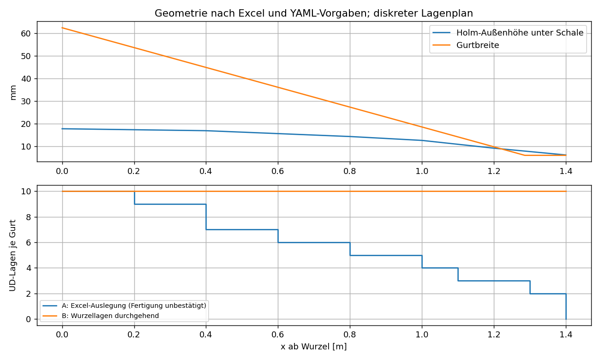


**Lesen:** Oben: Außenhöhe und Gurtbreite in mm über der Halbspannweite x. Unten: UD-Lagen je Gurt; die Stufenlinie A zeigt die diskreten Excel-Intervalle, B die durchgehenden Wurzellagen.

**Einordnung:** Der Gurt folgt dem Keil und bleibt nach Erreichen der YAML-Mindestbreite 6 mm breit. Die Höhe nimmt weiter ab. Der Nullwert der A-Lagen am Endpunkt kennzeichnet das Ende, keinen endlichen gurtlosen Abschnitt. B behält mehr Material außen und ist deshalb steifer und schwerer; die Mindestbreite ändert nicht den Lagenplan.

### Lastfälle und Lagerung

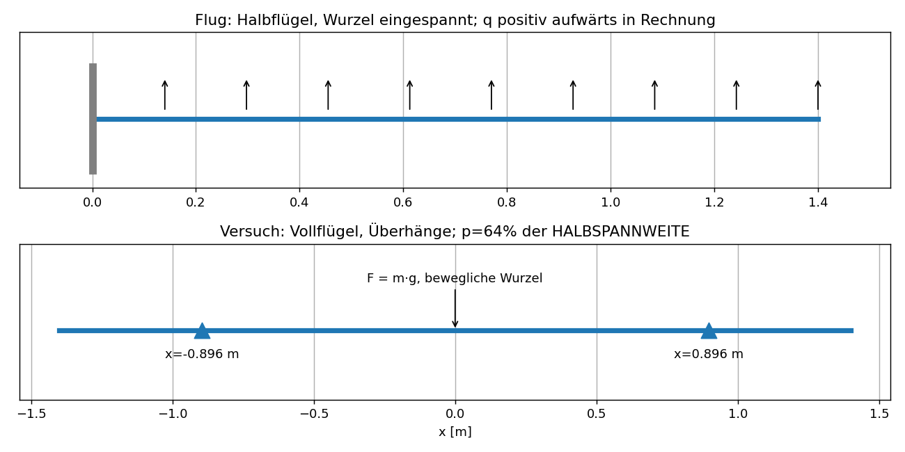


**Lesen:** Oben: eingespannter Halbflügel von 0 bis 1.4 m mit aufwärts gerichteter Fluglast. Unten: vollständiger Flügel mit beweglicher Mitte, zwei Auflagen bei ±0.896 m und zentraler Abwärtskraft.

**Einordnung:** Die Flugeinspannung und die Versuchslager sind unterschiedliche Randbedingungen; ihre Verformungswerte sind nicht direkt vergleichbar. Das Bild zeigt das mechanische Prinzip. In 3D werden endliche Bänder mit drei gemittelten Vertikalbedingungen verwendet, keine idealen einseitigen Kontaktpunkte. Die dafür erforderliche Niederhaltekraft ist oben im FEM-Abschnitt ausgewiesen.

### Balkenvergleich A/B: Steifigkeit, Masse und Verformung

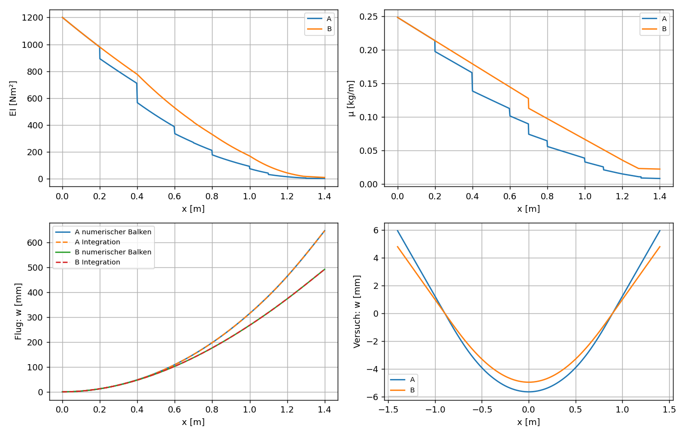


**Lesen:** Vier Teilbilder: oben links Biegesteifigkeit EI [N·m²], oben rechts längenbezogene Masse μ [kg/m], unten links Flugverformung w [mm], unten rechts Auflagenversuch w [mm]. x ist jeweils die Spannweitenkoordinate in m.

**Einordnung:** Lagenabstufungen erzeugen Sprünge in EI und μ bei A; das vordere Stegende bei 0,70 m erzeugt zusätzlich einen Übergang bei beiden Varianten. Mindestbreite und Mindestwanddicke ändern weitere Kurvensteigungen. B liegt außerhalb der Wurzel überwiegend höher: zusätzliche Masse erkauft zusätzliche Steifigkeit. Flugtip im Balken: A: 647.3 mm; B: 492.2 mm. Die gestrichelte Krümmungsintegration und die numerische Balkenlösung liegen fast übereinander; das ist eine interne Verfahrensprüfung, kein unabhängiger Bauteilnachweis. Im Versuch sinkt die Mitte ab (A: -5.641 mm; B: -4.95 mm); die freien Überhänge heben sich durch die Auflagerneigung. Die großen Flugverformungen verlangen eine nichtlineare Prüfung; deren Volllastläufe sind hier nicht abgeschlossen.

### Fluglast, Querkraft, Biegemoment und Krümmung

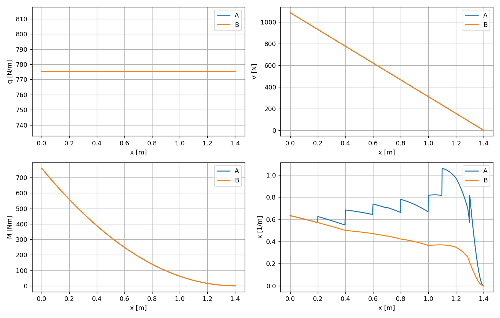


**Lesen:** Oben links Gleichlast q [N/m], oben rechts Querkraft V [N], unten links Moment M [N·m], unten rechts Krümmung κ=M/EI [1/m]. Alle vier Kurven beziehen sich auf den Flug-Halbflügel; A/B-Farben können bei gleichen Werten vollständig übereinanderliegen.

**Einordnung:** Die Last q≈775.3 N/m ist für A/B gleich. V nimmt zur freien Spitze linear, M quadratisch auf null ab; an der Wurzel wird M≈759.8 N·m übertragen. Unterschiede entstehen erst in κ über das jeweilige EI. Die Krümmungssprünge bei A sind Steifigkeitssprünge, keine zusätzlichen äußeren Kräfte. Dass κ außen bei A steigen kann, obwohl M fällt, erklärt sich aus dem noch stärkeren EI-Abfall. κ ist weder Spannung noch Bruchkriterium.

### Normierte Biegeeigenformen des 1D-Balkens

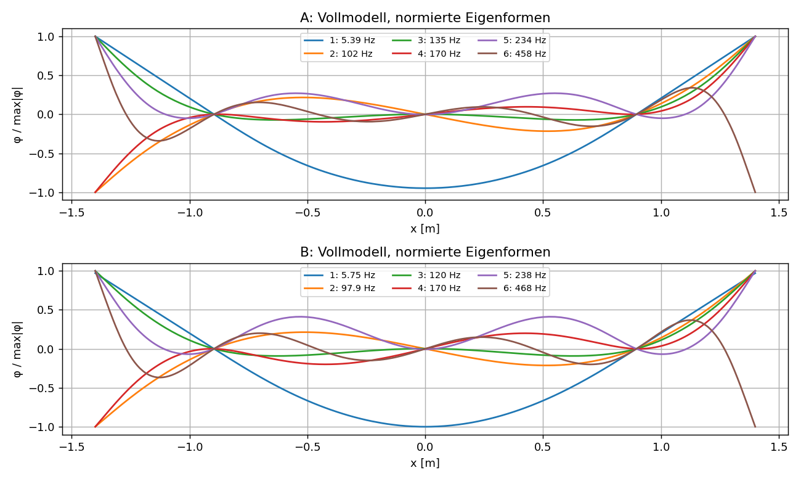


**Lesen:** Je ein Teilbild für A und B: x über den ganzen Flügel, vertikal φ/max|φ| ohne Einheit. Die Legende nennt die Eigenfrequenz jeder Kurve. Vorzeichen und Amplitude einer Eigenform sind frei wählbar.

**Einordnung:** Die erste Balkenfrequenz beträgt A: 5.389 Hz; B: 5.747 Hz. Weitere Vorzeichenwechsel kennzeichnen höhere Biegeformen. Eine hohe normierte Auslenkung ist keine vorhergesagte Schwingungsamplitude. Die Zentralmasse wirkt besonders auf Formen mit großer Bewegung in der Mitte. Der 1D-Balken beschreibt reine vertikale Biegung; 3D-FEM-Indizes können wegen Torsions- und Mischformen nicht ungeprüft zugeordnet werden.

### Tatsächliche Wurzelquerschnitte A und B


**Lesen:** Die beiden Teilbilder zeigen y und z in mm. Blau: UD-Gurte; beige: Depron; grau: CFK-Schlauch. Die Querpositionen der beiden Stege und der freie Taschenbereich werden geometrisch dargestellt.

**Einordnung:** A und B besitzen dieselben Wurzellagen und damit hier denselben Querschnitt. Ihre Unterschiede entstehen weiter außen. Der große Abstand zwischen Ober- und Untergurt erzeugt die hohe Biegesteifigkeit; die Stege übertragen Schub zwischen den Gurten. Eine gleiche Wurzelgeometrie bedeutet daher nicht gleiche Gesamtverformung oder Gesamtmasse. Ein zusätzlicher Verbinder-Steifigkeitsbeitrag ist nicht enthalten.

### Geometrieskizze und Spitzenquerschnitt


**Lesen:** Draufsicht, Wurzelquerschnitt und vergrößerter Spitzenquerschnitt B. Maßangaben sind maßgebend; die Gesamtzeichnung ist schematisch. Der hintere Steg läuft bis 1,40 m, der vordere bis 0,70 m.

**Einordnung:** Die konstante 6-mm-Gurtbreite schafft Platz für den unverändert 5 mm breiten Kern und den CFK-Schlauch. Der Steg bleibt bis zur Spitze mit beiden Gurten verbunden; der frühere stegfreie Bereich entfällt. Die Mindestwanddicke 0,10 mm ist eine Annahme, kein aus Excel oder Messung bestätigter Fertigungswert. Diese Skizze erläutert Eingaben und enthält selbst kein Solverergebnis.

[Skizze als verlustfrei vergrößerbare SVG öffnen](images/stegannahmen.svg).


**Geänderte Spitzengeometrie:** Hinterer Steg bis 1,40 m; Gurt mindestens 6 mm. Die CFK-Mindestwanddicke 0,10 mm bleibt eine Annahme. Die reale Flügelschale ist nicht enthalten. Frühere Messwerte dienen nur bei identischem tatsächlichem Bauzustand zur Validierung dieser neuen Variante.

Flug-Spitzenverschiebung bezeichnet den belasteten oberen Gurt; der untere Gurt wird in der JSON/CSV getrennt ausgewiesen. Die Versuchswurzel wird über die obere Gurtfläche im 35-mm-Taschenbereich bei x=0 gemittelt. Zentrale Kraft und Masse wirken über dieses Taschenband und 50 mm in Spannweitenrichtung. Nichtlineare Statik wird für den großen Fluglastfall versucht; beim kleinen Auflagenversuch bleibt die Statik linear. [FEM-Ergebnistabelle als CSV](fem_summary.csv).

Die drei gemittelten Vertikalbedingungen der Auflagenbänder unterdrücken Starrkörperbewegungen, lassen aber die Rotation in Spannweitenrichtung frei. Eine flächige Fixierung aller Auflagenknoten wird im aktiven Modell ausdrücklich nicht verwendet. Reaktionskräfte werden aus den ursprünglichen Flächenknoten zurückgewonnen.


### fem_sandwich_q20/A

**FEM A: Netzkonvergenz**

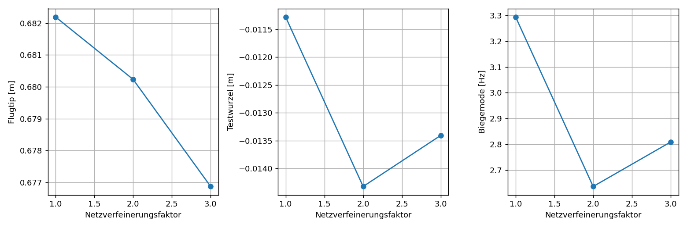


**Lesen:** Drei Teilbilder zeigen Flug-Spitzenverschiebung [m], Versuchswurzel [m] und ausgewählte Eigenfrequenz [Hz] gegen den Netzverfeinerungsfaktor. Faktor 3 ist das feinste Netz, keine physische Laststeigerung. Die y-Achsen sind unterschiedlich skaliert.

**Einordnung:** Änderung der letzten beiden Stufen, bezogen auf die feinste: Flugtip 0.497 %, Versuchswurzel 6.85 %, ausgewählte Biegemode 6.14 %. Das 2-%-Ziel ist nicht für alle geprüften Größen erreicht. Der Frequenzgraph zeigt nur eine ausgewählte Form; für den Gesamtstatus werden alle sechs Frequenzen geprüft. Ein optisch flacher Verlauf beweist keine vollständige Konvergenz, insbesondere nicht für lokale Spannungen oder bei Modenwechseln.


### fem_sandwich_q20/A/level_1/flight

**FEM A, Netz 1, Flug: Verformung**


**Lesen:** Grau: unverformte Lage; farbig: verformte Oberfläche mit dem im Bild genannten Faktor. Achsen sind mm. Die Farbe zeigt den realen Betrag |u| [mm], nicht die mit dem Darstellungsfaktor multiplizierte Auslenkung und nicht nur die vertikale Komponente.

**Einordnung:** Die obere Flugtip-Verschiebung uz beträgt 682.2 mm. Ober- und Untergurt bewegen sich durch den durchgehenden Steg gemeinsam; der alte freie Gurtauslauf ist beseitigt. Die lineare Flugverformung ist groß relativ zur Halbspannweite; die nichtlinearen Versuche lieferten kein abgeschlossenes Volllastergebnis. Der Wert ist damit kein bestätigter realer Flugzustand.

**FEM A, Netz 1, Flug: Verformung im Wurzeldetail**

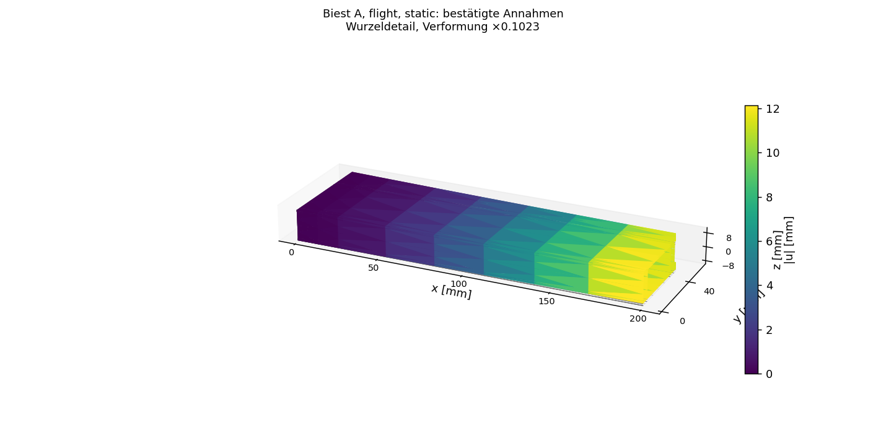


**Lesen:** Wurzelausschnitt derselben Rechnung; keine zusätzliche Laststufe. Grau: unverformte Lage; farbig: verformte Oberfläche mit dem im Bild genannten Faktor. Achsen sind mm. Die Farbe zeigt den realen Betrag |u| [mm], nicht die mit dem Darstellungsfaktor multiplizierte Auslenkung und nicht nur die vertikale Komponente.

**Einordnung:** Die obere Flugtip-Verschiebung uz beträgt 682.2 mm. Ober- und Untergurt bewegen sich durch den durchgehenden Steg gemeinsam; der alte freie Gurtauslauf ist beseitigt. Der Wurzelausschnitt zeigt vor allem lokale Bewegungen und nicht den Verlauf bis zur Spitze. Die lineare Flugverformung ist groß relativ zur Halbspannweite; die nichtlinearen Versuche lieferten kein abgeschlossenes Volllastergebnis. Der Wert ist damit kein bestätigter realer Flugzustand.

**FEM A, Netz 1, Flug: Netz am Wurzeldetail**


**Lesen:** Wurzelausschnitt derselben Rechnung; keine zusätzliche Laststufe. Gezeigt wird die sichtbare Oberfläche des 3D-Netzes mit insgesamt 11,835 Knoten und 2,004 quadratischen C3D20R-Volumenelementen. Achsen in mm; sichtbare Dreieckslinien stammen auch aus der Darstellung der Elementflächen und sind keine Tetraederelemente.

**Einordnung:** Die schmalen CFK-Schichten erzeugen stark unterschiedliche Elementabmessungen. Feinere Netze prüfen deren Einfluss; eine dichte Oberfläche allein beweist keine Genauigkeit. Innerhalb der Abschnitte teilen Materialien Knoten, an Lagensprüngen verbinden interpolierende Gleichungen nichtpassende Flächen. Das Detail hilft, Last-/Lagerband und dünne Schichten zu erkennen; daraus folgt noch kein konvergierter örtlicher Spannungswert.

**FEM A, Netz 1, Flug: Wurzeldetail des Modells**

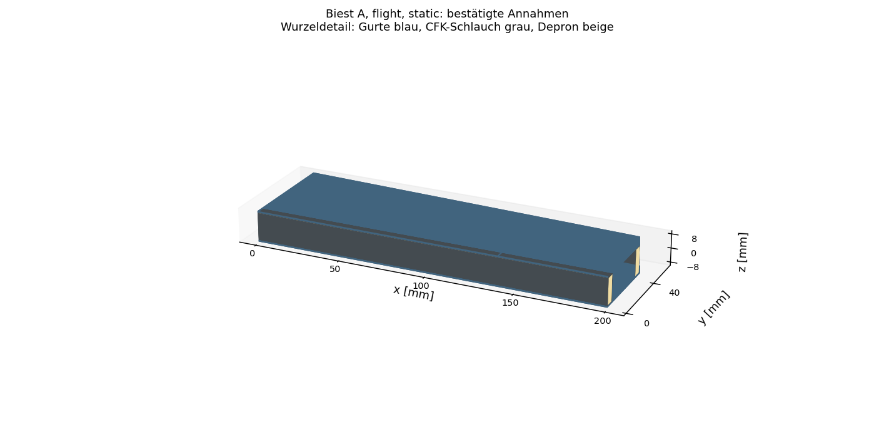


**Lesen:** Wurzelausschnitt derselben Rechnung; keine zusätzliche Laststufe. Geometrie aus den tatsächlichen CAD-Eingaben; Achsen in mm. Blau sind die Gurte, grau die CFK-Schläuche, beige die Depronkerne. Verdeckte Innenflächen können in der Außenansicht unsichtbar sein.

**Einordnung:** Hier wird die angenommene Bauweise kontrolliert, nicht die Beanspruchung: gerader hinterer Steg bis zur Spitze, vorderer Steg nur im inneren Bereich, diskrete Gurtdicken in A beziehungsweise durchgehende Wurzellagen in B. Im Wurzelausschnitt ist vor allem die Trennung der beiden Stege wichtig; die 6-mm-Spitze ist hier nicht sichtbar. Flügelschale und ein nachgewiesener steifer Verbinder fehlen weiterhin.

**FEM A, Netz 1, Flug: Längsspannung im Wurzeldetail**

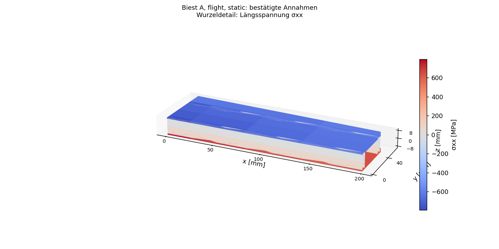


**Lesen:** Wurzelausschnitt derselben Rechnung; keine zusätzliche Laststufe. Unverformte Geometrie mit globaler σxx [MPa]: positiv Zug, negativ Druck, gemäß Farbskala. Gezeigt sind Integrationspunktmittelwerte je Element; es wird nicht über Materialgrenzen geglättet.

**Einordnung:** Die gegensinnigen Normalspannungen in Ober- und Untergurt kennzeichnen Biegung. Im UD-Gurt ist x die Faserrichtung; im ±45°-Schlauch ist σxx keine lokale Faserspannung und zeigt auch nicht die gesamte Schubbeanspruchung. Lokale Spitzen an Lagensprüngen, Lasten und Lagern sind netzabhängig. Es fehlen CFK-Festigkeitswerte sowie Klebe-, Delaminations- und Beulnachweise; die Farben bedeuten weder sicher noch gebrochen. Wegen der großen linearen Flugverformung sind auch diese Spannungen nur Ergebnisse des linearen Vergleichsmodells.

**FEM A, Netz 1, Flug: Volumennetz**

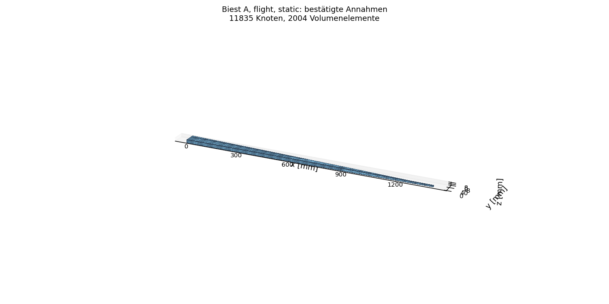


**Lesen:** Gezeigt wird die sichtbare Oberfläche des 3D-Netzes mit insgesamt 11,835 Knoten und 2,004 quadratischen C3D20R-Volumenelementen. Achsen in mm; sichtbare Dreieckslinien stammen auch aus der Darstellung der Elementflächen und sind keine Tetraederelemente.

**Einordnung:** Die schmalen CFK-Schichten erzeugen stark unterschiedliche Elementabmessungen. Feinere Netze prüfen deren Einfluss; eine dichte Oberfläche allein beweist keine Genauigkeit. Innerhalb der Abschnitte teilen Materialien Knoten, an Lagensprüngen verbinden interpolierende Gleichungen nichtpassende Flächen. Die Modellabmessungen und Lasten sind auf den Netzstufen gleich; nur die Diskretisierung wird verfeinert.

**FEM A, Netz 1, Flug: räumliches Modell**


**Lesen:** Geometrie aus den tatsächlichen CAD-Eingaben; Achsen in mm. Blau sind die Gurte, grau die CFK-Schläuche, beige die Depronkerne. Verdeckte Innenflächen können in der Außenansicht unsichtbar sein.

**Einordnung:** Hier wird die angenommene Bauweise kontrolliert, nicht die Beanspruchung: gerader hinterer Steg bis zur Spitze, vorderer Steg nur im inneren Bereich, diskrete Gurtdicken in A beziehungsweise durchgehende Wurzellagen in B. Die äußere Mindestgurtbreite beträgt 6 mm; eine durchgehende Verbindung ersetzt den früheren freien Gurtauslauf. Flügelschale und ein nachgewiesener steifer Verbinder fehlen weiterhin.

**FEM A, Netz 1, Flug: globale Längsspannung**


**Lesen:** Unverformte Geometrie mit globaler σxx [MPa]: positiv Zug, negativ Druck, gemäß Farbskala. Gezeigt sind Integrationspunktmittelwerte je Element; es wird nicht über Materialgrenzen geglättet.

**Einordnung:** Die gegensinnigen Normalspannungen in Ober- und Untergurt kennzeichnen Biegung. Im UD-Gurt ist x die Faserrichtung; im ±45°-Schlauch ist σxx keine lokale Faserspannung und zeigt auch nicht die gesamte Schubbeanspruchung. Lokale Spitzen an Lagensprüngen, Lasten und Lagern sind netzabhängig. Es fehlen CFK-Festigkeitswerte sowie Klebe-, Delaminations- und Beulnachweise; die Farben bedeuten weder sicher noch gebrochen. Wegen der großen linearen Flugverformung sind auch diese Spannungen nur Ergebnisse des linearen Vergleichsmodells.


### fem_sandwich_q20/A/level_1/test

**FEM A, Netz 1, Auflagenversuch: Verformung**

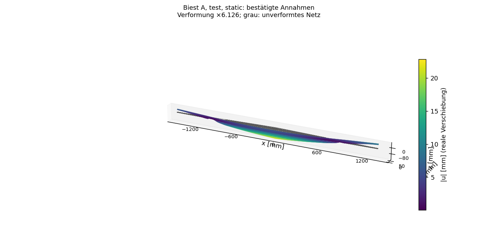


**Lesen:** Grau: unverformte Lage; farbig: verformte Oberfläche mit dem im Bild genannten Faktor. Achsen sind mm. Die Farbe zeigt den realen Betrag |u| [mm], nicht die mit dem Darstellungsfaktor multiplizierte Auslenkung und nicht nur die vertikale Komponente.

**Einordnung:** Die gemittelte vertikale Wurzelverschiebung im Taschenband beträgt -11.28 mm. Die Mitte sinkt ab, freie Überhänge können sich heben. Der größte räumliche Verschiebungsbetrag muss nicht an der Wurzel liegen und darf nicht mit diesem Tabellenwert gleichgesetzt werden. Die Versuchslager sind bilateral und erfordern eine Niederhaltekraft; die Darstellung bestätigt keinen Versuch auf lose aufliegenden Böcken.

**FEM A, Netz 1, Auflagenversuch: Verformung im Wurzeldetail**

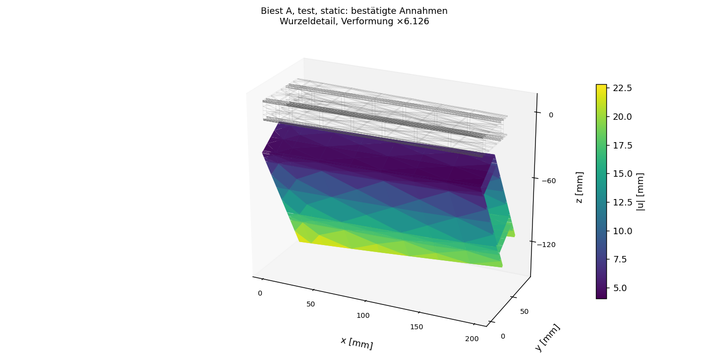


**Lesen:** Wurzelausschnitt derselben Rechnung; keine zusätzliche Laststufe. Grau: unverformte Lage; farbig: verformte Oberfläche mit dem im Bild genannten Faktor. Achsen sind mm. Die Farbe zeigt den realen Betrag |u| [mm], nicht die mit dem Darstellungsfaktor multiplizierte Auslenkung und nicht nur die vertikale Komponente.

**Einordnung:** Die gemittelte vertikale Wurzelverschiebung im Taschenband beträgt -11.28 mm. Die Mitte sinkt ab, freie Überhänge können sich heben. Der größte räumliche Verschiebungsbetrag muss nicht an der Wurzel liegen und darf nicht mit diesem Tabellenwert gleichgesetzt werden. Der Wurzelausschnitt zeigt vor allem lokale Bewegungen und nicht den Verlauf bis zur Spitze. Die Versuchslager sind bilateral und erfordern eine Niederhaltekraft; die Darstellung bestätigt keinen Versuch auf lose aufliegenden Böcken.

**FEM A, Netz 1, Auflagenversuch: Netz am Wurzeldetail**


**Lesen:** Wurzelausschnitt derselben Rechnung; keine zusätzliche Laststufe. Gezeigt wird die sichtbare Oberfläche des 3D-Netzes mit insgesamt 23,342 Knoten und 4,008 quadratischen C3D20R-Volumenelementen. Achsen in mm; sichtbare Dreieckslinien stammen auch aus der Darstellung der Elementflächen und sind keine Tetraederelemente.

**Einordnung:** Die schmalen CFK-Schichten erzeugen stark unterschiedliche Elementabmessungen. Feinere Netze prüfen deren Einfluss; eine dichte Oberfläche allein beweist keine Genauigkeit. Innerhalb der Abschnitte teilen Materialien Knoten, an Lagensprüngen verbinden interpolierende Gleichungen nichtpassende Flächen. Das Detail hilft, Last-/Lagerband und dünne Schichten zu erkennen; daraus folgt noch kein konvergierter örtlicher Spannungswert.

**FEM A, Netz 1, Auflagenversuch: Wurzeldetail des Modells**


**Lesen:** Wurzelausschnitt derselben Rechnung; keine zusätzliche Laststufe. Geometrie aus den tatsächlichen CAD-Eingaben; Achsen in mm. Blau sind die Gurte, grau die CFK-Schläuche, beige die Depronkerne. Verdeckte Innenflächen können in der Außenansicht unsichtbar sein.

**Einordnung:** Hier wird die angenommene Bauweise kontrolliert, nicht die Beanspruchung: gerader hinterer Steg bis zur Spitze, vorderer Steg nur im inneren Bereich, diskrete Gurtdicken in A beziehungsweise durchgehende Wurzellagen in B. Im Wurzelausschnitt ist vor allem die Trennung der beiden Stege wichtig; die 6-mm-Spitze ist hier nicht sichtbar. Flügelschale und ein nachgewiesener steifer Verbinder fehlen weiterhin.

**FEM A, Netz 1, Auflagenversuch: Längsspannung im Wurzeldetail**


**Lesen:** Wurzelausschnitt derselben Rechnung; keine zusätzliche Laststufe. Unverformte Geometrie mit globaler σxx [MPa]: positiv Zug, negativ Druck, gemäß Farbskala. Gezeigt sind Integrationspunktmittelwerte je Element; es wird nicht über Materialgrenzen geglättet.

**Einordnung:** Die gegensinnigen Normalspannungen in Ober- und Untergurt kennzeichnen Biegung. Im UD-Gurt ist x die Faserrichtung; im ±45°-Schlauch ist σxx keine lokale Faserspannung und zeigt auch nicht die gesamte Schubbeanspruchung. Lokale Spitzen an Lagensprüngen, Lasten und Lagern sind netzabhängig. Es fehlen CFK-Festigkeitswerte sowie Klebe-, Delaminations- und Beulnachweise; die Farben bedeuten weder sicher noch gebrochen. Die ideale Verklebung und bilaterale Lagerung beeinflussen die örtliche Lastübertragung.

**FEM A, Netz 1, Auflagenversuch: Volumennetz**

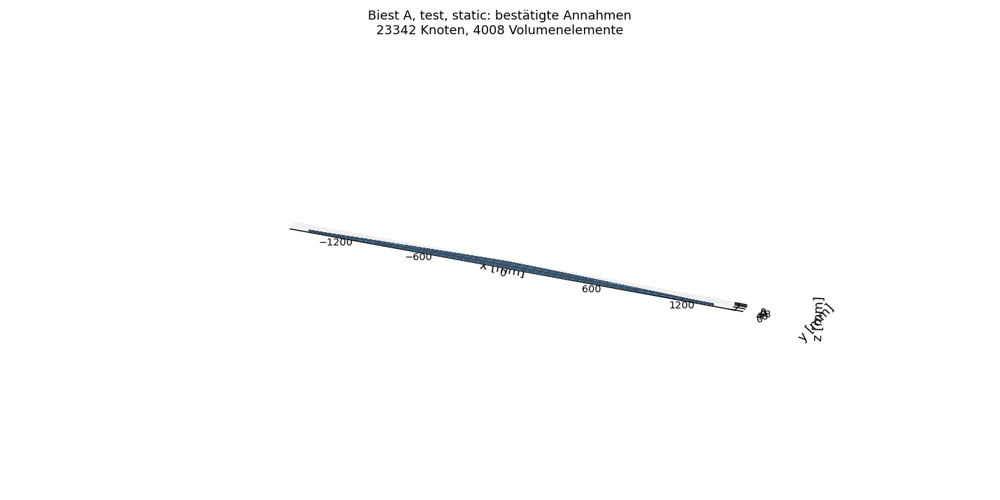


**Lesen:** Gezeigt wird die sichtbare Oberfläche des 3D-Netzes mit insgesamt 23,342 Knoten und 4,008 quadratischen C3D20R-Volumenelementen. Achsen in mm; sichtbare Dreieckslinien stammen auch aus der Darstellung der Elementflächen und sind keine Tetraederelemente.

**Einordnung:** Die schmalen CFK-Schichten erzeugen stark unterschiedliche Elementabmessungen. Feinere Netze prüfen deren Einfluss; eine dichte Oberfläche allein beweist keine Genauigkeit. Innerhalb der Abschnitte teilen Materialien Knoten, an Lagensprüngen verbinden interpolierende Gleichungen nichtpassende Flächen. Die Modellabmessungen und Lasten sind auf den Netzstufen gleich; nur die Diskretisierung wird verfeinert.

**FEM A, Netz 1, Auflagenversuch: räumliches Modell**

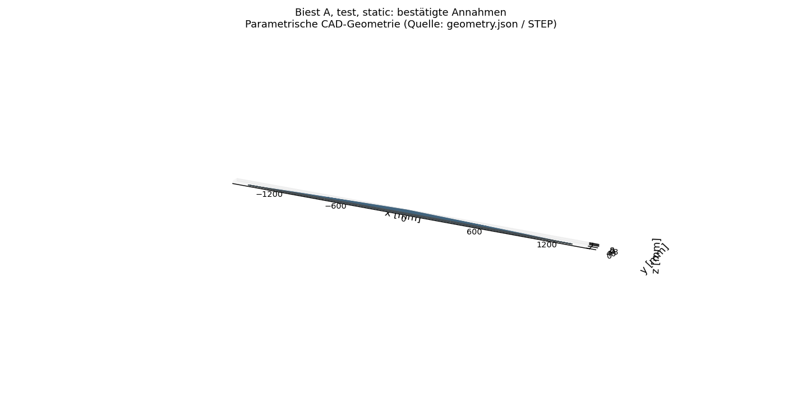


**Lesen:** Geometrie aus den tatsächlichen CAD-Eingaben; Achsen in mm. Blau sind die Gurte, grau die CFK-Schläuche, beige die Depronkerne. Verdeckte Innenflächen können in der Außenansicht unsichtbar sein.

**Einordnung:** Hier wird die angenommene Bauweise kontrolliert, nicht die Beanspruchung: gerader hinterer Steg bis zur Spitze, vorderer Steg nur im inneren Bereich, diskrete Gurtdicken in A beziehungsweise durchgehende Wurzellagen in B. Die äußere Mindestgurtbreite beträgt 6 mm; eine durchgehende Verbindung ersetzt den früheren freien Gurtauslauf. Flügelschale und ein nachgewiesener steifer Verbinder fehlen weiterhin.

**FEM A, Netz 1, Auflagenversuch: globale Längsspannung**

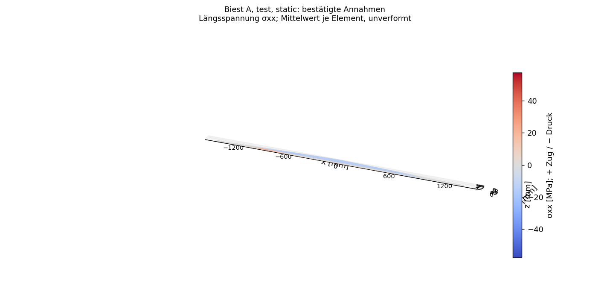


**Lesen:** Unverformte Geometrie mit globaler σxx [MPa]: positiv Zug, negativ Druck, gemäß Farbskala. Gezeigt sind Integrationspunktmittelwerte je Element; es wird nicht über Materialgrenzen geglättet.

**Einordnung:** Die gegensinnigen Normalspannungen in Ober- und Untergurt kennzeichnen Biegung. Im UD-Gurt ist x die Faserrichtung; im ±45°-Schlauch ist σxx keine lokale Faserspannung und zeigt auch nicht die gesamte Schubbeanspruchung. Lokale Spitzen an Lagensprüngen, Lasten und Lagern sind netzabhängig. Es fehlen CFK-Festigkeitswerte sowie Klebe-, Delaminations- und Beulnachweise; die Farben bedeuten weder sicher noch gebrochen. Die ideale Verklebung und bilaterale Lagerung beeinflussen die örtliche Lastübertragung.


### fem_sandwich_q20/A/level_3/flight

**FEM A, Netz 3, Flug: Verformung**


**Lesen:** Grau: unverformte Lage; farbig: verformte Oberfläche mit dem im Bild genannten Faktor. Achsen sind mm. Die Farbe zeigt den realen Betrag |u| [mm], nicht die mit dem Darstellungsfaktor multiplizierte Auslenkung und nicht nur die vertikale Komponente.

**Einordnung:** Die obere Flugtip-Verschiebung uz beträgt 676.9 mm. Ober- und Untergurt bewegen sich durch den durchgehenden Steg gemeinsam; der alte freie Gurtauslauf ist beseitigt. Die lineare Flugverformung ist groß relativ zur Halbspannweite; die nichtlinearen Versuche lieferten kein abgeschlossenes Volllastergebnis. Der Wert ist damit kein bestätigter realer Flugzustand.

**FEM A, Netz 3, Flug: Verformung im Wurzeldetail**

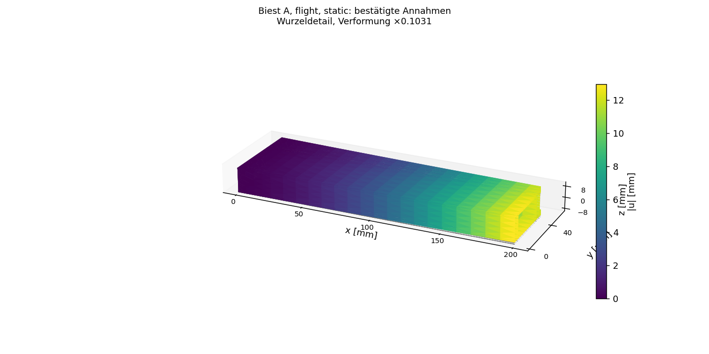


**Lesen:** Wurzelausschnitt derselben Rechnung; keine zusätzliche Laststufe. Grau: unverformte Lage; farbig: verformte Oberfläche mit dem im Bild genannten Faktor. Achsen sind mm. Die Farbe zeigt den realen Betrag |u| [mm], nicht die mit dem Darstellungsfaktor multiplizierte Auslenkung und nicht nur die vertikale Komponente.

**Einordnung:** Die obere Flugtip-Verschiebung uz beträgt 676.9 mm. Ober- und Untergurt bewegen sich durch den durchgehenden Steg gemeinsam; der alte freie Gurtauslauf ist beseitigt. Der Wurzelausschnitt zeigt vor allem lokale Bewegungen und nicht den Verlauf bis zur Spitze. Die lineare Flugverformung ist groß relativ zur Halbspannweite; die nichtlinearen Versuche lieferten kein abgeschlossenes Volllastergebnis. Der Wert ist damit kein bestätigter realer Flugzustand.

**FEM A, Netz 3, Flug: Netz am Wurzeldetail**


**Lesen:** Wurzelausschnitt derselben Rechnung; keine zusätzliche Laststufe. Gezeigt wird die sichtbare Oberfläche des 3D-Netzes mit insgesamt 33,982 Knoten und 6,217 quadratischen C3D20R-Volumenelementen. Achsen in mm; sichtbare Dreieckslinien stammen auch aus der Darstellung der Elementflächen und sind keine Tetraederelemente.

**Einordnung:** Die schmalen CFK-Schichten erzeugen stark unterschiedliche Elementabmessungen. Feinere Netze prüfen deren Einfluss; eine dichte Oberfläche allein beweist keine Genauigkeit. Innerhalb der Abschnitte teilen Materialien Knoten, an Lagensprüngen verbinden interpolierende Gleichungen nichtpassende Flächen. Das Detail hilft, Last-/Lagerband und dünne Schichten zu erkennen; daraus folgt noch kein konvergierter örtlicher Spannungswert.

**FEM A, Netz 3, Flug: Wurzeldetail des Modells**


**Lesen:** Wurzelausschnitt derselben Rechnung; keine zusätzliche Laststufe. Geometrie aus den tatsächlichen CAD-Eingaben; Achsen in mm. Blau sind die Gurte, grau die CFK-Schläuche, beige die Depronkerne. Verdeckte Innenflächen können in der Außenansicht unsichtbar sein.

**Einordnung:** Hier wird die angenommene Bauweise kontrolliert, nicht die Beanspruchung: gerader hinterer Steg bis zur Spitze, vorderer Steg nur im inneren Bereich, diskrete Gurtdicken in A beziehungsweise durchgehende Wurzellagen in B. Im Wurzelausschnitt ist vor allem die Trennung der beiden Stege wichtig; die 6-mm-Spitze ist hier nicht sichtbar. Flügelschale und ein nachgewiesener steifer Verbinder fehlen weiterhin.

**FEM A, Netz 3, Flug: Längsspannung im Wurzeldetail**


**Lesen:** Wurzelausschnitt derselben Rechnung; keine zusätzliche Laststufe. Unverformte Geometrie mit globaler σxx [MPa]: positiv Zug, negativ Druck, gemäß Farbskala. Gezeigt sind Integrationspunktmittelwerte je Element; es wird nicht über Materialgrenzen geglättet.

**Einordnung:** Der größte Betrag an Integrationspunkten im gesamten Modell beträgt 1229 MPa; er kann außerhalb des Ausschnitts oder über der gemittelten Elementfarbskala liegen. Die gegensinnigen Normalspannungen in Ober- und Untergurt kennzeichnen Biegung. Im UD-Gurt ist x die Faserrichtung; im ±45°-Schlauch ist σxx keine lokale Faserspannung und zeigt auch nicht die gesamte Schubbeanspruchung. Lokale Spitzen an Lagensprüngen, Lasten und Lagern sind netzabhängig. Es fehlen CFK-Festigkeitswerte sowie Klebe-, Delaminations- und Beulnachweise; die Farben bedeuten weder sicher noch gebrochen. Wegen der großen linearen Flugverformung sind auch diese Spannungen nur Ergebnisse des linearen Vergleichsmodells.

**FEM A, Netz 3, Flug: Volumennetz**

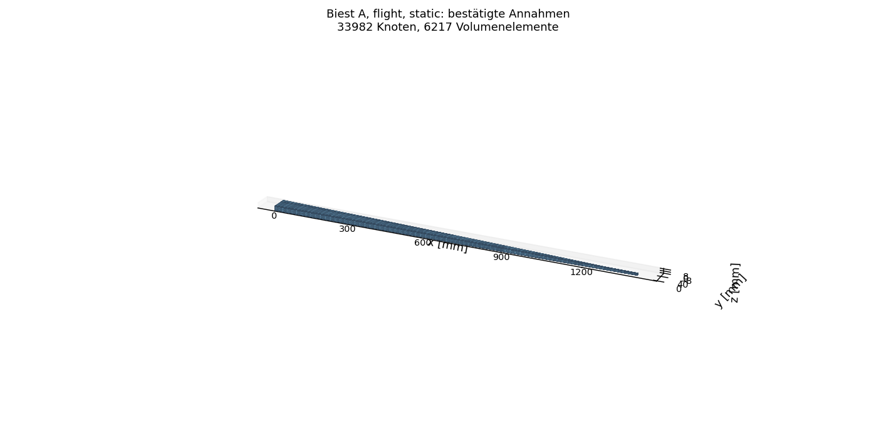


**Lesen:** Gezeigt wird die sichtbare Oberfläche des 3D-Netzes mit insgesamt 33,982 Knoten und 6,217 quadratischen C3D20R-Volumenelementen. Achsen in mm; sichtbare Dreieckslinien stammen auch aus der Darstellung der Elementflächen und sind keine Tetraederelemente.

**Einordnung:** Die schmalen CFK-Schichten erzeugen stark unterschiedliche Elementabmessungen. Feinere Netze prüfen deren Einfluss; eine dichte Oberfläche allein beweist keine Genauigkeit. Innerhalb der Abschnitte teilen Materialien Knoten, an Lagensprüngen verbinden interpolierende Gleichungen nichtpassende Flächen. Die Modellabmessungen und Lasten sind auf den Netzstufen gleich; nur die Diskretisierung wird verfeinert.

**FEM A, Netz 3, Flug: räumliches Modell**


**Lesen:** Geometrie aus den tatsächlichen CAD-Eingaben; Achsen in mm. Blau sind die Gurte, grau die CFK-Schläuche, beige die Depronkerne. Verdeckte Innenflächen können in der Außenansicht unsichtbar sein.

**Einordnung:** Hier wird die angenommene Bauweise kontrolliert, nicht die Beanspruchung: gerader hinterer Steg bis zur Spitze, vorderer Steg nur im inneren Bereich, diskrete Gurtdicken in A beziehungsweise durchgehende Wurzellagen in B. Die äußere Mindestgurtbreite beträgt 6 mm; eine durchgehende Verbindung ersetzt den früheren freien Gurtauslauf. Flügelschale und ein nachgewiesener steifer Verbinder fehlen weiterhin.

**FEM A, Netz 3, Flug: globale Längsspannung**

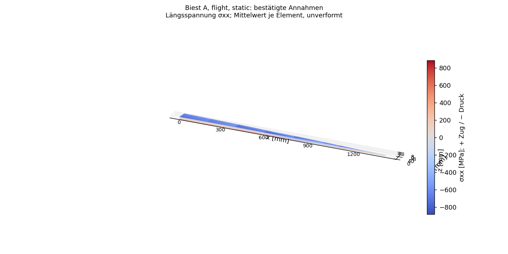


**Lesen:** Unverformte Geometrie mit globaler σxx [MPa]: positiv Zug, negativ Druck, gemäß Farbskala. Gezeigt sind Integrationspunktmittelwerte je Element; es wird nicht über Materialgrenzen geglättet.

**Einordnung:** Der größte Betrag an Integrationspunkten im gesamten Modell beträgt 1229 MPa; er kann außerhalb des Ausschnitts oder über der gemittelten Elementfarbskala liegen. Die gegensinnigen Normalspannungen in Ober- und Untergurt kennzeichnen Biegung. Im UD-Gurt ist x die Faserrichtung; im ±45°-Schlauch ist σxx keine lokale Faserspannung und zeigt auch nicht die gesamte Schubbeanspruchung. Lokale Spitzen an Lagensprüngen, Lasten und Lagern sind netzabhängig. Es fehlen CFK-Festigkeitswerte sowie Klebe-, Delaminations- und Beulnachweise; die Farben bedeuten weder sicher noch gebrochen. Wegen der großen linearen Flugverformung sind auch diese Spannungen nur Ergebnisse des linearen Vergleichsmodells.


### fem_sandwich_q20/A/level_3/test

**FEM A, Netz 3, Auflagenversuch: Eigenform 1, 2.809 Hz**

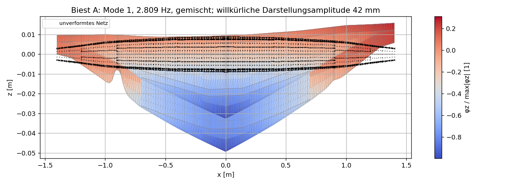


**Lesen:** Seitenprojektion in die x-z-Ebene. Schwarze Punkte: unverformtes Netz; farbige Fläche: Eigenform mit willkürlich gewählter Darstellungsamplitude. Die Farbskala φz/max|φz| ist dimensionslos; die Achsen geben die gezeichneten Koordinaten in m an.

**Einordnung:** Diese Form ist gemischt; der rechnerische Anteil Σuz²/Σ|u|² beträgt 83.6 %. Das ist eine Verschiebungskennzahl, keine effektive Modalmasse oder Energiequote. Sie ist die im Konvergenzgraphen verwendete überwiegend vertikale Form. Formen mit ähnlicher Frequenz können sich bei Netzänderung mischen oder die Reihenfolge wechseln. Die 2D-Projektion zeigt seitliche Bewegung und Torsion nur eingeschränkt. Weder Amplitude noch Vorzeichen sagen eine reale Schwingungsantwort voraus; die Modalanalyse ist unbelastet und linear.

**FEM A, Netz 3, Auflagenversuch: Eigenform 2, 6.229 Hz**

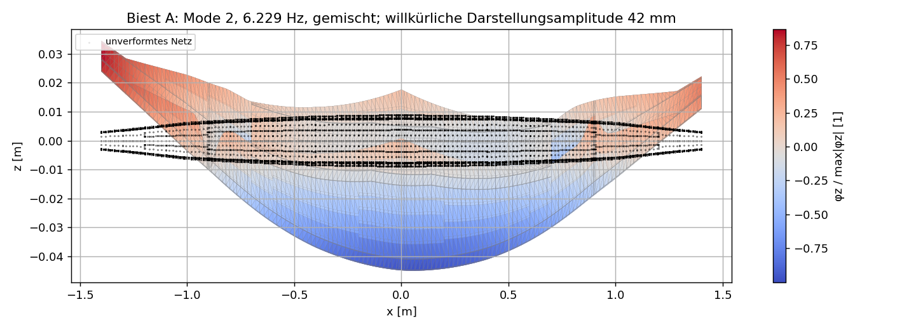


**Lesen:** Seitenprojektion in die x-z-Ebene. Schwarze Punkte: unverformtes Netz; farbige Fläche: Eigenform mit willkürlich gewählter Darstellungsamplitude. Die Farbskala φz/max|φz| ist dimensionslos; die Achsen geben die gezeichneten Koordinaten in m an.

**Einordnung:** Diese Form ist gemischt; der rechnerische Anteil Σuz²/Σ|u|² beträgt 68.1 %. Das ist eine Verschiebungskennzahl, keine effektive Modalmasse oder Energiequote. Sie ist eine weitere räumliche Eigenform und nicht automatisch die gleich nummerierte Balkenmode. Formen mit ähnlicher Frequenz können sich bei Netzänderung mischen oder die Reihenfolge wechseln. Die 2D-Projektion zeigt seitliche Bewegung und Torsion nur eingeschränkt. Weder Amplitude noch Vorzeichen sagen eine reale Schwingungsantwort voraus; die Modalanalyse ist unbelastet und linear.

**FEM A, Netz 3, Auflagenversuch: Eigenform 3, 17.53 Hz**

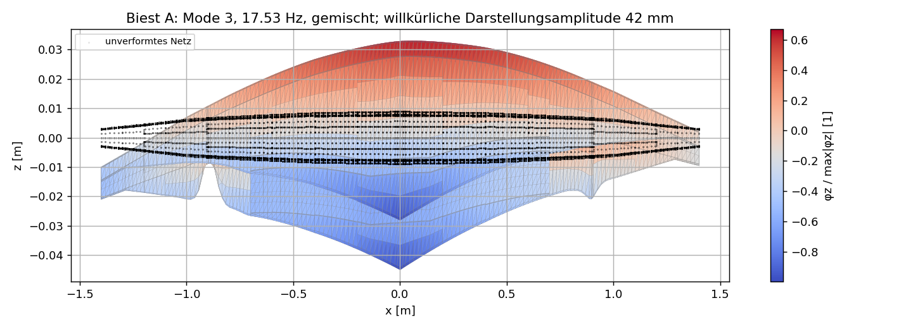


**Lesen:** Seitenprojektion in die x-z-Ebene. Schwarze Punkte: unverformtes Netz; farbige Fläche: Eigenform mit willkürlich gewählter Darstellungsamplitude. Die Farbskala φz/max|φz| ist dimensionslos; die Achsen geben die gezeichneten Koordinaten in m an.

**Einordnung:** Diese Form ist gemischt; der rechnerische Anteil Σuz²/Σ|u|² beträgt 52.3 %. Das ist eine Verschiebungskennzahl, keine effektive Modalmasse oder Energiequote. Sie ist eine weitere räumliche Eigenform und nicht automatisch die gleich nummerierte Balkenmode. Formen mit ähnlicher Frequenz können sich bei Netzänderung mischen oder die Reihenfolge wechseln. Die 2D-Projektion zeigt seitliche Bewegung und Torsion nur eingeschränkt. Weder Amplitude noch Vorzeichen sagen eine reale Schwingungsantwort voraus; die Modalanalyse ist unbelastet und linear.

**FEM A, Netz 3, Auflagenversuch: Eigenform 4, 73.7 Hz**

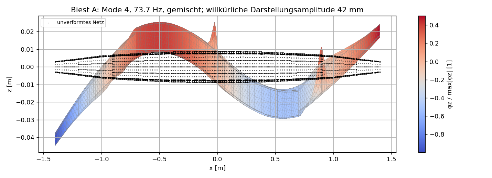


**Lesen:** Seitenprojektion in die x-z-Ebene. Schwarze Punkte: unverformtes Netz; farbige Fläche: Eigenform mit willkürlich gewählter Darstellungsamplitude. Die Farbskala φz/max|φz| ist dimensionslos; die Achsen geben die gezeichneten Koordinaten in m an.

**Einordnung:** Diese Form ist gemischt; der rechnerische Anteil Σuz²/Σ|u|² beträgt 99.1 %. Das ist eine Verschiebungskennzahl, keine effektive Modalmasse oder Energiequote. Sie ist eine weitere räumliche Eigenform und nicht automatisch die gleich nummerierte Balkenmode. Formen mit ähnlicher Frequenz können sich bei Netzänderung mischen oder die Reihenfolge wechseln. Die 2D-Projektion zeigt seitliche Bewegung und Torsion nur eingeschränkt. Weder Amplitude noch Vorzeichen sagen eine reale Schwingungsantwort voraus; die Modalanalyse ist unbelastet und linear.

**FEM A, Netz 3, Auflagenversuch: Eigenform 5, 78.34 Hz**

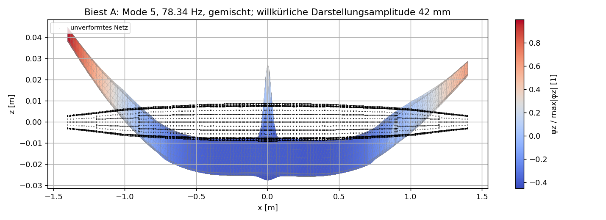


**Lesen:** Seitenprojektion in die x-z-Ebene. Schwarze Punkte: unverformtes Netz; farbige Fläche: Eigenform mit willkürlich gewählter Darstellungsamplitude. Die Farbskala φz/max|φz| ist dimensionslos; die Achsen geben die gezeichneten Koordinaten in m an.

**Einordnung:** Diese Form ist gemischt; der rechnerische Anteil Σuz²/Σ|u|² beträgt 99.3 %. Das ist eine Verschiebungskennzahl, keine effektive Modalmasse oder Energiequote. Sie ist eine weitere räumliche Eigenform und nicht automatisch die gleich nummerierte Balkenmode. Formen mit ähnlicher Frequenz können sich bei Netzänderung mischen oder die Reihenfolge wechseln. Die 2D-Projektion zeigt seitliche Bewegung und Torsion nur eingeschränkt. Weder Amplitude noch Vorzeichen sagen eine reale Schwingungsantwort voraus; die Modalanalyse ist unbelastet und linear.

**FEM A, Netz 3, Auflagenversuch: Eigenform 6, 95.29 Hz**

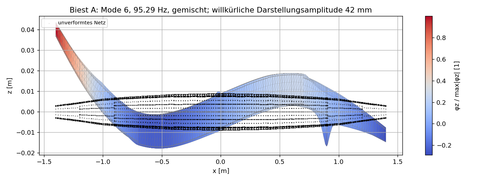


**Lesen:** Seitenprojektion in die x-z-Ebene. Schwarze Punkte: unverformtes Netz; farbige Fläche: Eigenform mit willkürlich gewählter Darstellungsamplitude. Die Farbskala φz/max|φz| ist dimensionslos; die Achsen geben die gezeichneten Koordinaten in m an.

**Einordnung:** Diese Form ist gemischt; der rechnerische Anteil Σuz²/Σ|u|² beträgt 96 %. Das ist eine Verschiebungskennzahl, keine effektive Modalmasse oder Energiequote. Sie ist eine weitere räumliche Eigenform und nicht automatisch die gleich nummerierte Balkenmode. Formen mit ähnlicher Frequenz können sich bei Netzänderung mischen oder die Reihenfolge wechseln. Die 2D-Projektion zeigt seitliche Bewegung und Torsion nur eingeschränkt. Weder Amplitude noch Vorzeichen sagen eine reale Schwingungsantwort voraus; die Modalanalyse ist unbelastet und linear.

**FEM A, Netz 3, Auflagenversuch: Verformung**

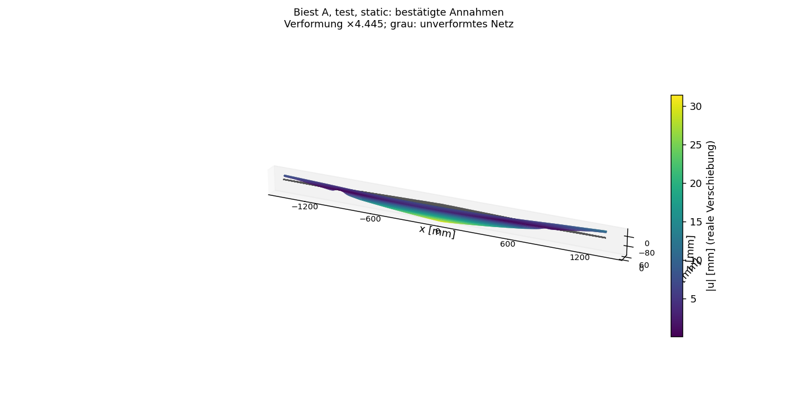


**Lesen:** Grau: unverformte Lage; farbig: verformte Oberfläche mit dem im Bild genannten Faktor. Achsen sind mm. Die Farbe zeigt den realen Betrag |u| [mm], nicht die mit dem Darstellungsfaktor multiplizierte Auslenkung und nicht nur die vertikale Komponente.

**Einordnung:** Die gemittelte vertikale Wurzelverschiebung im Taschenband beträgt -13.41 mm. Die Mitte sinkt ab, freie Überhänge können sich heben. Der größte räumliche Verschiebungsbetrag muss nicht an der Wurzel liegen und darf nicht mit diesem Tabellenwert gleichgesetzt werden. Die Versuchslager sind bilateral und erfordern eine Niederhaltekraft; die Darstellung bestätigt keinen Versuch auf lose aufliegenden Böcken.

**FEM A, Netz 3, Auflagenversuch: Verformung im Wurzeldetail**

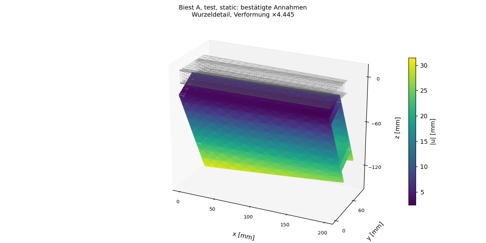


**Lesen:** Wurzelausschnitt derselben Rechnung; keine zusätzliche Laststufe. Grau: unverformte Lage; farbig: verformte Oberfläche mit dem im Bild genannten Faktor. Achsen sind mm. Die Farbe zeigt den realen Betrag |u| [mm], nicht die mit dem Darstellungsfaktor multiplizierte Auslenkung und nicht nur die vertikale Komponente.

**Einordnung:** Die gemittelte vertikale Wurzelverschiebung im Taschenband beträgt -13.41 mm. Die Mitte sinkt ab, freie Überhänge können sich heben. Der größte räumliche Verschiebungsbetrag muss nicht an der Wurzel liegen und darf nicht mit diesem Tabellenwert gleichgesetzt werden. Der Wurzelausschnitt zeigt vor allem lokale Bewegungen und nicht den Verlauf bis zur Spitze. Die Versuchslager sind bilateral und erfordern eine Niederhaltekraft; die Darstellung bestätigt keinen Versuch auf lose aufliegenden Böcken.

**FEM A, Netz 3, Auflagenversuch: Netz am Wurzeldetail**


**Lesen:** Wurzelausschnitt derselben Rechnung; keine zusätzliche Laststufe. Gezeigt wird die sichtbare Oberfläche des 3D-Netzes mit insgesamt 67,528 Knoten und 12,434 quadratischen C3D20R-Volumenelementen. Achsen in mm; sichtbare Dreieckslinien stammen auch aus der Darstellung der Elementflächen und sind keine Tetraederelemente.

**Einordnung:** Die schmalen CFK-Schichten erzeugen stark unterschiedliche Elementabmessungen. Feinere Netze prüfen deren Einfluss; eine dichte Oberfläche allein beweist keine Genauigkeit. Innerhalb der Abschnitte teilen Materialien Knoten, an Lagensprüngen verbinden interpolierende Gleichungen nichtpassende Flächen. Das Detail hilft, Last-/Lagerband und dünne Schichten zu erkennen; daraus folgt noch kein konvergierter örtlicher Spannungswert.

**FEM A, Netz 3, Auflagenversuch: Wurzeldetail des Modells**


**Lesen:** Wurzelausschnitt derselben Rechnung; keine zusätzliche Laststufe. Geometrie aus den tatsächlichen CAD-Eingaben; Achsen in mm. Blau sind die Gurte, grau die CFK-Schläuche, beige die Depronkerne. Verdeckte Innenflächen können in der Außenansicht unsichtbar sein.

**Einordnung:** Hier wird die angenommene Bauweise kontrolliert, nicht die Beanspruchung: gerader hinterer Steg bis zur Spitze, vorderer Steg nur im inneren Bereich, diskrete Gurtdicken in A beziehungsweise durchgehende Wurzellagen in B. Im Wurzelausschnitt ist vor allem die Trennung der beiden Stege wichtig; die 6-mm-Spitze ist hier nicht sichtbar. Flügelschale und ein nachgewiesener steifer Verbinder fehlen weiterhin.

**FEM A, Netz 3, Auflagenversuch: Längsspannung im Wurzeldetail**


**Lesen:** Wurzelausschnitt derselben Rechnung; keine zusätzliche Laststufe. Unverformte Geometrie mit globaler σxx [MPa]: positiv Zug, negativ Druck, gemäß Farbskala. Gezeigt sind Integrationspunktmittelwerte je Element; es wird nicht über Materialgrenzen geglättet.

**Einordnung:** Der größte Betrag an Integrationspunkten im gesamten Modell beträgt 275.8 MPa; er kann außerhalb des Ausschnitts oder über der gemittelten Elementfarbskala liegen. Die gegensinnigen Normalspannungen in Ober- und Untergurt kennzeichnen Biegung. Im UD-Gurt ist x die Faserrichtung; im ±45°-Schlauch ist σxx keine lokale Faserspannung und zeigt auch nicht die gesamte Schubbeanspruchung. Lokale Spitzen an Lagensprüngen, Lasten und Lagern sind netzabhängig. Es fehlen CFK-Festigkeitswerte sowie Klebe-, Delaminations- und Beulnachweise; die Farben bedeuten weder sicher noch gebrochen. Die ideale Verklebung und bilaterale Lagerung beeinflussen die örtliche Lastübertragung.

**FEM A, Netz 3, Auflagenversuch: Volumennetz**


**Lesen:** Gezeigt wird die sichtbare Oberfläche des 3D-Netzes mit insgesamt 67,528 Knoten und 12,434 quadratischen C3D20R-Volumenelementen. Achsen in mm; sichtbare Dreieckslinien stammen auch aus der Darstellung der Elementflächen und sind keine Tetraederelemente.

**Einordnung:** Die schmalen CFK-Schichten erzeugen stark unterschiedliche Elementabmessungen. Feinere Netze prüfen deren Einfluss; eine dichte Oberfläche allein beweist keine Genauigkeit. Innerhalb der Abschnitte teilen Materialien Knoten, an Lagensprüngen verbinden interpolierende Gleichungen nichtpassende Flächen. Die Modellabmessungen und Lasten sind auf den Netzstufen gleich; nur die Diskretisierung wird verfeinert.

**FEM A, Netz 3, Auflagenversuch: räumliches Modell**


**Lesen:** Geometrie aus den tatsächlichen CAD-Eingaben; Achsen in mm. Blau sind die Gurte, grau die CFK-Schläuche, beige die Depronkerne. Verdeckte Innenflächen können in der Außenansicht unsichtbar sein.

**Einordnung:** Hier wird die angenommene Bauweise kontrolliert, nicht die Beanspruchung: gerader hinterer Steg bis zur Spitze, vorderer Steg nur im inneren Bereich, diskrete Gurtdicken in A beziehungsweise durchgehende Wurzellagen in B. Die äußere Mindestgurtbreite beträgt 6 mm; eine durchgehende Verbindung ersetzt den früheren freien Gurtauslauf. Flügelschale und ein nachgewiesener steifer Verbinder fehlen weiterhin.

**FEM A, Netz 3, Auflagenversuch: globale Längsspannung**


**Lesen:** Unverformte Geometrie mit globaler σxx [MPa]: positiv Zug, negativ Druck, gemäß Farbskala. Gezeigt sind Integrationspunktmittelwerte je Element; es wird nicht über Materialgrenzen geglättet.

**Einordnung:** Der größte Betrag an Integrationspunkten im gesamten Modell beträgt 275.8 MPa; er kann außerhalb des Ausschnitts oder über der gemittelten Elementfarbskala liegen. Die gegensinnigen Normalspannungen in Ober- und Untergurt kennzeichnen Biegung. Im UD-Gurt ist x die Faserrichtung; im ±45°-Schlauch ist σxx keine lokale Faserspannung und zeigt auch nicht die gesamte Schubbeanspruchung. Lokale Spitzen an Lagensprüngen, Lasten und Lagern sind netzabhängig. Es fehlen CFK-Festigkeitswerte sowie Klebe-, Delaminations- und Beulnachweise; die Farben bedeuten weder sicher noch gebrochen. Die ideale Verklebung und bilaterale Lagerung beeinflussen die örtliche Lastübertragung.


### fem_sandwich_q20/B

**FEM B: Netzkonvergenz**

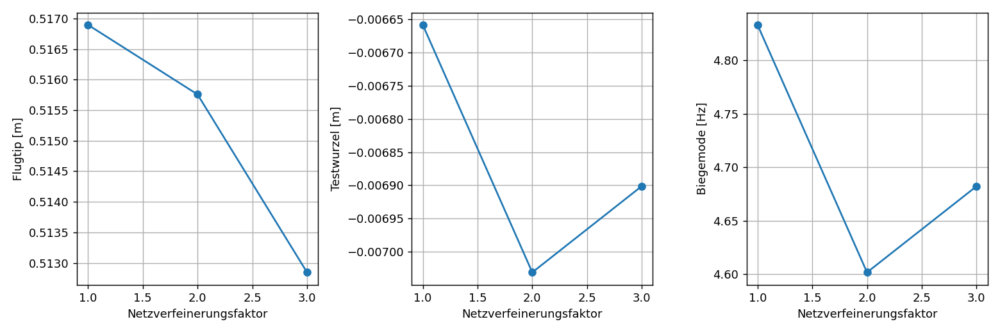


**Lesen:** Drei Teilbilder zeigen Flug-Spitzenverschiebung [m], Versuchswurzel [m] und ausgewählte Eigenfrequenz [Hz] gegen den Netzverfeinerungsfaktor. Faktor 3 ist das feinste Netz, keine physische Laststeigerung. Die y-Achsen sind unterschiedlich skaliert.

**Einordnung:** Änderung der letzten beiden Stufen, bezogen auf die feinste: Flugtip 0.568 %, Versuchswurzel 1.88 %, ausgewählte Biegemode 1.72 %. Das 2-%-Ziel ist nicht für alle geprüften Größen erreicht. Der Frequenzgraph zeigt nur eine ausgewählte Form; für den Gesamtstatus werden alle sechs Frequenzen geprüft. Ein optisch flacher Verlauf beweist keine vollständige Konvergenz, insbesondere nicht für lokale Spannungen oder bei Modenwechseln.


### fem_sandwich_q20/B/level_1/flight

**FEM B, Netz 1, Flug: Verformung**


**Lesen:** Grau: unverformte Lage; farbig: verformte Oberfläche mit dem im Bild genannten Faktor. Achsen sind mm. Die Farbe zeigt den realen Betrag |u| [mm], nicht die mit dem Darstellungsfaktor multiplizierte Auslenkung und nicht nur die vertikale Komponente.

**Einordnung:** Die obere Flugtip-Verschiebung uz beträgt 516.9 mm. Ober- und Untergurt bewegen sich durch den durchgehenden Steg gemeinsam; der alte freie Gurtauslauf ist beseitigt. Die lineare Flugverformung ist groß relativ zur Halbspannweite; die nichtlinearen Versuche lieferten kein abgeschlossenes Volllastergebnis. Der Wert ist damit kein bestätigter realer Flugzustand.

**FEM B, Netz 1, Flug: Verformung im Wurzeldetail**


**Lesen:** Wurzelausschnitt derselben Rechnung; keine zusätzliche Laststufe. Grau: unverformte Lage; farbig: verformte Oberfläche mit dem im Bild genannten Faktor. Achsen sind mm. Die Farbe zeigt den realen Betrag |u| [mm], nicht die mit dem Darstellungsfaktor multiplizierte Auslenkung und nicht nur die vertikale Komponente.

**Einordnung:** Die obere Flugtip-Verschiebung uz beträgt 516.9 mm. Ober- und Untergurt bewegen sich durch den durchgehenden Steg gemeinsam; der alte freie Gurtauslauf ist beseitigt. Der Wurzelausschnitt zeigt vor allem lokale Bewegungen und nicht den Verlauf bis zur Spitze. Die lineare Flugverformung ist groß relativ zur Halbspannweite; die nichtlinearen Versuche lieferten kein abgeschlossenes Volllastergebnis. Der Wert ist damit kein bestätigter realer Flugzustand.

**FEM B, Netz 1, Flug: Netz am Wurzeldetail**


**Lesen:** Wurzelausschnitt derselben Rechnung; keine zusätzliche Laststufe. Gezeigt wird die sichtbare Oberfläche des 3D-Netzes mit insgesamt 10,536 Knoten und 1,979 quadratischen C3D20R-Volumenelementen. Achsen in mm; sichtbare Dreieckslinien stammen auch aus der Darstellung der Elementflächen und sind keine Tetraederelemente.

**Einordnung:** Die schmalen CFK-Schichten erzeugen stark unterschiedliche Elementabmessungen. Feinere Netze prüfen deren Einfluss; eine dichte Oberfläche allein beweist keine Genauigkeit. Innerhalb der Abschnitte teilen Materialien Knoten, an Lagensprüngen verbinden interpolierende Gleichungen nichtpassende Flächen. Das Detail hilft, Last-/Lagerband und dünne Schichten zu erkennen; daraus folgt noch kein konvergierter örtlicher Spannungswert.

**FEM B, Netz 1, Flug: Wurzeldetail des Modells**


**Lesen:** Wurzelausschnitt derselben Rechnung; keine zusätzliche Laststufe. Geometrie aus den tatsächlichen CAD-Eingaben; Achsen in mm. Blau sind die Gurte, grau die CFK-Schläuche, beige die Depronkerne. Verdeckte Innenflächen können in der Außenansicht unsichtbar sein.

**Einordnung:** Hier wird die angenommene Bauweise kontrolliert, nicht die Beanspruchung: gerader hinterer Steg bis zur Spitze, vorderer Steg nur im inneren Bereich, diskrete Gurtdicken in A beziehungsweise durchgehende Wurzellagen in B. Im Wurzelausschnitt ist vor allem die Trennung der beiden Stege wichtig; die 6-mm-Spitze ist hier nicht sichtbar. Flügelschale und ein nachgewiesener steifer Verbinder fehlen weiterhin.

**FEM B, Netz 1, Flug: Längsspannung im Wurzeldetail**


**Lesen:** Wurzelausschnitt derselben Rechnung; keine zusätzliche Laststufe. Unverformte Geometrie mit globaler σxx [MPa]: positiv Zug, negativ Druck, gemäß Farbskala. Gezeigt sind Integrationspunktmittelwerte je Element; es wird nicht über Materialgrenzen geglättet.

**Einordnung:** Die gegensinnigen Normalspannungen in Ober- und Untergurt kennzeichnen Biegung. Im UD-Gurt ist x die Faserrichtung; im ±45°-Schlauch ist σxx keine lokale Faserspannung und zeigt auch nicht die gesamte Schubbeanspruchung. Lokale Spitzen an Lagensprüngen, Lasten und Lagern sind netzabhängig. Es fehlen CFK-Festigkeitswerte sowie Klebe-, Delaminations- und Beulnachweise; die Farben bedeuten weder sicher noch gebrochen. Wegen der großen linearen Flugverformung sind auch diese Spannungen nur Ergebnisse des linearen Vergleichsmodells.

**FEM B, Netz 1, Flug: Volumennetz**


**Lesen:** Gezeigt wird die sichtbare Oberfläche des 3D-Netzes mit insgesamt 10,536 Knoten und 1,979 quadratischen C3D20R-Volumenelementen. Achsen in mm; sichtbare Dreieckslinien stammen auch aus der Darstellung der Elementflächen und sind keine Tetraederelemente.

**Einordnung:** Die schmalen CFK-Schichten erzeugen stark unterschiedliche Elementabmessungen. Feinere Netze prüfen deren Einfluss; eine dichte Oberfläche allein beweist keine Genauigkeit. Innerhalb der Abschnitte teilen Materialien Knoten, an Lagensprüngen verbinden interpolierende Gleichungen nichtpassende Flächen. Die Modellabmessungen und Lasten sind auf den Netzstufen gleich; nur die Diskretisierung wird verfeinert.

**FEM B, Netz 1, Flug: räumliches Modell**

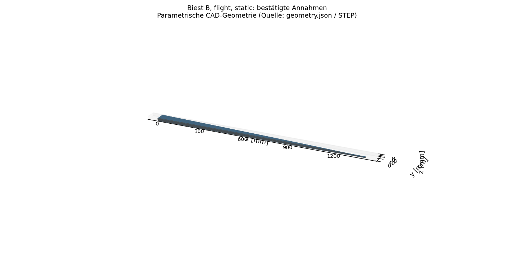


**Lesen:** Geometrie aus den tatsächlichen CAD-Eingaben; Achsen in mm. Blau sind die Gurte, grau die CFK-Schläuche, beige die Depronkerne. Verdeckte Innenflächen können in der Außenansicht unsichtbar sein.

**Einordnung:** Hier wird die angenommene Bauweise kontrolliert, nicht die Beanspruchung: gerader hinterer Steg bis zur Spitze, vorderer Steg nur im inneren Bereich, diskrete Gurtdicken in A beziehungsweise durchgehende Wurzellagen in B. Die äußere Mindestgurtbreite beträgt 6 mm; eine durchgehende Verbindung ersetzt den früheren freien Gurtauslauf. Flügelschale und ein nachgewiesener steifer Verbinder fehlen weiterhin.

**FEM B, Netz 1, Flug: globale Längsspannung**


**Lesen:** Unverformte Geometrie mit globaler σxx [MPa]: positiv Zug, negativ Druck, gemäß Farbskala. Gezeigt sind Integrationspunktmittelwerte je Element; es wird nicht über Materialgrenzen geglättet.

**Einordnung:** Die gegensinnigen Normalspannungen in Ober- und Untergurt kennzeichnen Biegung. Im UD-Gurt ist x die Faserrichtung; im ±45°-Schlauch ist σxx keine lokale Faserspannung und zeigt auch nicht die gesamte Schubbeanspruchung. Lokale Spitzen an Lagensprüngen, Lasten und Lagern sind netzabhängig. Es fehlen CFK-Festigkeitswerte sowie Klebe-, Delaminations- und Beulnachweise; die Farben bedeuten weder sicher noch gebrochen. Wegen der großen linearen Flugverformung sind auch diese Spannungen nur Ergebnisse des linearen Vergleichsmodells.


### fem_sandwich_q20/B/level_1/test

**FEM B, Netz 1, Auflagenversuch: Verformung**

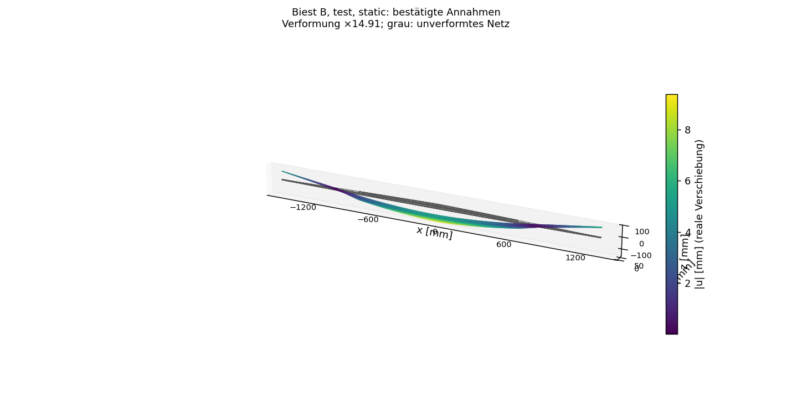


**Lesen:** Grau: unverformte Lage; farbig: verformte Oberfläche mit dem im Bild genannten Faktor. Achsen sind mm. Die Farbe zeigt den realen Betrag |u| [mm], nicht die mit dem Darstellungsfaktor multiplizierte Auslenkung und nicht nur die vertikale Komponente.

**Einordnung:** Die gemittelte vertikale Wurzelverschiebung im Taschenband beträgt -6.659 mm. Die Mitte sinkt ab, freie Überhänge können sich heben. Der größte räumliche Verschiebungsbetrag muss nicht an der Wurzel liegen und darf nicht mit diesem Tabellenwert gleichgesetzt werden. Die Versuchslager sind bilateral und erfordern eine Niederhaltekraft; die Darstellung bestätigt keinen Versuch auf lose aufliegenden Böcken.

**FEM B, Netz 1, Auflagenversuch: Verformung im Wurzeldetail**

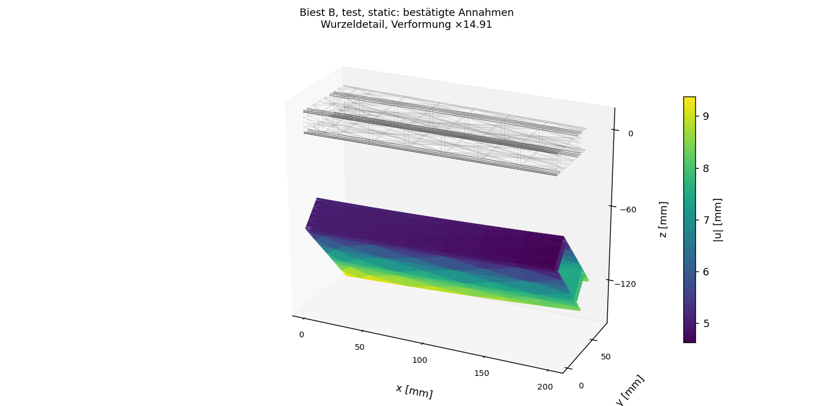


**Lesen:** Wurzelausschnitt derselben Rechnung; keine zusätzliche Laststufe. Grau: unverformte Lage; farbig: verformte Oberfläche mit dem im Bild genannten Faktor. Achsen sind mm. Die Farbe zeigt den realen Betrag |u| [mm], nicht die mit dem Darstellungsfaktor multiplizierte Auslenkung und nicht nur die vertikale Komponente.

**Einordnung:** Die gemittelte vertikale Wurzelverschiebung im Taschenband beträgt -6.659 mm. Die Mitte sinkt ab, freie Überhänge können sich heben. Der größte räumliche Verschiebungsbetrag muss nicht an der Wurzel liegen und darf nicht mit diesem Tabellenwert gleichgesetzt werden. Der Wurzelausschnitt zeigt vor allem lokale Bewegungen und nicht den Verlauf bis zur Spitze. Die Versuchslager sind bilateral und erfordern eine Niederhaltekraft; die Darstellung bestätigt keinen Versuch auf lose aufliegenden Böcken.

**FEM B, Netz 1, Auflagenversuch: Netz am Wurzeldetail**


**Lesen:** Wurzelausschnitt derselben Rechnung; keine zusätzliche Laststufe. Gezeigt wird die sichtbare Oberfläche des 3D-Netzes mit insgesamt 20,744 Knoten und 3,958 quadratischen C3D20R-Volumenelementen. Achsen in mm; sichtbare Dreieckslinien stammen auch aus der Darstellung der Elementflächen und sind keine Tetraederelemente.

**Einordnung:** Die schmalen CFK-Schichten erzeugen stark unterschiedliche Elementabmessungen. Feinere Netze prüfen deren Einfluss; eine dichte Oberfläche allein beweist keine Genauigkeit. Innerhalb der Abschnitte teilen Materialien Knoten, an Lagensprüngen verbinden interpolierende Gleichungen nichtpassende Flächen. Das Detail hilft, Last-/Lagerband und dünne Schichten zu erkennen; daraus folgt noch kein konvergierter örtlicher Spannungswert.

**FEM B, Netz 1, Auflagenversuch: Wurzeldetail des Modells**


**Lesen:** Wurzelausschnitt derselben Rechnung; keine zusätzliche Laststufe. Geometrie aus den tatsächlichen CAD-Eingaben; Achsen in mm. Blau sind die Gurte, grau die CFK-Schläuche, beige die Depronkerne. Verdeckte Innenflächen können in der Außenansicht unsichtbar sein.

**Einordnung:** Hier wird die angenommene Bauweise kontrolliert, nicht die Beanspruchung: gerader hinterer Steg bis zur Spitze, vorderer Steg nur im inneren Bereich, diskrete Gurtdicken in A beziehungsweise durchgehende Wurzellagen in B. Im Wurzelausschnitt ist vor allem die Trennung der beiden Stege wichtig; die 6-mm-Spitze ist hier nicht sichtbar. Flügelschale und ein nachgewiesener steifer Verbinder fehlen weiterhin.

**FEM B, Netz 1, Auflagenversuch: Längsspannung im Wurzeldetail**


**Lesen:** Wurzelausschnitt derselben Rechnung; keine zusätzliche Laststufe. Unverformte Geometrie mit globaler σxx [MPa]: positiv Zug, negativ Druck, gemäß Farbskala. Gezeigt sind Integrationspunktmittelwerte je Element; es wird nicht über Materialgrenzen geglättet.

**Einordnung:** Die gegensinnigen Normalspannungen in Ober- und Untergurt kennzeichnen Biegung. Im UD-Gurt ist x die Faserrichtung; im ±45°-Schlauch ist σxx keine lokale Faserspannung und zeigt auch nicht die gesamte Schubbeanspruchung. Lokale Spitzen an Lagensprüngen, Lasten und Lagern sind netzabhängig. Es fehlen CFK-Festigkeitswerte sowie Klebe-, Delaminations- und Beulnachweise; die Farben bedeuten weder sicher noch gebrochen. Die ideale Verklebung und bilaterale Lagerung beeinflussen die örtliche Lastübertragung.

**FEM B, Netz 1, Auflagenversuch: Volumennetz**


**Lesen:** Gezeigt wird die sichtbare Oberfläche des 3D-Netzes mit insgesamt 20,744 Knoten und 3,958 quadratischen C3D20R-Volumenelementen. Achsen in mm; sichtbare Dreieckslinien stammen auch aus der Darstellung der Elementflächen und sind keine Tetraederelemente.

**Einordnung:** Die schmalen CFK-Schichten erzeugen stark unterschiedliche Elementabmessungen. Feinere Netze prüfen deren Einfluss; eine dichte Oberfläche allein beweist keine Genauigkeit. Innerhalb der Abschnitte teilen Materialien Knoten, an Lagensprüngen verbinden interpolierende Gleichungen nichtpassende Flächen. Die Modellabmessungen und Lasten sind auf den Netzstufen gleich; nur die Diskretisierung wird verfeinert.

**FEM B, Netz 1, Auflagenversuch: räumliches Modell**

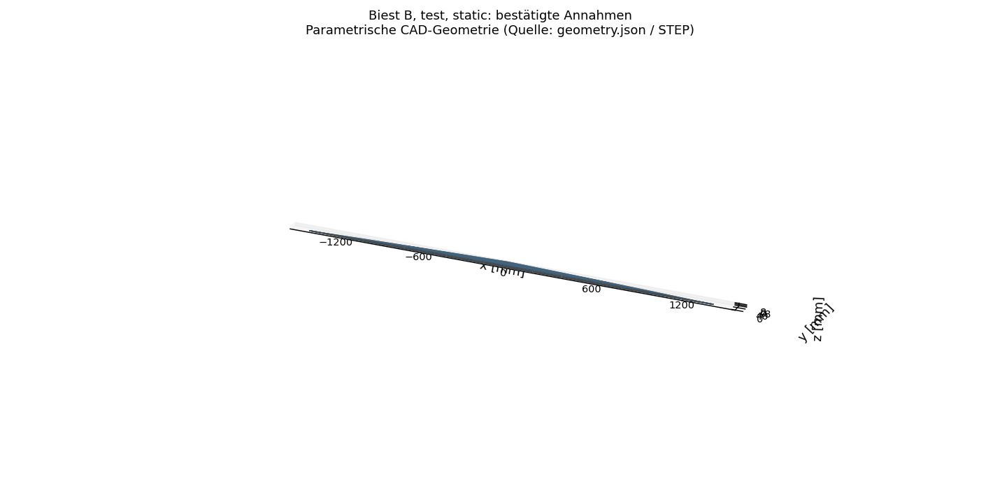


**Lesen:** Geometrie aus den tatsächlichen CAD-Eingaben; Achsen in mm. Blau sind die Gurte, grau die CFK-Schläuche, beige die Depronkerne. Verdeckte Innenflächen können in der Außenansicht unsichtbar sein.

**Einordnung:** Hier wird die angenommene Bauweise kontrolliert, nicht die Beanspruchung: gerader hinterer Steg bis zur Spitze, vorderer Steg nur im inneren Bereich, diskrete Gurtdicken in A beziehungsweise durchgehende Wurzellagen in B. Die äußere Mindestgurtbreite beträgt 6 mm; eine durchgehende Verbindung ersetzt den früheren freien Gurtauslauf. Flügelschale und ein nachgewiesener steifer Verbinder fehlen weiterhin.

**FEM B, Netz 1, Auflagenversuch: globale Längsspannung**

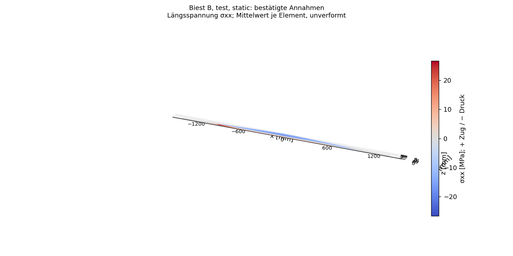


**Lesen:** Unverformte Geometrie mit globaler σxx [MPa]: positiv Zug, negativ Druck, gemäß Farbskala. Gezeigt sind Integrationspunktmittelwerte je Element; es wird nicht über Materialgrenzen geglättet.

**Einordnung:** Die gegensinnigen Normalspannungen in Ober- und Untergurt kennzeichnen Biegung. Im UD-Gurt ist x die Faserrichtung; im ±45°-Schlauch ist σxx keine lokale Faserspannung und zeigt auch nicht die gesamte Schubbeanspruchung. Lokale Spitzen an Lagensprüngen, Lasten und Lagern sind netzabhängig. Es fehlen CFK-Festigkeitswerte sowie Klebe-, Delaminations- und Beulnachweise; die Farben bedeuten weder sicher noch gebrochen. Die ideale Verklebung und bilaterale Lagerung beeinflussen die örtliche Lastübertragung.


### fem_sandwich_q20/B/level_3/flight

**FEM B, Netz 3, Flug: Verformung**

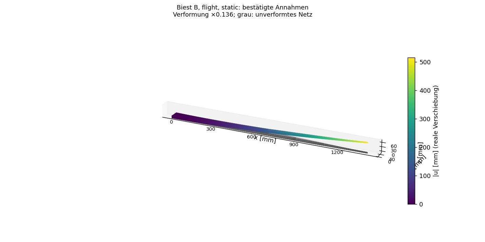


**Lesen:** Grau: unverformte Lage; farbig: verformte Oberfläche mit dem im Bild genannten Faktor. Achsen sind mm. Die Farbe zeigt den realen Betrag |u| [mm], nicht die mit dem Darstellungsfaktor multiplizierte Auslenkung und nicht nur die vertikale Komponente.

**Einordnung:** Die obere Flugtip-Verschiebung uz beträgt 512.8 mm. Ober- und Untergurt bewegen sich durch den durchgehenden Steg gemeinsam; der alte freie Gurtauslauf ist beseitigt. Die lineare Flugverformung ist groß relativ zur Halbspannweite; die nichtlinearen Versuche lieferten kein abgeschlossenes Volllastergebnis. Der Wert ist damit kein bestätigter realer Flugzustand.

**FEM B, Netz 3, Flug: Verformung im Wurzeldetail**


**Lesen:** Wurzelausschnitt derselben Rechnung; keine zusätzliche Laststufe. Grau: unverformte Lage; farbig: verformte Oberfläche mit dem im Bild genannten Faktor. Achsen sind mm. Die Farbe zeigt den realen Betrag |u| [mm], nicht die mit dem Darstellungsfaktor multiplizierte Auslenkung und nicht nur die vertikale Komponente.

**Einordnung:** Die obere Flugtip-Verschiebung uz beträgt 512.8 mm. Ober- und Untergurt bewegen sich durch den durchgehenden Steg gemeinsam; der alte freie Gurtauslauf ist beseitigt. Der Wurzelausschnitt zeigt vor allem lokale Bewegungen und nicht den Verlauf bis zur Spitze. Die lineare Flugverformung ist groß relativ zur Halbspannweite; die nichtlinearen Versuche lieferten kein abgeschlossenes Volllastergebnis. Der Wert ist damit kein bestätigter realer Flugzustand.

**FEM B, Netz 3, Flug: Netz am Wurzeldetail**


**Lesen:** Wurzelausschnitt derselben Rechnung; keine zusätzliche Laststufe. Gezeigt wird die sichtbare Oberfläche des 3D-Netzes mit insgesamt 32,134 Knoten und 6,147 quadratischen C3D20R-Volumenelementen. Achsen in mm; sichtbare Dreieckslinien stammen auch aus der Darstellung der Elementflächen und sind keine Tetraederelemente.

**Einordnung:** Die schmalen CFK-Schichten erzeugen stark unterschiedliche Elementabmessungen. Feinere Netze prüfen deren Einfluss; eine dichte Oberfläche allein beweist keine Genauigkeit. Innerhalb der Abschnitte teilen Materialien Knoten, an Lagensprüngen verbinden interpolierende Gleichungen nichtpassende Flächen. Das Detail hilft, Last-/Lagerband und dünne Schichten zu erkennen; daraus folgt noch kein konvergierter örtlicher Spannungswert.

**FEM B, Netz 3, Flug: Wurzeldetail des Modells**


**Lesen:** Wurzelausschnitt derselben Rechnung; keine zusätzliche Laststufe. Geometrie aus den tatsächlichen CAD-Eingaben; Achsen in mm. Blau sind die Gurte, grau die CFK-Schläuche, beige die Depronkerne. Verdeckte Innenflächen können in der Außenansicht unsichtbar sein.

**Einordnung:** Hier wird die angenommene Bauweise kontrolliert, nicht die Beanspruchung: gerader hinterer Steg bis zur Spitze, vorderer Steg nur im inneren Bereich, diskrete Gurtdicken in A beziehungsweise durchgehende Wurzellagen in B. Im Wurzelausschnitt ist vor allem die Trennung der beiden Stege wichtig; die 6-mm-Spitze ist hier nicht sichtbar. Flügelschale und ein nachgewiesener steifer Verbinder fehlen weiterhin.

**FEM B, Netz 3, Flug: Längsspannung im Wurzeldetail**

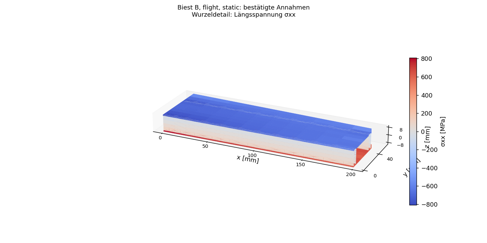


**Lesen:** Wurzelausschnitt derselben Rechnung; keine zusätzliche Laststufe. Unverformte Geometrie mit globaler σxx [MPa]: positiv Zug, negativ Druck, gemäß Farbskala. Gezeigt sind Integrationspunktmittelwerte je Element; es wird nicht über Materialgrenzen geglättet.

**Einordnung:** Der größte Betrag an Integrationspunkten im gesamten Modell beträgt 870.1 MPa; er kann außerhalb des Ausschnitts oder über der gemittelten Elementfarbskala liegen. Die gegensinnigen Normalspannungen in Ober- und Untergurt kennzeichnen Biegung. Im UD-Gurt ist x die Faserrichtung; im ±45°-Schlauch ist σxx keine lokale Faserspannung und zeigt auch nicht die gesamte Schubbeanspruchung. Lokale Spitzen an Lagensprüngen, Lasten und Lagern sind netzabhängig. Es fehlen CFK-Festigkeitswerte sowie Klebe-, Delaminations- und Beulnachweise; die Farben bedeuten weder sicher noch gebrochen. Wegen der großen linearen Flugverformung sind auch diese Spannungen nur Ergebnisse des linearen Vergleichsmodells.

**FEM B, Netz 3, Flug: Volumennetz**


**Lesen:** Gezeigt wird die sichtbare Oberfläche des 3D-Netzes mit insgesamt 32,134 Knoten und 6,147 quadratischen C3D20R-Volumenelementen. Achsen in mm; sichtbare Dreieckslinien stammen auch aus der Darstellung der Elementflächen und sind keine Tetraederelemente.

**Einordnung:** Die schmalen CFK-Schichten erzeugen stark unterschiedliche Elementabmessungen. Feinere Netze prüfen deren Einfluss; eine dichte Oberfläche allein beweist keine Genauigkeit. Innerhalb der Abschnitte teilen Materialien Knoten, an Lagensprüngen verbinden interpolierende Gleichungen nichtpassende Flächen. Die Modellabmessungen und Lasten sind auf den Netzstufen gleich; nur die Diskretisierung wird verfeinert.

**FEM B, Netz 3, Flug: räumliches Modell**


**Lesen:** Geometrie aus den tatsächlichen CAD-Eingaben; Achsen in mm. Blau sind die Gurte, grau die CFK-Schläuche, beige die Depronkerne. Verdeckte Innenflächen können in der Außenansicht unsichtbar sein.

**Einordnung:** Hier wird die angenommene Bauweise kontrolliert, nicht die Beanspruchung: gerader hinterer Steg bis zur Spitze, vorderer Steg nur im inneren Bereich, diskrete Gurtdicken in A beziehungsweise durchgehende Wurzellagen in B. Die äußere Mindestgurtbreite beträgt 6 mm; eine durchgehende Verbindung ersetzt den früheren freien Gurtauslauf. Flügelschale und ein nachgewiesener steifer Verbinder fehlen weiterhin.

**FEM B, Netz 3, Flug: globale Längsspannung**


**Lesen:** Unverformte Geometrie mit globaler σxx [MPa]: positiv Zug, negativ Druck, gemäß Farbskala. Gezeigt sind Integrationspunktmittelwerte je Element; es wird nicht über Materialgrenzen geglättet.

**Einordnung:** Der größte Betrag an Integrationspunkten im gesamten Modell beträgt 870.1 MPa; er kann außerhalb des Ausschnitts oder über der gemittelten Elementfarbskala liegen. Die gegensinnigen Normalspannungen in Ober- und Untergurt kennzeichnen Biegung. Im UD-Gurt ist x die Faserrichtung; im ±45°-Schlauch ist σxx keine lokale Faserspannung und zeigt auch nicht die gesamte Schubbeanspruchung. Lokale Spitzen an Lagensprüngen, Lasten und Lagern sind netzabhängig. Es fehlen CFK-Festigkeitswerte sowie Klebe-, Delaminations- und Beulnachweise; die Farben bedeuten weder sicher noch gebrochen. Wegen der großen linearen Flugverformung sind auch diese Spannungen nur Ergebnisse des linearen Vergleichsmodells.


### fem_sandwich_q20/B/level_3/test

**FEM B, Netz 3, Auflagenversuch: Eigenform 1, 4.682 Hz**

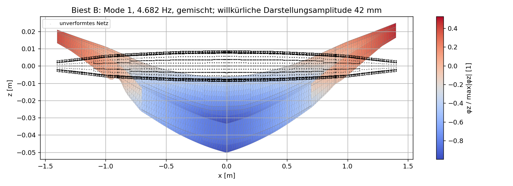


**Lesen:** Seitenprojektion in die x-z-Ebene. Schwarze Punkte: unverformtes Netz; farbige Fläche: Eigenform mit willkürlich gewählter Darstellungsamplitude. Die Farbskala φz/max|φz| ist dimensionslos; die Achsen geben die gezeichneten Koordinaten in m an.

**Einordnung:** Diese Form ist gemischt; der rechnerische Anteil Σuz²/Σ|u|² beträgt 95.6 %. Das ist eine Verschiebungskennzahl, keine effektive Modalmasse oder Energiequote. Sie ist die im Konvergenzgraphen verwendete überwiegend vertikale Form. Formen mit ähnlicher Frequenz können sich bei Netzänderung mischen oder die Reihenfolge wechseln. Die 2D-Projektion zeigt seitliche Bewegung und Torsion nur eingeschränkt. Weder Amplitude noch Vorzeichen sagen eine reale Schwingungsantwort voraus; die Modalanalyse ist unbelastet und linear.

**FEM B, Netz 3, Auflagenversuch: Eigenform 2, 7.952 Hz**

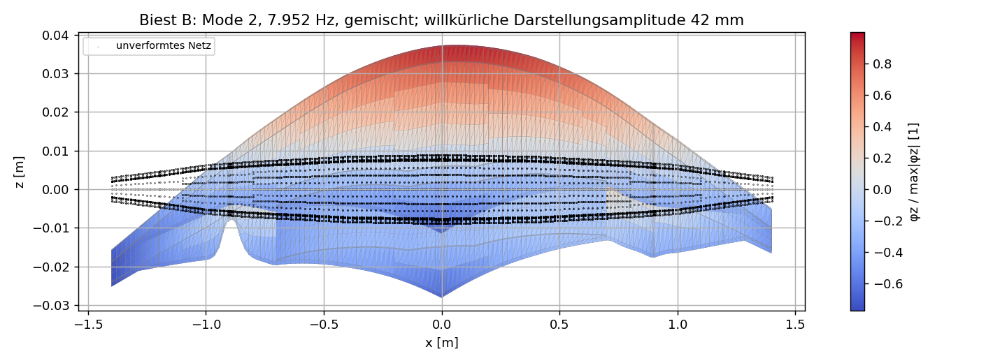


**Lesen:** Seitenprojektion in die x-z-Ebene. Schwarze Punkte: unverformtes Netz; farbige Fläche: Eigenform mit willkürlich gewählter Darstellungsamplitude. Die Farbskala φz/max|φz| ist dimensionslos; die Achsen geben die gezeichneten Koordinaten in m an.

**Einordnung:** Diese Form ist gemischt; der rechnerische Anteil Σuz²/Σ|u|² beträgt 36.2 %. Das ist eine Verschiebungskennzahl, keine effektive Modalmasse oder Energiequote. Sie ist eine weitere räumliche Eigenform und nicht automatisch die gleich nummerierte Balkenmode. Formen mit ähnlicher Frequenz können sich bei Netzänderung mischen oder die Reihenfolge wechseln. Die 2D-Projektion zeigt seitliche Bewegung und Torsion nur eingeschränkt. Weder Amplitude noch Vorzeichen sagen eine reale Schwingungsantwort voraus; die Modalanalyse ist unbelastet und linear.

**FEM B, Netz 3, Auflagenversuch: Eigenform 3, 22.25 Hz**

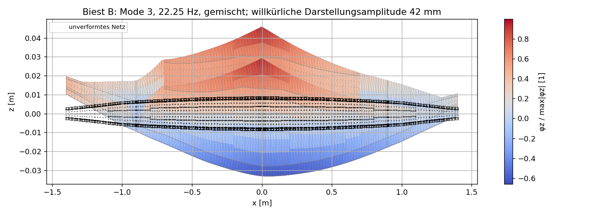


**Lesen:** Seitenprojektion in die x-z-Ebene. Schwarze Punkte: unverformtes Netz; farbige Fläche: Eigenform mit willkürlich gewählter Darstellungsamplitude. Die Farbskala φz/max|φz| ist dimensionslos; die Achsen geben die gezeichneten Koordinaten in m an.

**Einordnung:** Diese Form ist gemischt; der rechnerische Anteil Σuz²/Σ|u|² beträgt 59.7 %. Das ist eine Verschiebungskennzahl, keine effektive Modalmasse oder Energiequote. Sie ist eine weitere räumliche Eigenform und nicht automatisch die gleich nummerierte Balkenmode. Formen mit ähnlicher Frequenz können sich bei Netzänderung mischen oder die Reihenfolge wechseln. Die 2D-Projektion zeigt seitliche Bewegung und Torsion nur eingeschränkt. Weder Amplitude noch Vorzeichen sagen eine reale Schwingungsantwort voraus; die Modalanalyse ist unbelastet und linear.

**FEM B, Netz 3, Auflagenversuch: Eigenform 4, 74.54 Hz**

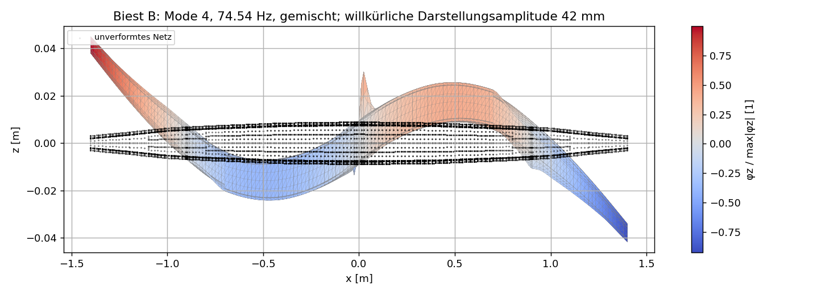


**Lesen:** Seitenprojektion in die x-z-Ebene. Schwarze Punkte: unverformtes Netz; farbige Fläche: Eigenform mit willkürlich gewählter Darstellungsamplitude. Die Farbskala φz/max|φz| ist dimensionslos; die Achsen geben die gezeichneten Koordinaten in m an.

**Einordnung:** Diese Form ist gemischt; der rechnerische Anteil Σuz²/Σ|u|² beträgt 99.4 %. Das ist eine Verschiebungskennzahl, keine effektive Modalmasse oder Energiequote. Sie ist eine weitere räumliche Eigenform und nicht automatisch die gleich nummerierte Balkenmode. Formen mit ähnlicher Frequenz können sich bei Netzänderung mischen oder die Reihenfolge wechseln. Die 2D-Projektion zeigt seitliche Bewegung und Torsion nur eingeschränkt. Weder Amplitude noch Vorzeichen sagen eine reale Schwingungsantwort voraus; die Modalanalyse ist unbelastet und linear.

**FEM B, Netz 3, Auflagenversuch: Eigenform 5, 78.09 Hz**

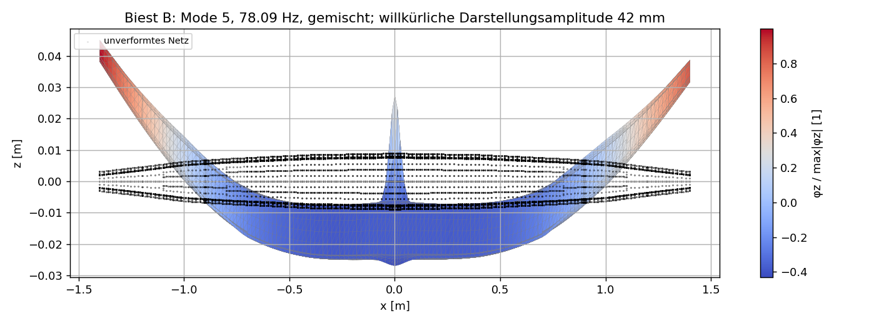


**Lesen:** Seitenprojektion in die x-z-Ebene. Schwarze Punkte: unverformtes Netz; farbige Fläche: Eigenform mit willkürlich gewählter Darstellungsamplitude. Die Farbskala φz/max|φz| ist dimensionslos; die Achsen geben die gezeichneten Koordinaten in m an.

**Einordnung:** Diese Form ist gemischt; der rechnerische Anteil Σuz²/Σ|u|² beträgt 99.7 %. Das ist eine Verschiebungskennzahl, keine effektive Modalmasse oder Energiequote. Sie ist eine weitere räumliche Eigenform und nicht automatisch die gleich nummerierte Balkenmode. Formen mit ähnlicher Frequenz können sich bei Netzänderung mischen oder die Reihenfolge wechseln. Die 2D-Projektion zeigt seitliche Bewegung und Torsion nur eingeschränkt. Weder Amplitude noch Vorzeichen sagen eine reale Schwingungsantwort voraus; die Modalanalyse ist unbelastet und linear.

**FEM B, Netz 3, Auflagenversuch: Eigenform 6, 94.75 Hz**

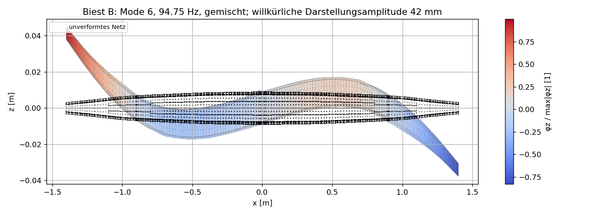


**Lesen:** Seitenprojektion in die x-z-Ebene. Schwarze Punkte: unverformtes Netz; farbige Fläche: Eigenform mit willkürlich gewählter Darstellungsamplitude. Die Farbskala φz/max|φz| ist dimensionslos; die Achsen geben die gezeichneten Koordinaten in m an.

**Einordnung:** Diese Form ist gemischt; der rechnerische Anteil Σuz²/Σ|u|² beträgt 99.3 %. Das ist eine Verschiebungskennzahl, keine effektive Modalmasse oder Energiequote. Sie ist eine weitere räumliche Eigenform und nicht automatisch die gleich nummerierte Balkenmode. Formen mit ähnlicher Frequenz können sich bei Netzänderung mischen oder die Reihenfolge wechseln. Die 2D-Projektion zeigt seitliche Bewegung und Torsion nur eingeschränkt. Weder Amplitude noch Vorzeichen sagen eine reale Schwingungsantwort voraus; die Modalanalyse ist unbelastet und linear.

**FEM B, Netz 3, Auflagenversuch: Verformung**

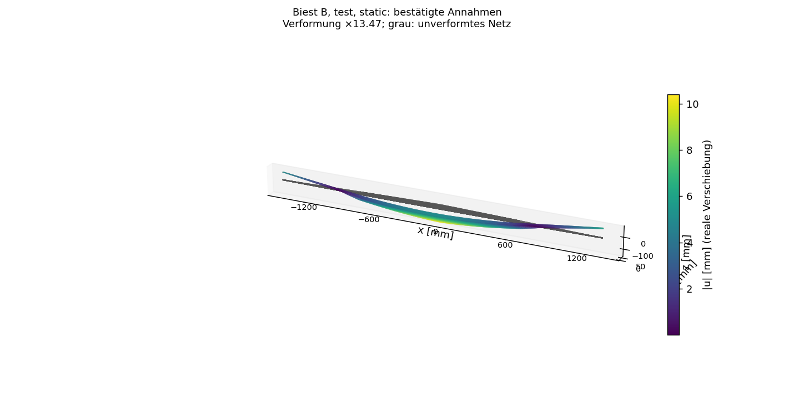


**Lesen:** Grau: unverformte Lage; farbig: verformte Oberfläche mit dem im Bild genannten Faktor. Achsen sind mm. Die Farbe zeigt den realen Betrag |u| [mm], nicht die mit dem Darstellungsfaktor multiplizierte Auslenkung und nicht nur die vertikale Komponente.

**Einordnung:** Die gemittelte vertikale Wurzelverschiebung im Taschenband beträgt -6.901 mm. Die Mitte sinkt ab, freie Überhänge können sich heben. Der größte räumliche Verschiebungsbetrag muss nicht an der Wurzel liegen und darf nicht mit diesem Tabellenwert gleichgesetzt werden. Die Versuchslager sind bilateral und erfordern eine Niederhaltekraft; die Darstellung bestätigt keinen Versuch auf lose aufliegenden Böcken.

**FEM B, Netz 3, Auflagenversuch: Verformung im Wurzeldetail**

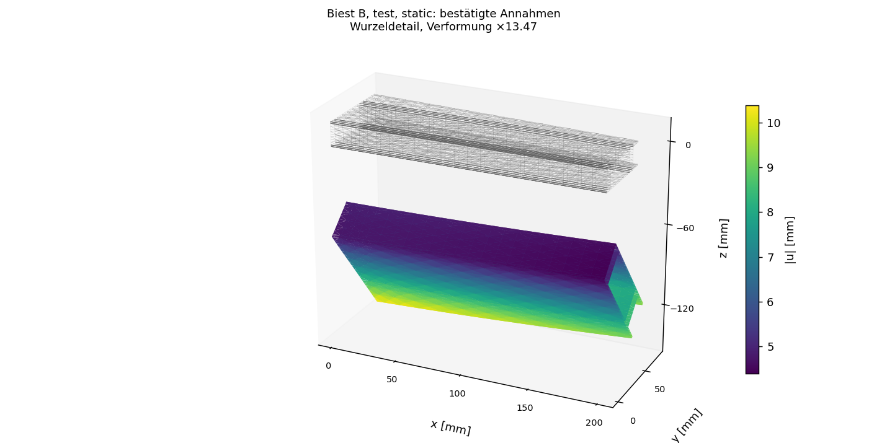


**Lesen:** Wurzelausschnitt derselben Rechnung; keine zusätzliche Laststufe. Grau: unverformte Lage; farbig: verformte Oberfläche mit dem im Bild genannten Faktor. Achsen sind mm. Die Farbe zeigt den realen Betrag |u| [mm], nicht die mit dem Darstellungsfaktor multiplizierte Auslenkung und nicht nur die vertikale Komponente.

**Einordnung:** Die gemittelte vertikale Wurzelverschiebung im Taschenband beträgt -6.901 mm. Die Mitte sinkt ab, freie Überhänge können sich heben. Der größte räumliche Verschiebungsbetrag muss nicht an der Wurzel liegen und darf nicht mit diesem Tabellenwert gleichgesetzt werden. Der Wurzelausschnitt zeigt vor allem lokale Bewegungen und nicht den Verlauf bis zur Spitze. Die Versuchslager sind bilateral und erfordern eine Niederhaltekraft; die Darstellung bestätigt keinen Versuch auf lose aufliegenden Böcken.

**FEM B, Netz 3, Auflagenversuch: Netz am Wurzeldetail**

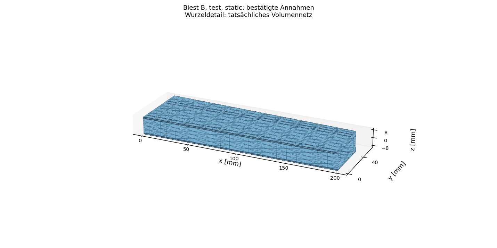


**Lesen:** Wurzelausschnitt derselben Rechnung; keine zusätzliche Laststufe. Gezeigt wird die sichtbare Oberfläche des 3D-Netzes mit insgesamt 63,832 Knoten und 12,294 quadratischen C3D20R-Volumenelementen. Achsen in mm; sichtbare Dreieckslinien stammen auch aus der Darstellung der Elementflächen und sind keine Tetraederelemente.

**Einordnung:** Die schmalen CFK-Schichten erzeugen stark unterschiedliche Elementabmessungen. Feinere Netze prüfen deren Einfluss; eine dichte Oberfläche allein beweist keine Genauigkeit. Innerhalb der Abschnitte teilen Materialien Knoten, an Lagensprüngen verbinden interpolierende Gleichungen nichtpassende Flächen. Das Detail hilft, Last-/Lagerband und dünne Schichten zu erkennen; daraus folgt noch kein konvergierter örtlicher Spannungswert.

**FEM B, Netz 3, Auflagenversuch: Wurzeldetail des Modells**


**Lesen:** Wurzelausschnitt derselben Rechnung; keine zusätzliche Laststufe. Geometrie aus den tatsächlichen CAD-Eingaben; Achsen in mm. Blau sind die Gurte, grau die CFK-Schläuche, beige die Depronkerne. Verdeckte Innenflächen können in der Außenansicht unsichtbar sein.

**Einordnung:** Hier wird die angenommene Bauweise kontrolliert, nicht die Beanspruchung: gerader hinterer Steg bis zur Spitze, vorderer Steg nur im inneren Bereich, diskrete Gurtdicken in A beziehungsweise durchgehende Wurzellagen in B. Im Wurzelausschnitt ist vor allem die Trennung der beiden Stege wichtig; die 6-mm-Spitze ist hier nicht sichtbar. Flügelschale und ein nachgewiesener steifer Verbinder fehlen weiterhin.

**FEM B, Netz 3, Auflagenversuch: Längsspannung im Wurzeldetail**


**Lesen:** Wurzelausschnitt derselben Rechnung; keine zusätzliche Laststufe. Unverformte Geometrie mit globaler σxx [MPa]: positiv Zug, negativ Druck, gemäß Farbskala. Gezeigt sind Integrationspunktmittelwerte je Element; es wird nicht über Materialgrenzen geglättet.

**Einordnung:** Der größte Betrag an Integrationspunkten im gesamten Modell beträgt 77.66 MPa; er kann außerhalb des Ausschnitts oder über der gemittelten Elementfarbskala liegen. Die gegensinnigen Normalspannungen in Ober- und Untergurt kennzeichnen Biegung. Im UD-Gurt ist x die Faserrichtung; im ±45°-Schlauch ist σxx keine lokale Faserspannung und zeigt auch nicht die gesamte Schubbeanspruchung. Lokale Spitzen an Lagensprüngen, Lasten und Lagern sind netzabhängig. Es fehlen CFK-Festigkeitswerte sowie Klebe-, Delaminations- und Beulnachweise; die Farben bedeuten weder sicher noch gebrochen. Die ideale Verklebung und bilaterale Lagerung beeinflussen die örtliche Lastübertragung.

**FEM B, Netz 3, Auflagenversuch: Volumennetz**

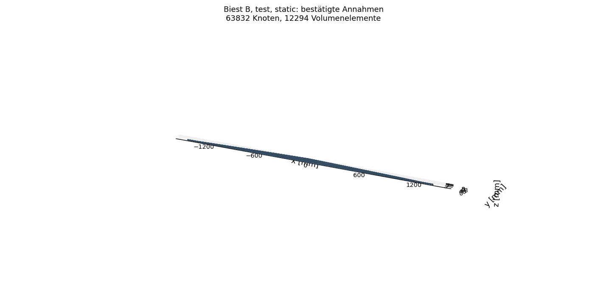


**Lesen:** Gezeigt wird die sichtbare Oberfläche des 3D-Netzes mit insgesamt 63,832 Knoten und 12,294 quadratischen C3D20R-Volumenelementen. Achsen in mm; sichtbare Dreieckslinien stammen auch aus der Darstellung der Elementflächen und sind keine Tetraederelemente.

**Einordnung:** Die schmalen CFK-Schichten erzeugen stark unterschiedliche Elementabmessungen. Feinere Netze prüfen deren Einfluss; eine dichte Oberfläche allein beweist keine Genauigkeit. Innerhalb der Abschnitte teilen Materialien Knoten, an Lagensprüngen verbinden interpolierende Gleichungen nichtpassende Flächen. Die Modellabmessungen und Lasten sind auf den Netzstufen gleich; nur die Diskretisierung wird verfeinert.

**FEM B, Netz 3, Auflagenversuch: räumliches Modell**


**Lesen:** Geometrie aus den tatsächlichen CAD-Eingaben; Achsen in mm. Blau sind die Gurte, grau die CFK-Schläuche, beige die Depronkerne. Verdeckte Innenflächen können in der Außenansicht unsichtbar sein.

**Einordnung:** Hier wird die angenommene Bauweise kontrolliert, nicht die Beanspruchung: gerader hinterer Steg bis zur Spitze, vorderer Steg nur im inneren Bereich, diskrete Gurtdicken in A beziehungsweise durchgehende Wurzellagen in B. Die äußere Mindestgurtbreite beträgt 6 mm; eine durchgehende Verbindung ersetzt den früheren freien Gurtauslauf. Flügelschale und ein nachgewiesener steifer Verbinder fehlen weiterhin.

**FEM B, Netz 3, Auflagenversuch: globale Längsspannung**


**Lesen:** Unverformte Geometrie mit globaler σxx [MPa]: positiv Zug, negativ Druck, gemäß Farbskala. Gezeigt sind Integrationspunktmittelwerte je Element; es wird nicht über Materialgrenzen geglättet.

**Einordnung:** Der größte Betrag an Integrationspunkten im gesamten Modell beträgt 77.66 MPa; er kann außerhalb des Ausschnitts oder über der gemittelten Elementfarbskala liegen. Die gegensinnigen Normalspannungen in Ober- und Untergurt kennzeichnen Biegung. Im UD-Gurt ist x die Faserrichtung; im ±45°-Schlauch ist σxx keine lokale Faserspannung und zeigt auch nicht die gesamte Schubbeanspruchung. Lokale Spitzen an Lagensprüngen, Lasten und Lagern sind netzabhängig. Es fehlen CFK-Festigkeitswerte sowie Klebe-, Delaminations- und Beulnachweise; die Farben bedeuten weder sicher noch gebrochen. Die ideale Verklebung und bilaterale Lagerung beeinflussen die örtliche Lastübertragung.


## FEM-Bilder des synthetischen Prüffalls – keine Biest-Ergebnisse

**Diese Modelle, Netze und Solverergebnisse gehören ausschließlich zum synthetischen Software-Prüffall. Sie sind kein FEM-Nachweis der Excel-Holmauslegung und kein A/B-Vergleich des Biest-Holms.**
Gezeigt wird der vorhandene homogene I-Holm-Prüffall (L=0,15 m je Halbflügel, E=70 GPa, ν=0,3, ρ=2700 kg/m³) auf seiner feinsten vorhandenen Netzstufe. Die Statik wurde für die Spannungsanforderung erneut mit CalculiX gerechnet. Das 2-%-Konvergenzziel des Auflagenversuchs war noch nicht erreicht; insbesondere Spannungen an Last- und Lagerstellen sind netzabhängig.
Modellbilder zeigen die parametrischen Körper aus den tatsächlichen CAD-Eingaben; Netzbilder zeigen die zugehörigen quadratischen Tetraeder. Verformungsbilder überlagern das unverformte Netz; Farbskala und Vergrößerungsfaktor sind getrennt angegeben.
Spannungsbilder zeigen globale Längsspannung σxx in MPa, positiv bei Zug und negativ bei Druck. x entspricht der UD-Gurtfaserrichtung; im ±45°-Schlauch ist σxx keine lokale Faserspannung. Dargestellt werden Mittelwerte der echten Integrationspunktspannungen innerhalb jedes Elements, ohne Glättung über Materialgrenzen. Die Farbskala enthält daher nicht zwingend die Integrationspunktspitze. Eine Spannungsdarstellung ist kein CFK-Festigkeitsnachweis.

### Synthetischer Prueffall: Flug-Halbmodell

1846 Knoten, 867 C3D10-Elemente; max. reale Verschiebung 0.0091631 mm. Max. |σxx| an Integrationspunkten: 1.2645 MPa.
[Solverdaten und Herkunft](fem_reference/flight/gallery.json); [CalculiX-Ergebnisdatei](fem_reference/flight/gallery_static.dat).

**Parametrisches räumliches Modell**


**Lesen:** Achsen in mm; dargestellt ist die parametrische Geometrie des homogenen Referenz-I-Holms.

**Einordnung:** Der einfache, ausdrücklich definierte Querschnitt dient der Softwareprüfung. Seine Steifigkeit und Lastübertragung sind nicht die des CFK-/Depron-Holms; dieses Bild validiert keine Biest-Geometrie.


**Quadratisches Volumennetz**

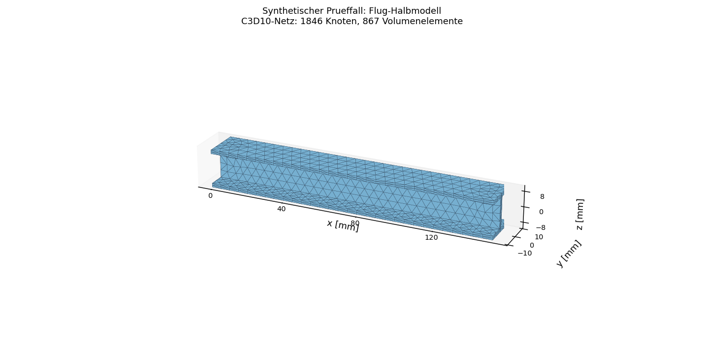

**Lesen:** Die Drahtdarstellung zeigt die Oberfläche des quadratischen C3D10-Tetraedernetzes; Achsen in mm.

**Einordnung:** Hier wird ein anderer Netz-/Elementadapter als beim aktuellen C3D20R-Biest-Modell geprüft. Die Netzfeinheit und die Genauigkeit des Referenzfalls dürfen nicht auf das Originalmodell übertragen werden.


**Verformung aus CalculiX**


**Lesen:** Grau ist die unverformte Lage; Farbe ist der reale Betrag |u| in mm. Der gezeichnete Weg ist mit dem Bildfaktor vergrößert.

**Einordnung:** Die maximale reale Verschiebung dieses Referenzfalls beträgt 0.009163 mm; die große sichtbare Biegung ist eine Darstellungsvergrößerung. Diese Antwort prüft den definierten Referenzlastfall und ist keine Vorhersage für den Biest-Holm.


**Längsspannung σxx aus CalculiX**

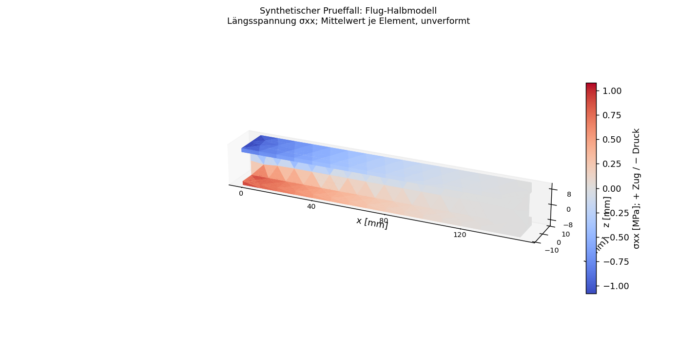

**Lesen:** Globale σxx in MPa auf der unverformten Geometrie; positiv Zug, negativ Druck; Mittelwerte je Element.

**Einordnung:** Maximaler Betrag an Integrationspunkten: 1.264 MPa. Der Zug-/Druckwechsel zwischen den Gurten ist mit Biegung vereinbar. Lokale Spitzen hängen vom Netz und der Lasteinleitung ab. Dies prüft Spannungsexport und Darstellung; es ist kein CFK-Festigkeitsnachweis.


### Synthetischer Prueffall: Auflagenversuch-Vollmodell

3630 Knoten, 1721 C3D10-Elemente; max. reale Verschiebung 0.0019459 mm. Max. |σxx| an Integrationspunkten: 0.46719 MPa.
[Solverdaten und Herkunft](fem_reference/test/gallery.json); [CalculiX-Ergebnisdatei](fem_reference/test/gallery_static.dat).

**Parametrisches räumliches Modell**

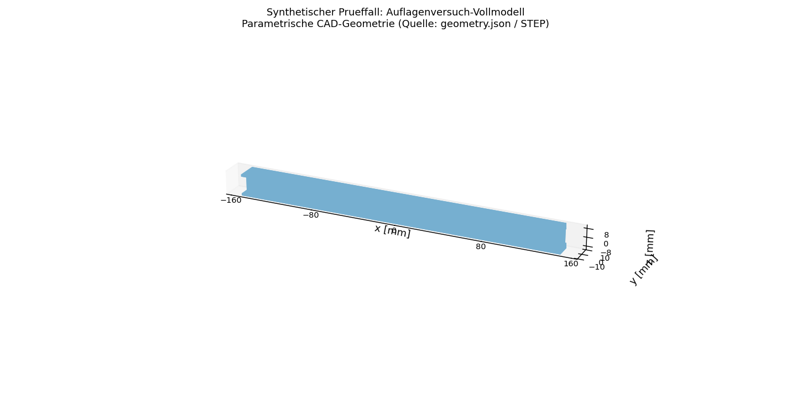

**Lesen:** Achsen in mm; dargestellt ist die parametrische Geometrie des homogenen Referenz-I-Holms.

**Einordnung:** Der einfache, ausdrücklich definierte Querschnitt dient der Softwareprüfung. Seine Steifigkeit und Lastübertragung sind nicht die des CFK-/Depron-Holms; dieses Bild validiert keine Biest-Geometrie.


**Quadratisches Volumennetz**


**Lesen:** Die Drahtdarstellung zeigt die Oberfläche des quadratischen C3D10-Tetraedernetzes; Achsen in mm.

**Einordnung:** Hier wird ein anderer Netz-/Elementadapter als beim aktuellen C3D20R-Biest-Modell geprüft. Die Netzfeinheit und die Genauigkeit des Referenzfalls dürfen nicht auf das Originalmodell übertragen werden.


**Verformung aus CalculiX**


**Lesen:** Grau ist die unverformte Lage; Farbe ist der reale Betrag |u| in mm. Der gezeichnete Weg ist mit dem Bildfaktor vergrößert.

**Einordnung:** Die maximale reale Verschiebung dieses Referenzfalls beträgt 0.001946 mm; die große sichtbare Biegung ist eine Darstellungsvergrößerung. Diese Antwort prüft den definierten Referenzlastfall und ist keine Vorhersage für den Biest-Holm.


**Längsspannung σxx aus CalculiX**


**Lesen:** Globale σxx in MPa auf der unverformten Geometrie; positiv Zug, negativ Druck; Mittelwerte je Element.

**Einordnung:** Maximaler Betrag an Integrationspunkten: 0.4672 MPa. Der Zug-/Druckwechsel zwischen den Gurten ist mit Biegung vereinbar. Lokale Spitzen hängen vom Netz und der Lasteinleitung ab. Dies prüft Spannungsexport und Darstellung; es ist kein CFK-Festigkeitsnachweis.


## Versionen und Reproduzierbarkeit

```json
{
  "python": "3.9.7 (tags/v3.9.7:1016ef3, Aug 30 2021, 20:19:38) [MSC v.1929 64 bit (AMD64)]",
  "packages": {
    "numpy": "2.0.2",
    "scipy": "1.13.1",
    "matplotlib": "3.9.4",
    "xlrd": "2.0.2",
    "openpyxl": "3.1.5",
    "PyYAML": "6.0.3"
  },
  "freecad_python": {
    "path": "C:/Program Files/FreeCAD 1.1/bin/python.exe",
    "available": true,
    "returncode": 0,
    "version": "['1', '1', '4', '20260928 (Git shallow)', 'Unknown', '2026/09/28 13:46:34', '(HEAD detached at 4fd3bf320)', '4fd3bf320d9566a27e60069fc8387448aaa3a094']"
  },
  "calculix": {
    "path": "C:/Program Files/FreeCAD 1.1/bin/ccx.exe",
    "available": true,
    "returncode": 201,
    "version": "This is Version 2.22"
  },
  "gmsh": {
    "path": "C:/Program Files/FreeCAD 1.1/bin/gmsh.exe",
    "available": true,
    "returncode": 0,
    "version": "4.15.0"
  }
}
```

## Offizielle technische Quellen

- [CalculiX 2.22 Handbuch](https://www.dhondt.de/ccx_2.22.pdf): C3D10, C3D20R, *ELASTIC / ENGINEERING CONSTANTS, *ORIENTATION, *SOLID SECTION, *EQUATION, *FREQUENCY, *MASS, *NODE PRINT und *EL PRINT.
- [FreeCAD Part-Scripting](https://github.com/FreeCAD/FreeCAD-documentation/blob/main/wiki/Topological_data_scripting.md): Part-Geometrie und Export.
- [Gmsh-Handbuch](https://gmsh.info/doc/texinfo/gmsh.html): STEP-Import, MSH2, quadratische Tetraeder und Knotenreihenfolge.

Quelle der Excel-Auslegung: Christian Baron, 11/2013; Bearbeitungen und Kommentare der gelieferten Arbeitsmappe bleiben unverändert.

## Separater Software-Prüfnachweis

[Referenztests und tatsächlich ausgeführte synthetische Solverläufe](validation.md). Diese Ergebnisse gehören nicht zur gelieferten Excel-Holmauslegung.

## Numerische Balkenkonvergenz

[Verdopplung der Balkenelemente](beam_convergence.json): relative Änderungen der statischen Durchbiegungen und der ersten sechs Eigenfrequenzen bezogen auf das verfeinerte Modell dokumentiert. Dies prüft die Diskretisierung, nicht die Richtigkeit der Material-/Fertigungsannahmen.

## Unabhängiger einfacher C3D20R-Referenzfall

Ein separater homogener 3D-Kragträger wurde tatsächlich mit CalculiX gerechnet und mit geschlossenen Balkenformeln verglichen. Dieser synthetische Referenzfall prüft Elementexport, Einheiten, Statik und Dynamik; er bestätigt keine Genauigkeit des komplexen Biest-Modells.
Abweichung der Spitzendurchbiegung: -0.747 %; Abweichung der ersten Eigenfrequenz: 0.278 %.
[Eingaben und tatsächliche Referenzergebnisse](c3d20r_reference/validation.json).

## CAD-/Netz-Konsistenz

[Erneut geöffnete CAD-Dateien, gültige Volumenkörper und Vergleich der CAD-/Netzmassen](cad_validation.json).

[Prüfung der tatsächlichen Original-FEM-Dateien und Reaktionsgleichgewichte](original_fem_validation.json).

## Änderung gegenüber dem archivierten Aufbau

Archiv: `../results_before_full_web/`. Dort endete der hintere Steg bei 1,29 m; jetzt läuft er bis 1,40 m durch. Gurtbreite mindestens 6 mm und angenommene CFK-Mindestwanddicke 0,10 mm. Die folgenden Werte gehören zu unterschiedlichen Geometrien; dies ist kein Netzkonvergenzvergleich.

| Variante | frühere lineare Flugtip [m] | neue lineare Flugtip [m] |
|---|---:|---:|
| A | 29.0492 | 0.67687 |
| B | 0.824473 | 0.512845 |
